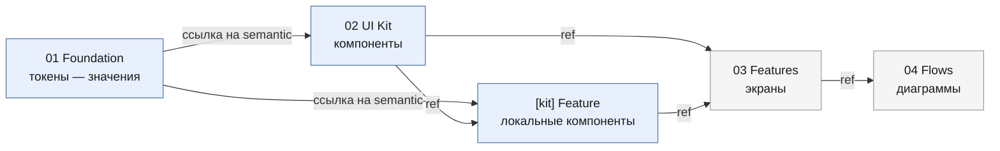

# Иерархия фреймов: от корня до состояния компонента

Всё дерево файла. Каждый уровень — фрейм с layout, а не свободно лежащие ноды: layout физически запрещает наложение, ручные координаты его лишь откладывают.

## Полное дерево

```
ROOT ─ layout:vertical, gap ─ все зоны его дети ⇒ наложение конструктивно невозможно
│
├── [note] О файле ──────────────────── аннотация уровня ROOT: конвенции, владелец
│                                        (аннотации возможны на ЛЮБОМ уровне, см. ниже)
├── 00 Cover / Index ─────────────────────────────── навигация и статус файла
│      якоря на зоны · легенда статусов · changelog · владелец
│
├── 01 Foundation ───────────────────────────────── ТОКЕНЫ, нарисованные глазами
│   │   layout:vertical · каждая секция = фрейм
│   ├── Color        свотчи: имя · значение · на светлом и тёмном · контраст-бейдж
│   ├── Typography   вся шкала реальным текстом: H1…caption, вес, high/line-height
│   ├── Spacing      полоски-эталоны, ширина = значение токена (видно ритм)
│   ├── Radius       образцы углов · Elevation — образцы теней
│   └── Icons        сетка в едином размере · Grid — колонки брейкпоинтов
│         ▲
│         │ компоненты ссылаются на semantic-токены
│         │
├── 02 UI Kit ────────────────────────────────────── ИСТОЧНИКИ (reusable:true)
│   │   общие источники; нужные одной фиче — в её [kit], см. «Два уровня Kit»
│   ├── Primitives    Button · Input · Checkbox · Badge · Avatar · Icon Button
│   ├── Navigation    Header · Tabs · Breadcrumbs · Pagination · Sidebar
│   ├── Forms         Field · Select · DatePicker · Upload · Form Row
│   ├── Cards         Product Card · List Item · Stat Tile
│   ├── Feedback      Toast · Alert · Skeleton · Empty Block · Progress
│   ├── Overlays      Modal · Drawer · Popover · Tooltip · Sheet
│   └── Media/Brand   Logo · Illustration · Image placeholder
│         │
│         └── <Компонент> ── секция, одинаковая у всех:
│             ├── Section Header   имя · назначение · статус · ссылка на код
│             ├── Specimen Grid    строки = варианты × колонки = состояния
│             ├── [motion]         динамика: переходы, тайминги, кривые
│             ├── [anatomy]        опц.: разбор с токен-аннотациями
│             └── [do-dont]        опц.: пара «правильно / неправильно»
│         ▲
│         │ экраны собираются из ref на компоненты Kit
│         │
├── 03 Features ─────────────────────────────────── ЭКРАНЫ, только инстансы
│   │   layout:vertical · фича = продуктовая единица, платформа внутри неё
│   └── <Feature>  «Каталог» · «Онбординг» · «Профиль»
│       ├── [spec] <Feature> ── правила фичи: сортировки, лимиты, edge-cases
│       ├── [kit] <Feature>  ── ЛОКАЛЬНЫЕ компоненты этой фичи (см. ниже)
│       │      источники, нужные только здесь: FilterPanel, PriceHistogram…
│       │      собраны из примитивов 02, живут рядом со своими экранами
│       ├── Web ── группа, layout:horizontal
│       │   ├── 1440 ─┐
│       │   ├── 834   ├─ колонка = брейкпоинт
│       │   └── 390  ─┘   строки внутри = состояния экрана (канон)
│       └── Mobile ─ группа, layout:horizontal
│           ├── iOS      ─┐ строки = те же состояния
│           └── Android  ─┘ различия только там, где их требует платформа
│         ▲
│         │ узлы флоу = ref на реальные экраны
│         │
├── 04 Flows ────────────────────────────────────── ДИАГРАММЫ
│   ├── Site Map      дерево разделов, сверху-вниз
│   ├── User Flow     путь задачи, слева-направо, swimlanes по ролям
│   ├── State         переходы состояний одного экрана
│   └── Journey       этапы · цели · боли · эмоции
│
└── 99 Archive ──────────────────────────────────── ОТЖИВШЕЕ, зона-ровня Kit и Features
    ├── Components    снятые с эксплуатации источники
    ├── Screens       отменённые или переделанные экраны
    └── Explorations  отвергнутые варианты — почему решили не так
       сохраняет историю и id, на которые могли остаться ссылки
```

**Как читать стрелки `▲`:** каждый уровень потребляет предыдущий и ничего не копирует. Это тот самый механизм «поменял в одном месте — поменялось везде»; развёрнуто ниже, в «Правиле переиспользования».

Нумерованные префиксы (`00`/`01`/…) держат порядок зон стабильным при сортировке по имени и дают короткий адрес в разговоре («источник в 02/Forms»).

## Инварианты дерева

Их проверяет чеклист и audit-скрипт:

| Инвариант | Нарушение выглядит так |
|---|---|
| Источник (`reusable:true`) — в одном из трёх легальных мест (ниже) | источник валяется среди экранов вне `[kit]` → дубли и дрейф |
| В `03 Features` из вёрстки только `ref` | копия вёрстки на экране → правка Kit до неё не дойдёт |
| Экран — ребёнок фрейма-зоны | экран лежит в корне → выпадает из layout, наезжает на соседей |
| Узлы `04 Flows` — `ref` на `03` | копия экрана во флоу → флоу устареет |
| В ROOT только зоны | голый text/icon в корне (`layout-grouping.md` → «Гигиена холста») |

**Три легальных места для источника** — audit обязан различать их и не считать нарушением:

| Место | Что там лежит |
|---|---|
| `02 UI Kit` | общие компоненты, используемые двумя и более фичами |
| `[kit] <Feature>` | локальные компоненты одной фичи (см. «Два уровня Kit») |
| `03 Features`, рядом с состояниями | **screen-source**: happy-экран как источник своих состояний (`components-refs.md` → «Screen-sources») |

Источник вне этих трёх мест — нарушение.

## Аннотации: где описывать то, чего не видно в статике

Макет статичен — анимации, тайминги, правила пересчёта, edge-cases и «почему так решили» в нём не нарисовать. Для этого на **любом уровне дерева** рядом с узлом ставится фрейм-аннотация: сосед по layout, а не наложенный сверху стикер (наложение = потерянные узлы).

**Типы, по префиксу в имени:**

| Префикс | Что несёт | Пример |
|---|---|---|
| `[note]` | пояснение, контекст, открытый вопрос | «ждём решение по копирайту» |
| `[spec]` | правила поведения для разработчика | «сортировка по дате desc, при равенстве — по id» |
| `[motion]` | динамика: что, откуда куда, за сколько, чем | «Drawer: справа, 220 мс, ease-out; фон затемняется 150 мс» |
| `[a11y]` | порядок фокуса, метки, объявления скринридера | «фокус в модалке замкнут; Esc закрывает» |
| `[data]` | источник данных, пустые/предельные значения | «до 999+, дальше не растёт» |

**Правила:**

- **Аннотация уровня = область её действия.** У ROOT — про файл целиком, у зоны — про зону, у компонента в Kit — про этот компонент, у экрана — про этот экран. Аннотация, стоящая не на своём уровне, теряется.
- **Визуально отличима от макета:** dashed-бордер, не-белый фон, приглушённый текст. Читатель не должен спутать спецификацию с интерфейсом.
- **Ребёнок layout-контейнера, а не absolute-стикер.** Двигается вместе с тем, что описывает, и не перекрывает соседей.
- **`[motion]` обязателен там, где есть движение.** Переход, которого нет ни в макете, ни в аннотации, будет придуман при реализации — и придуман иначе. Минимум: что меняется, длительность, кривая, триггер.
- **Не дублируй сам макет словами.** «Кнопка синяя» — шум; «синяя, потому что destructive-действий на экране два и это основное» — контекст, которого в пикселях нет.
- **Аннотация с ответом устаревает** — снимай её, когда вопрос закрыт, иначе она превращается в осадок и ей перестают верить.

Аннотации исключены из audit-проверок макета (это не UI), но включены в гигиену холста: те же layout и ноль перекрытий.

`[anatomy]` и `[do-dont]` в секции компонента записаны тем же синтаксисом, но аннотациями не являются: это нарисованные экспонаты витрины, и audit проверяет их как обычный UI.

## Два уровня Kit: общий и локальный

`02 UI Kit` — кирпичики, ничего не знающие о фичах: Button, Input, Card. `[kit] <Feature>` внутри фичи — компоненты, осмысленные только в ней: `FilterPanel` каталога, `PriceHistogram`, `OnboardingStepDots`. Оба уровня — полноценные источники (`reusable:true`) со своими Specimen Grid.

**Где проходит граница:**

| Признак | → `02 UI Kit` (общий) | → `[kit] <Feature>` (локальный) |
|---|---|---|
| Кто использует | две и более фичи | одна |
| Знает ли о домене | нет — «кнопка», не «кнопка добавления в корзину» | да, домен в самом названии |
| Что сломается при правке | весь продукт | одна фича |

**Правила:**

- **Локальный собирается из общего.** `FilterPanel` — это `ref` на Checkbox, Slider и Button из `02`, а не своя вёрстка. Локальность про composition, а не про право копировать примитивы.
- **Второй потребитель = переезд наверх.** Компонент понадобился второй фиче — поднимай в `02 UI Kit` через Move (id сохранится, инстансы не порвутся), а не копируй во вторую фичу. Копия здесь — тот же дрейф, что и копия вёрстки на экране.
- **Начинай локально.** Новый компонент рождается в фиче; в общий Kit он поднимается по факту второго потребителя, а не по предчувствию. Общий Kit, набитый впрок, никто не помнит целиком.
- **Локальный не ссылается на локальный чужой.** Компонент из `[kit] Каталог` в экранах «Профиля» — сигнал, что он на самом деле общий: поднимай в `02`.
- **Токены — всегда общие.** Локальных токенов не бывает: `01 Foundation` один на файл, локальный компонент ссылается на те же semantic-токены.

Префикс `[kit]` визуально отделяет источники от экранов внутри фичи и делает их находимыми поиском по имени.

## Устаревшее: пометка и переезд

Отжившее не удаляется — оно проходит два шага: **пометка на месте**, затем **переезд в `99 Archive`**.

**Шаг 1 — пометить, оставив на месте.** Пока на узел есть хоть один инстанс, он остаётся там, где стоял, но получает:
- префикс в имени — `[deprecated] Old Card`, чтобы статус читался в дереве и поиском;
- визуальную метку в макете — приглушённая заливка или бейдж `deprecated` в Section Header;
- **замену в описании** — «→ используй `Card v2`». Пометка без указания замены заставляет каждого разбираться заново.

Метка обязательна **до** переезда: узел, который молча уехал в Archive, ломает инстансы, а помеченный на месте — предупреждает.

**Шаг 2 — переезд в `99 Archive`,** когда инстансов не осталось (проверено audit-скриптом). Переносить только `Move` — id сохранится, и внешние ссылки, если где-то остались, не превратятся в orphan-refs. Полная процедура для компонентов — `components-refs.md` → «Retirement legacy-компонентов».

**Что попадает в Archive:**

| Подзона | Что кладём | Зачем хранить |
|---|---|---|
| `Components` | снятые источники | история решений, id для старых ссылок |
| `Screens` | отменённые и переделанные экраны | «почему было так» при возврате к вопросу |
| `Explorations` | отвергнутые варианты | защита от второго захода на те же грабли |

Archive стоит зоной наравне с Kit и Features, а не прячется внутрь: у него та же гигиена (layout, ноль перекрытий), но он исключён из audit-проверок актуальности — устаревшие токены и старые паттерны внутри Archive это норма, а не долг. Убедись, что audit-скрипт его пропускает, иначе он будет вечно светить ложными нарушениями.

Archive растёт бесконечно — это нормально; чистить его стоит только когда файл начинает тормозить, и тогда через git-историю, а не удалением вслепую.

## Две оси состояний — не путать

Скилл оперирует двумя независимыми наборами. Смешение — частая ошибка.

| | Interaction-состояния | Состояния экрана |
|---|---|---|
| **Чьи** | компонента в Kit (02) | экрана в Features (03) |
| **Набор** | базовый + типозависимый (ниже) | канон: `happy · loading · empty · no-results · error · offline` (`visual-language.md` → «Состояния») |
| **Где рисуются** | колонки Specimen Grid внутри секции компонента | строки внутри колонки-брейкпоинта |
| **Чем делаются** | variant/свойство компонента | `ref` на happy-источник + override |

**Третья ось — роль/контекст** (`guest` vs `authorized`, тариф, права). Она пересекает обе предыдущие, поэтому не размножай по ней экраны: роль меняет **шапку и доступные действия**, а не весь макет. Реализация — variant компонента шапки (`layout-grouping.md`), на экране — override этого слота (`components-refs.md`). Отдельная колонка экранов на роль оправдана только там, где роль меняет структуру страницы целиком, а не набор кнопок.

**Совпадающие имена в разных осях** — источник путаницы, различай по владельцу:
- `error` экрана (запрос упал, страница не собралась) ≠ `error` поля (значение не прошло валидацию);
- `loading` экрана (скелет всей сетки) ≠ `loading` кнопки (спиннер внутри неё);
- `no-results` экрана (поиск ничего не нашёл) ≠ `no-results` в выпадающем списке комбобокса.

В обоих случаях спрашивай: это состояние **узла, на который нажимают**, или **экрана целиком**?

## Interaction-состояния: что рисовать

**Базовый набор — у каждого интерактивного компонента, без исключений:**

| Состояние | Что показывает | Практика |
|---|---|---|
| `default` | покой | эталон, с которым сравниваются остальные |
| `hover` | курсор над элементом | только desktop-контур; на touch его нет — не делай его единственным носителем смысла |
| `focus-visible` | фокус с клавиатуры | **обязателен**, отдельный от hover: видимое кольцо с контрастом ≥3:1 к фону, не обрезанное родителем. Убрать outline, не дав замену, — прямая поломка доступности |
| `active` / `pressed` | момент нажатия | заметно отличается от hover, иначе нажатие «не чувствуется» |
| `disabled` | действие недоступно | приглушённый, не выглядит нажимаемым. Контраст может падать ниже 4.5:1 (WCAG исключает disabled), но оставь читаемым. Главное — рядом сказать, **почему** недоступно: иначе тупик. Если причину нужно объяснить по требованию — бери «мягкий» вариант (ниже), а не настоящий `disabled` |
| `loading` | действие выполняется | спиннер **внутри** компонента, размер зафиксирован (иначе кнопка прыгает), элемент заблокирован от повторного клика |

**Типозависимые — по природе компонента:**

- **Поля ввода:** `empty` (с placeholder) · `filled` · `focused` · `error` (+ текст ошибки под полем, не только красная рамка) · `success` (когда подтверждение важно — проверка логина) · `disabled` · `read-only` (визуально отличается от disabled: копировать можно) · `with-clear` (крестик появляется только при значении).
- **Чекбокс / радио / свитч:** `unchecked` · `checked` · `indeterminate` (для «выбрать всё» с частичным выбором) — и каждое ещё в `disabled` и `focus-visible`.
- **Селект / комбобокс:** `closed` · `open` · `option-hover` · `option-selected` · `multi-select с чипами` · `no-results` при поиске.
- **Элементы навигации:** `current` (где я сейчас) — отдельно от `hover`; для ссылок `visited`, если это несёт смысл.
- **Карточки и списочные строки:** `hover` · `selected` · `dragging`, если есть перетаскивание.
- **Компоненты с данными:** `skeleton` — повторяет точную сетку контента, не центр-спиннер (`visual-language.md` → «Состояния»).

**Практики, отличающие проработанный Kit от формального:**

1. **Комбинации, а не только одиночные состояния.** Реальные баги живут на пересечениях: `disabled + loading`, `error + filled`, `checked + disabled`. Рисуй те пересечения, что возможны в продукте.
2. **Состояние — это variant, а не копия.** Каждое собирается свойством компонента от одного источника; отдельные копии-фреймы разойдутся после первой правки (`components-refs.md`).
3. **Смысл не только цветом.** `error` — цвет **и** иконка **и** текст; `checked` — цвет **и** галочка. Дальтонизм и ч/б печать не должны стирать состояние.
4. **Переходы — часть спецификации.** Что меняется и за сколько: состояния 100–150 мс, появление слоёв 150–250 мс, `transform`+`opacity`. `disabled` и появление ошибки — мгновенно, без анимации. Заложи и вариант для `prefers-reduced-motion`: переход остаётся, движение заменяется на изменение цвета/прозрачности.
5. **Длина контента ломает состояния.** Проверь компонент на самой длинной реальной строке и на самой короткой: `hover` не должен менять размер и толкать соседей.
6. **Тёмная тема — отдельная проверка.** `hover` осветлением на светлой теме должен стать осветлением и на тёмной; инверсия там читается как нажатие.
7. **«Мягкий» disabled вместо настоящего.** Кнопка, недоступная из-за незаполненной формы: настоящий `disabled` выпадает из tab-порядка и молчит для скринридера — пользователь не узнает, чего не хватает. Рисуй приглушённый, но фокусируемый вариант, который по нажатию показывает причину (в коде — `aria-disabled`). Настоящий `disabled` оставь там, где причина очевидна из контекста.
8. **Порядок колонок в Specimen Grid фиксирован** и одинаков у всех компонентов: `default → hover → focus-visible → active → disabled → loading`, типозависимые следом. Разный порядок в соседних секциях убивает сравнение глазом, ради которого сетка и рисуется.
9. **Состояния выживают на малом размере.** У варианта `sm` фокус-кольцо не должно обрезаться, а таргет — падать ниже порога из чеклиста: визуальный размер кнопки и её тач-зона могут различаться.
10. **RTL — ось наравне с темой.** Если продукт поедет на арабский или иврит, зеркалится раскладка и направленные иконки (стрелки, `back`), но не зеркалятся логотипы, цифры и графики. Проверяй на компонентах с асимметрией: Breadcrumbs, Pagination, Drawer, поля с иконкой-префиксом.
11. **Вложенная интерактивность.** У карточки с кнопкой внутри — два разных hover'а: наведение на карточку не должно выглядеть как наведение на кнопку. Покажи оба в специмене, иначе разработчик выберет за тебя.
12. **Слои и уведомления живут во времени.** Toast/Modal/Drawer имеют вход, выход, автодисмисс и поведение стека (что при трёх сразу). Статичная картинка «как выглядит» их не описывает — подпиши тайминги и правило стекирования.

**Форма Specimen Grid:** строки — варианты (primary/secondary/ghost, размеры), колонки — interaction-состояния, подписанные именами. Одинаковый контент во всех ячейках, иначе дрейф не виден глазом. Сетка собирается layout-контейнером: `vertical` (строки) → в каждой `horizontal` (ячейки) → gap из шкалы. Состояния, которые нельзя показать статикой (`hover` на touch), помечай подписью, а не пропускай.

## Семантика осей: что вправо, что вниз

Дерево задаёт вложенность, оси — физическое расположение. Правило одно и сквозное:

> **Вправо — то, что сравнивают взглядом и чего конечное число. Вниз — то, что перечисляют и чего может стать больше.**

Ось X — окно обзора: всё, что легло в ряд, охватывается одним взглядом, поэтому туда идёт набор, который читатель держит рядом и сличает. Ось Y бесконечна: туда идёт то, что будет прибывать. Раскладка против этого читается как шум даже при нуле перекрытий.

| Уровень | Вправо (сравнивают, конечно) | Вниз (перечисляют, растёт) |
|---|---|---|
| **ROOT** | — (`layout:vertical`, зоны не в ряд) | зоны в порядке зависимости: `00 → 01 → 02 → 03 → 04 → 99` |
| **01 Foundation** | образцы, сличаемые в ряд: свотчи одного оттенка (`blue-100…900`), иконки одной секции — набор растёт, поэтому режь на подписанные ряды | категории (Color → Typography → …); внутри Spacing и Typography — ступени шкалы, выровненные по левому краю (лесенка видна только вертикально) |
| **02 UI Kit** | — (секции идут столбцом) | секции в порядке дерева: Primitives → Navigation → Forms → Cards → Feedback → Overlays → Media/Brand |
| **Секция компонента** | interaction-состояния — фиксированный порядок, их 5–7 и они сличаются между собой | варианты и размеры: их набор растёт по мере развития компонента |
| **03 Features** | сначала группы `Web` и `Mobile`, внутри `Web` — 1440 → 834 → 390, внутри `Mobile` — iOS → Android (брейкпоинты **не** наравне с платформами) | состояния экрана из канона |
| **04 Flows** | по нотации диаграммы, не по этому правилу — см. ниже | — |

**Почему именно так:**

- **Сравнение работает только вдоль одной оси.** Брейкпоинты в ряд сличаются взглядом — видно, что сломалось при сужении. Разнеси их по вертикали, и сравнение потребует скролла, то есть исчезнет.
- **Ось X упирается в предел обзора, ось Y — нет.** Поэтому вправо идёт то, чего заведомо немного и число чего не растёт: три брейкпоинта, шесть interaction-состояний. Варианты компонента и фичи прибывают месяцами — им место вниз.
- **Порядок вдоль оси — тоже смысл.** Вправо: от широкого к узкому (1440 → 390), от нейтрального к крайнему (`default` → `disabled`). Вниз: от базового к составному (Primitives → Overlays), от частого к редкому (`happy` → `offline`). Обратный порядок заставляет читать против шерсти.

**Диаграммы живут по своей нотации.** В `04 Flows` направление задано жанром, а не этим правилом: User Flow — слева-направо (шаги пути), Site Map — сверху-вниз (уровни дерева, сиблинги в ряд), State Diagram — по логике переходов, swimlanes-роли — строками. Подробности — `flows-ia.md` → «Четыре артефакта», «Нотация». Не пытайся подчинить их осевому правилу зон: у диаграммы ось несёт направление процесса, а не тип содержимого.

**Ритм и выравнивание:**

- Одноимённые вещи выровнены по одной линии: `loading` каталога и `loading` профиля — на одной высоте, чтобы состояние сравнивалось по горизонтали через весь файл.
- Зоны одной ширины по левому краю: рваный левый край на масштабе 100k px превращает навигацию в поиск.
- Ритм отступов и его проверка — `layout-grouping.md` → «Гигиена холста»; значения gap берутся из шкалы (`visual-language.md` → «Spacing»).

**Когда ось X переполняется** (10 брейкпоинтов, 12 состояний) — не сжимай, а разбивай на несколько подписанных рядов. Ряд, уходящий за предел обзора, хуже двух подписанных.

## Почему layout, а не координаты

На каждом уровне дерева — фрейм с `layout` и `gap`, а не абсолютные X/Y:

- **Наложение становится невозможным**, а не «пока не случилось». `0 перекрытий` из чеклиста выполняется конструктивно.
- **Вставка не ломает соседей.** Новый компонент в секцию, новый брейкпоинт в группу, новая зона в ROOT — остальное разъезжается само.
- **Порядок = смысл.** Позиция ребёнка в layout — это его место в иерархии, а не координата, которую надо пересчитывать.

Ручные координаты остаются только там, где инструмент не тянет layout (см. `layout-grouping.md` → «Координаты раскладки»), и это компромисс, а не выбор по умолчанию.

Sizing по уровням: контейнеры-зоны и секции — `fit_content` (растут под содержимое); листья-экраны — **фиксированные** размеры (макет 1440×900 — это 1440×900). `fit_content`-родитель с `fill_container`-ребёнком по одной оси схлопнется в 0 (`canvas-gotchas.md` → «Sizing-циркулярность»).

## Правило переиспользования сверху вниз

Каждый уровень потребляет предыдущий и ничего не дублирует:



Смысл цепочки — **одна правка расходится везде**: сменил `color-bg-accent` в Foundation → перекрасились все кнопки в Kit → и все их инстансы на экранах → и узлы во флоу. Ни одного ручного прохода.

Цепочка рвётся в трёх местах, и каждый разрыв возвращает N правок вместо одной:
- **хардкод-hex в компоненте** вместо ссылки на токен → ребренд обойдёт этот узел;
- **копия вёрстки на экране** вместо `ref` на Kit → правка компонента до неё не дойдёт;
- **копия экрана во флоу** вместо `ref` на Features → флоу устареет после первой же правки экрана.

Проверяются audit-скриптом (`canvas-gotchas.md`): `hardcoded-hex`, `source-вне-Kit`, `orphan-refs`.

## Порядок сборки нового файла

1. **01 Foundation** — токены заводятся первыми: без них компоненты соберутся на хардкоде, и его придётся вычищать.
2. **02 UI Kit** — сначала Primitives, затем составные секции: Card собирается из Button и Badge, а не параллельно с ними.
3. **03 Features** — экраны из готовых `ref`. Компонента не хватает — заводи его в `[kit]` этой фичи (а если он явно общий, сразу в `02`), но не рисуй деталь прямо на экране: она станет копией, которую правка Kit не догонит.
4. **04 Flows** — когда экраны существуют: узлы флоу ссылаются на них.

Порядок не догма (реальная работа идёт итерациями), но нарушение стоит переделки: экраны, собранные до токенов, переписываются целиком.
