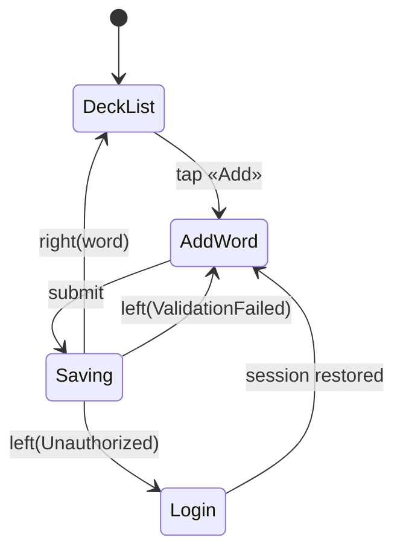

<user_route>
**If this phase spans more than one screen, name the screens and the route through them before any of them is designed.**

Nothing upstream carries this. UI-SPEC.md holds palette, spacing and typography — its only mention of a page is a spacing token. The user story is one sentence ("As a user, I want to add a word, so that I can review it later"), which names an outcome, not a path. So screens get designed one at a time, verified one at a time, and the route between them is assembled by whoever writes the code last.

Start with the inventory — every screen the phase touches:

| Screen | Route | Purpose | Entered from |
|--------|-------|---------|--------------|
| DeckList | `/decks` | browse decks | app launch, back from AddWord |
| AddWord | `/decks/:id/add` | create a word | DeckList «Add» |

Then the route itself. A `stateDiagram-v2` is the right shape here, and not for decoration: it forces a label on every transition, so an unlabelled arrow — a transition nobody decided — cannot be drawn without noticing.

**Then state where each failure sends the user — not just where success does.** The happy path is always covered, because each screen is reviewed on its own and each one renders. What no artifact records is the branch: the session expiring on step three, the 403 on submit, the network dropping mid-upload. The user lands on an empty screen with no way back, and it surfaces in UAT as a major issue that needs its own phase to fix.

For each screen this phase touches, name the exits:

| From | Trigger | Goes to | User sees | State kept? |
|------|---------|---------|-----------|-------------|
| AddWord | submit succeeds | DeckList | new word in list | — |
| AddWord | `left(ValidationFailed)` | AddWord | field errors inline | yes — input preserved |
| AddWord | `left(Unauthorized)` | Login | session expired notice | **decide: draft kept or lost** |

Four rules that make this worth writing down:

- **Every screen needs an entry.** A screen nobody can reach is built and never seen; the inventory's "entered from" column is what catches it, and it catches it before the code exists rather than in UAT.
- **Every `left(...)` in the flow needs a destination.** An error branch with no target screen is a dead end, and dead ends are found by users, not by reviewers.
- **Say explicitly whether unsaved input survives.** This is the single question most often left unanswered, and the answer changes the implementation — it decides whether the form state lives in the component or above it.
- **Re-entry is a case too.** After the user logs back in, do they return to where they were or to the start? Both are defensible; silence is not.

Two consumers depend on this, which is why it belongs in the plan rather than in someone's head: the UI work knows which screens to design and which states each must carry, and UAT knows how many paths to walk — otherwise it walks the happy one and calls the phase done.

If the phase renders exactly one screen with no navigation away from it, say so in one line and skip both tables — an empty table filled out of obligation teaches everyone to skip the real ones.
</user_route>
