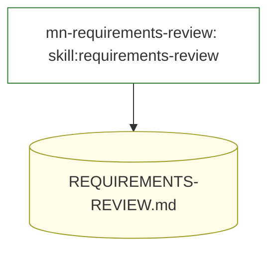
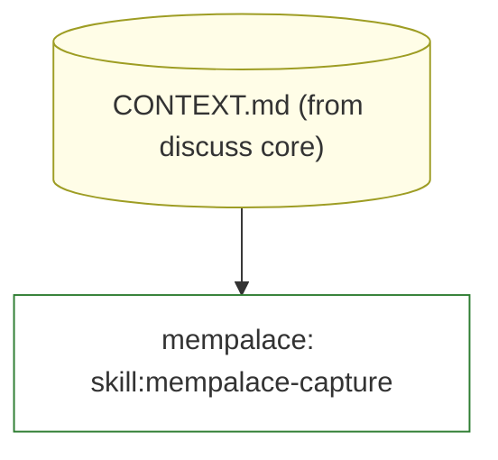
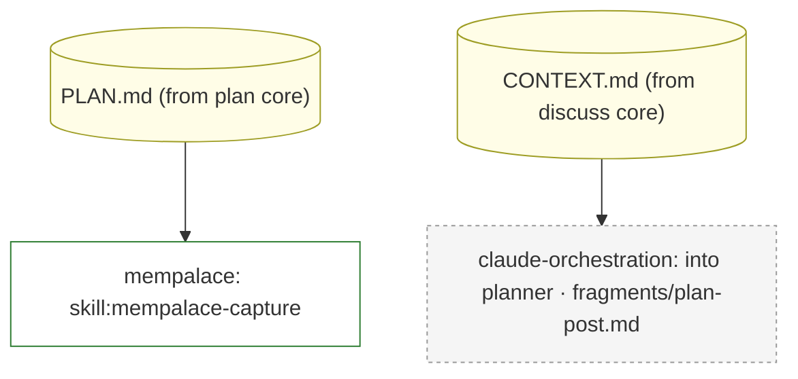
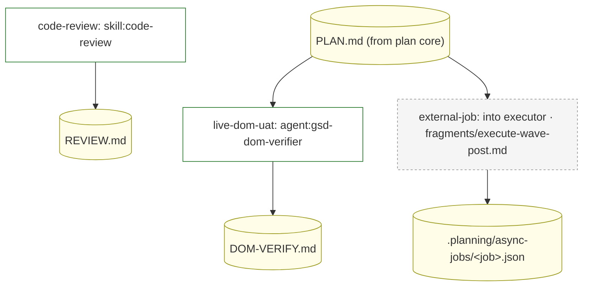
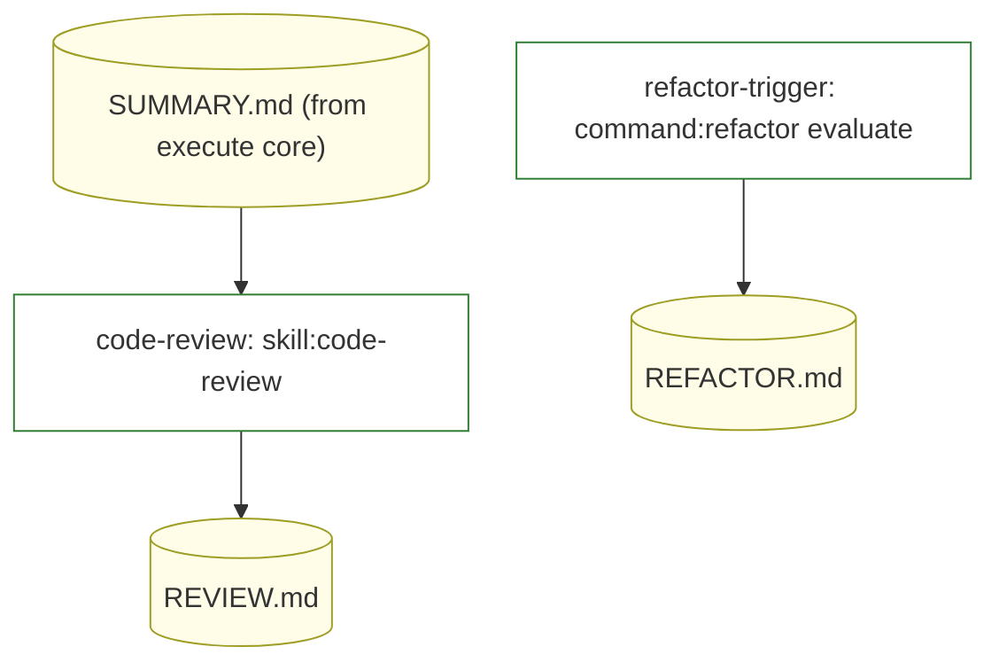
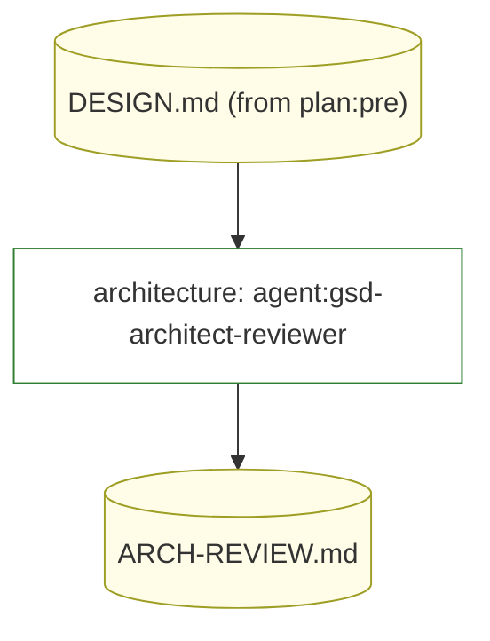
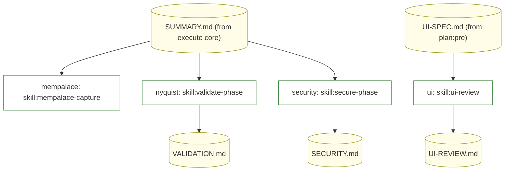
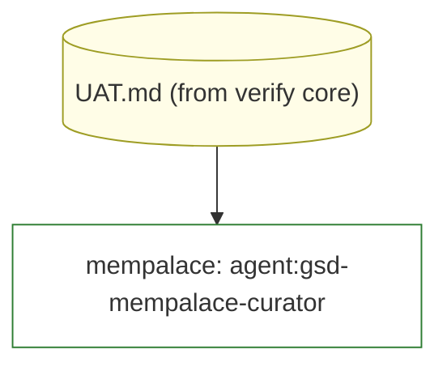

<!-- gsd:derived source=scripts/gen-loop-hooks-map.cjs — regenerated, do not hand-edit -->

# Loop hooks map

Which capability hooks into which loop point, and in what order — generated from the Loop Host Contract
(`gsd-core/bin/lib/loop-host-contract.cjs`), the capability registry's `byLoopPoint`, the raw
`capabilities/*/capability.json` declarations and the `loop render-hooks` call sites of the host workflows.
Regenerate with `node scripts/gen-loop-hooks-map.cjs --write`; `--check` (part of `npm run lint:generated-sync`) fails when
any of them changes without regeneration.

This map answers "what happens at a point, and in what order". Where a capability attaches is the
`capability-matrix.md` question; this document does not repeat it.

82 registered hook(s) at 15 of 16 points.

## Overview

A box is a step hook, a diamond a gate (red and on a thick edge when blocking), a dotted edge a
contribution into the named agent role. A red dashed node is a defect (see the list at the end).

```mermaid
flowchart LR
  subgraph n_step_roadmap["roadmap"]
    n_point_roadmap_pre(["roadmap#58;pre"]):::point
    n_core_roadmap("roadmap#58; orchestrator → ROADMAP.md, REQUIREMENTS.md"):::core
    n_point_roadmap_post(["roadmap#58;post"]):::point
    n_hook_roadmap_pre_step_mn_requirements_review_0["mn-requirements-review#58; skill#58;requirements-review"]:::step
    n_hook_roadmap_pre_gate_mn_requirements_review_1{"mn-requirements-review#58; check mn-requirements-review"}:::crit
    n_hook_roadmap_post_step_retro_0["retro#58; command#58;retro stage"]:::step
  end
  subgraph n_step_discuss["discuss"]
    n_point_discuss_pre(["discuss#58;pre"]):::point
    n_core_discuss("discuss#58; orchestrator → CONTEXT.md"):::core
    n_point_discuss_post(["discuss#58;post"]):::point
    n_hook_discuss_pre_contribution_mempalace_0["mempalace#58; into orchestrator · fragments/recall-discuss.md"]:::contribution
    n_hook_discuss_post_step_mempalace_0["mempalace#58; skill#58;mempalace-capture"]:::step
  end
  subgraph n_step_plan["plan"]
    n_point_plan_pre(["plan#58;pre"]):::point
    n_core_plan("plan#58; researcher, planner, checker → PLAN.md"):::core
    n_point_plan_post(["plan#58;post"]):::point
    n_hook_plan_pre_step_ai_integration_0["ai-integration#58; skill#58;ai-integration-phase"]:::step
    n_hook_plan_pre_step_architecture_1["architecture#58; agent#58;gsd-system-architect"]:::step
    n_hook_plan_pre_step_intel_2["intel#58; command#58;intel api-surface"]:::step
    n_hook_plan_pre_step_mempalace_3["mempalace#58; skill#58;mempalace-recall"]:::step
    n_hook_plan_pre_step_research_4["research#58; agent#58;gsd-phase-researcher"]:::step
    n_hook_plan_pre_step_ui_5["ui#58; skill#58;ui-phase"]:::step
    n_hook_plan_pre_step_pattern_mapper_6["pattern-mapper#58; agent#58;gsd-pattern-mapper"]:::step
    n_hook_plan_pre_gate_drift_7{"drift#58; check verify.codebase-drift"}:::gate
    n_hook_plan_pre_gate_drift_8{"drift#58; check verify.context-drift"}:::gate
    n_hook_plan_pre_gate_ui_9{"ui#58; check ui.plan-gate"}:::crit
    n_hook_plan_pre_contribution_ai_integration_10["ai-integration#58; into planner · fragments/api-coverage-plan-pre.md"]:::contribution
    n_hook_plan_pre_contribution_assumption_delta_11["assumption-delta#58; into planner · fragments/plan-pre.md"]:::contribution
    n_hook_plan_pre_contribution_mn_verify_gate_12["mn-verify-gate#58; into planner · fragments/plan-pre-design.md"]:::contribution
    n_hook_plan_pre_contribution_mn_verify_gate_13["mn-verify-gate#58; into planner · fragments/plan-pre-typemodel.md"]:::contribution
    n_hook_plan_pre_contribution_mn_verify_gate_14["mn-verify-gate#58; into planner · fragments/plan-pre-fieldtable.md"]:::contribution
    n_hook_plan_pre_contribution_mn_verify_gate_15["mn-verify-gate#58; into planner · fragments/plan-pre-user-route.md"]:::contribution
    n_hook_plan_pre_contribution_mn_verify_gate_16["mn-verify-gate#58; into planner · fragments/plan-pre-migration.md"]:::contribution
    n_hook_plan_pre_contribution_mn_verify_gate_17["mn-verify-gate#58; into planner · fragments/plan-pre-design-registry.md"]:::contribution
    n_hook_plan_pre_contribution_mn_verify_gate_18["mn-verify-gate#58; into checker · fragments/plan-pre-refute-findings.md"]:::contribution
    n_hook_plan_pre_contribution_mn_verify_gate_19["mn-verify-gate#58; into planner · fragments/plan-pre-restate-goal.md"]:::contribution
    n_hook_plan_pre_contribution_mn_verify_gate_20["mn-verify-gate#58; into planner · fragments/plan-pre-failure-paths.md"]:::contribution
    n_hook_plan_pre_contribution_schema_gate_21["schema-gate#58; into planner · fragments/plan-pre.md"]:::contribution
    n_hook_plan_pre_contribution_security_22["security#58; into planner · inline"]:::contribution
    n_hook_plan_pre_contribution_tdd_23["tdd#58; into planner · inline"]:::contribution
    n_hook_plan_post_step_mempalace_0["mempalace#58; skill#58;mempalace-capture"]:::step
    n_hook_plan_post_gate_architecture_1{"architecture#58; check architecture.diagrams"}:::crit
    n_hook_plan_post_gate_gap_analysis_2{"gap-analysis#58; check gap-analysis.plan-post"}:::gate
    n_hook_plan_post_gate_mn_verify_gate_3{"mn-verify-gate#58; check mn-wave-collision"}:::crit
    n_hook_plan_post_gate_mn_verify_gate_4{"mn-verify-gate#58; check mn-wave-solve"}:::crit
    n_hook_plan_post_gate_mn_verify_gate_5{"mn-verify-gate#58; check mn-wave-collision"}:::crit
    n_hook_plan_post_gate_mn_verify_gate_6{"mn-verify-gate#58; check mn-failure-paths"}:::crit
    n_hook_plan_post_contribution_claude_orchestration_7["claude-orchestration#58; into planner · fragments/plan-post.md"]:::contribution
    n_hook_plan_post_contribution_external_job_8["external-job#58; into planner · fragments/plan-post.md"]:::contribution
  end
  subgraph n_step_execute["execute"]
    n_point_execute_pre(["execute#58;pre"]):::point
    n_point_execute_wave_pre(["execute#58;wave#58;pre"]):::point
    n_core_execute("execute#58; executor, verifier, code-reviewer → SUMMARY.md"):::core
    n_point_execute_wave_post(["execute#58;wave#58;post"]):::point
    n_point_execute_post(["execute#58;post"]):::point
    n_hook_execute_pre_step_mn_verify_gate_0["mn-verify-gate#58; command#58;verify baseline"]:::step
    n_hook_execute_pre_gate_mn_verify_gate_1{"mn-verify-gate#58; check mn-baseline"}:::crit
    n_hook_execute_pre_gate_mn_verify_gate_2{"mn-verify-gate#58; check mn-tool-preflight"}:::crit
    n_hook_execute_wave_post_step_code_review_0["code-review#58; skill#58;code-review"]:::step
    n_hook_execute_wave_post_step_live_dom_uat_1["live-dom-uat#58; agent#58;gsd-dom-verifier"]:::step
    n_hook_execute_wave_post_gate_drift_2{"drift#58; check verify.schema-drift"}:::crit
    n_hook_execute_wave_post_gate_drift_3{"drift#58; check verify.codebase-drift"}:::gate
    n_hook_execute_wave_post_gate_mn_verify_gate_4{"mn-verify-gate#58; check mn-migration-safety"}:::crit
    n_hook_execute_wave_post_gate_mn_verify_gate_5{"mn-verify-gate#58; check mn-migration-safety"}:::crit
    n_hook_execute_wave_post_gate_mn_verify_gate_6{"mn-verify-gate#58; check mn-plan-status"}:::crit
    n_hook_execute_wave_post_gate_ui_7{"ui#58; check ui.safety-gate"}:::crit
    n_hook_execute_wave_post_contribution_external_job_8["external-job#58; into executor · fragments/execute-wave-post.md"]:::contribution
    n_hook_execute_wave_post_contribution_mempalace_9["mempalace#58; into verifier · fragments/capture-problems.md"]:::contribution
    n_hook_execute_post_step_code_review_0["code-review#58; skill#58;code-review"]:::step
    n_hook_execute_post_step_refactor_trigger_1["refactor-trigger#58; command#58;refactor evaluate"]:::step
    n_hook_execute_post_step_retro_2["retro#58; command#58;retro stage"]:::step
    n_hook_execute_post_gate_tdd_3{"tdd#58; check tdd.review-checkpoint"}:::gate
  end
  subgraph n_step_verify["verify"]
    n_point_verify_pre(["verify#58;pre"]):::point
    n_core_verify("verify#58; orchestrator → UAT.md"):::core
    n_point_verify_post(["verify#58;post"]):::point
    n_hook_verify_pre_step_architecture_0["architecture#58; agent#58;gsd-architect-reviewer"]:::step
    n_hook_verify_pre_step_mn_verify_gate_1["mn-verify-gate#58; command#58;verify gates"]:::step
    n_hook_verify_pre_step_mn_verify_gate_2["mn-verify-gate#58; command#58;verify mutation"]:::step
    n_hook_verify_pre_gate_ai_integration_3{"ai-integration#58; check api-coverage.verify-pre"}:::crit
    n_hook_verify_pre_gate_mn_verify_gate_4{"mn-verify-gate#58; check mn-mutation-spot-check"}:::crit
    n_hook_verify_pre_gate_mn_verify_gate_5{"mn-verify-gate#58; check mn-assertion-ratchet"}:::crit
    n_hook_verify_pre_gate_mn_verify_gate_6{"mn-verify-gate#58; check mn-blast-radius"}:::crit
    n_hook_verify_pre_gate_mn_verify_gate_7{"mn-verify-gate#58; check mn-contract-drift"}:::crit
    n_hook_verify_pre_gate_mn_verify_gate_8{"mn-verify-gate#58; check mn-orphan-plans"}:::crit
    n_hook_verify_post_step_mempalace_0["mempalace#58; skill#58;mempalace-capture"]:::step
    n_hook_verify_post_step_nyquist_1["nyquist#58; skill#58;validate-phase"]:::step
    n_hook_verify_post_step_security_2["security#58; skill#58;secure-phase"]:::step
    n_hook_verify_post_step_ui_3["ui#58; skill#58;ui-review"]:::step
  end
  subgraph n_step_ship["ship"]
    n_point_ship_pre(["ship#58;pre"]):::point
    n_core_ship("ship#58; orchestrator"):::core
    n_point_ship_post(["ship#58;post"]):::point
    n_hook_ship_pre_gate_broken_windows_0{"broken-windows#58; check ?"}:::crit
    n_hook_ship_pre_gate_mn_verify_gate_1{"mn-verify-gate#58; check ?"}:::crit
    n_hook_ship_pre_gate_mn_verify_gate_2{"mn-verify-gate#58; check ?"}:::crit
    n_hook_ship_pre_gate_mn_verify_gate_3{"mn-verify-gate#58; check mn-verify-gates"}:::crit
    n_hook_ship_pre_gate_mn_verify_gate_4{"mn-verify-gate#58; check mn-uat-open"}:::crit
    n_hook_ship_pre_gate_mn_verify_gate_5{"mn-verify-gate#58; check ?"}:::crit
    n_hook_ship_pre_gate_mn_verify_gate_6{"mn-verify-gate#58; check ?"}:::crit
    n_hook_ship_pre_gate_mn_verify_gate_7{"mn-verify-gate#58; check mn-clean-state"}:::crit
    n_hook_ship_pre_gate_security_8{"security#58; check ?"}:::crit
    n_hook_ship_post_step_mempalace_0["mempalace#58; agent#58;gsd-mempalace-curator"]:::step
    n_hook_ship_post_step_retro_1["retro#58; command#58;retro stage signals"]:::step
  end
  subgraph n_step_milestone["milestone"]
    n_point_milestone_pre(["milestone#58;pre"]):::point
    n_core_milestone("milestone#58; orchestrator → MILESTONES.md"):::core
    n_point_milestone_post(["milestone#58;post"]):::point
    n_hook_milestone_pre_step_code_review_0["code-review#58; command#58;review stage"]:::step
    n_hook_milestone_pre_gate_code_review_1{"code-review#58; check milestone-review"}:::crit
    n_hook_milestone_post_step_architecture_0["architecture#58; command#58;arch stage"]:::step
  end
  n_point_roadmap_pre --> n_core_roadmap
  n_core_roadmap --> n_point_roadmap_post
  n_point_roadmap_pre --> n_hook_roadmap_pre_step_mn_requirements_review_0
  n_point_roadmap_pre ==> n_hook_roadmap_pre_gate_mn_requirements_review_1
  n_point_roadmap_post --> n_hook_roadmap_post_step_retro_0
  n_point_discuss_pre --> n_core_discuss
  n_core_discuss --> n_point_discuss_post
  n_point_roadmap_post ==> n_point_discuss_pre
  n_hook_discuss_pre_contribution_mempalace_0 -.->|"orchestrator"| n_point_discuss_pre
  n_point_discuss_post --> n_hook_discuss_post_step_mempalace_0
  n_point_plan_pre --> n_core_plan
  n_core_plan --> n_point_plan_post
  n_point_discuss_post ==> n_point_plan_pre
  n_point_plan_pre --> n_hook_plan_pre_step_ai_integration_0
  n_point_plan_pre --> n_hook_plan_pre_step_architecture_1
  n_point_plan_pre --> n_hook_plan_pre_step_intel_2
  n_point_plan_pre --> n_hook_plan_pre_step_mempalace_3
  n_point_plan_pre --> n_hook_plan_pre_step_research_4
  n_point_plan_pre --> n_hook_plan_pre_step_ui_5
  n_point_plan_pre --> n_hook_plan_pre_step_pattern_mapper_6
  n_point_plan_pre --> n_hook_plan_pre_gate_drift_7
  n_point_plan_pre --> n_hook_plan_pre_gate_drift_8
  n_point_plan_pre ==> n_hook_plan_pre_gate_ui_9
  n_hook_plan_pre_contribution_ai_integration_10 -.->|"planner"| n_point_plan_pre
  n_hook_plan_pre_contribution_assumption_delta_11 -.->|"planner"| n_point_plan_pre
  n_hook_plan_pre_contribution_mn_verify_gate_12 -.->|"planner"| n_point_plan_pre
  n_hook_plan_pre_contribution_mn_verify_gate_13 -.->|"planner"| n_point_plan_pre
  n_hook_plan_pre_contribution_mn_verify_gate_14 -.->|"planner"| n_point_plan_pre
  n_hook_plan_pre_contribution_mn_verify_gate_15 -.->|"planner"| n_point_plan_pre
  n_hook_plan_pre_contribution_mn_verify_gate_16 -.->|"planner"| n_point_plan_pre
  n_hook_plan_pre_contribution_mn_verify_gate_17 -.->|"planner"| n_point_plan_pre
  n_hook_plan_pre_contribution_mn_verify_gate_18 -.->|"checker"| n_point_plan_pre
  n_hook_plan_pre_contribution_mn_verify_gate_19 -.->|"planner"| n_point_plan_pre
  n_hook_plan_pre_contribution_mn_verify_gate_20 -.->|"planner"| n_point_plan_pre
  n_hook_plan_pre_contribution_schema_gate_21 -.->|"planner"| n_point_plan_pre
  n_hook_plan_pre_contribution_security_22 -.->|"planner"| n_point_plan_pre
  n_hook_plan_pre_contribution_tdd_23 -.->|"planner"| n_point_plan_pre
  n_point_plan_post --> n_hook_plan_post_step_mempalace_0
  n_point_plan_post ==> n_hook_plan_post_gate_architecture_1
  n_point_plan_post --> n_hook_plan_post_gate_gap_analysis_2
  n_point_plan_post ==> n_hook_plan_post_gate_mn_verify_gate_3
  n_point_plan_post ==> n_hook_plan_post_gate_mn_verify_gate_4
  n_point_plan_post ==> n_hook_plan_post_gate_mn_verify_gate_5
  n_point_plan_post ==> n_hook_plan_post_gate_mn_verify_gate_6
  n_hook_plan_post_contribution_claude_orchestration_7 -.->|"planner"| n_point_plan_post
  n_hook_plan_post_contribution_external_job_8 -.->|"planner"| n_point_plan_post
  n_point_execute_pre --> n_point_execute_wave_pre
  n_point_execute_wave_pre --> n_core_execute
  n_core_execute --> n_point_execute_wave_post
  n_point_execute_wave_post --> n_point_execute_post
  n_point_plan_post ==> n_point_execute_pre
  n_point_execute_pre --> n_hook_execute_pre_step_mn_verify_gate_0
  n_point_execute_pre ==> n_hook_execute_pre_gate_mn_verify_gate_1
  n_point_execute_pre ==> n_hook_execute_pre_gate_mn_verify_gate_2
  n_point_execute_wave_post --> n_hook_execute_wave_post_step_code_review_0
  n_point_execute_wave_post --> n_hook_execute_wave_post_step_live_dom_uat_1
  n_point_execute_wave_post ==> n_hook_execute_wave_post_gate_drift_2
  n_point_execute_wave_post --> n_hook_execute_wave_post_gate_drift_3
  n_point_execute_wave_post ==> n_hook_execute_wave_post_gate_mn_verify_gate_4
  n_point_execute_wave_post ==> n_hook_execute_wave_post_gate_mn_verify_gate_5
  n_point_execute_wave_post ==> n_hook_execute_wave_post_gate_mn_verify_gate_6
  n_point_execute_wave_post ==> n_hook_execute_wave_post_gate_ui_7
  n_hook_execute_wave_post_contribution_external_job_8 -.->|"executor"| n_point_execute_wave_post
  n_hook_execute_wave_post_contribution_mempalace_9 -.->|"verifier"| n_point_execute_wave_post
  n_point_execute_post --> n_hook_execute_post_step_code_review_0
  n_point_execute_post --> n_hook_execute_post_step_refactor_trigger_1
  n_point_execute_post --> n_hook_execute_post_step_retro_2
  n_point_execute_post --> n_hook_execute_post_gate_tdd_3
  n_point_verify_pre --> n_core_verify
  n_core_verify --> n_point_verify_post
  n_point_execute_post ==> n_point_verify_pre
  n_point_verify_pre --> n_hook_verify_pre_step_architecture_0
  n_point_verify_pre --> n_hook_verify_pre_step_mn_verify_gate_1
  n_point_verify_pre --> n_hook_verify_pre_step_mn_verify_gate_2
  n_point_verify_pre ==> n_hook_verify_pre_gate_ai_integration_3
  n_point_verify_pre ==> n_hook_verify_pre_gate_mn_verify_gate_4
  n_point_verify_pre ==> n_hook_verify_pre_gate_mn_verify_gate_5
  n_point_verify_pre ==> n_hook_verify_pre_gate_mn_verify_gate_6
  n_point_verify_pre ==> n_hook_verify_pre_gate_mn_verify_gate_7
  n_point_verify_pre ==> n_hook_verify_pre_gate_mn_verify_gate_8
  n_point_verify_post --> n_hook_verify_post_step_mempalace_0
  n_point_verify_post --> n_hook_verify_post_step_nyquist_1
  n_point_verify_post --> n_hook_verify_post_step_security_2
  n_point_verify_post --> n_hook_verify_post_step_ui_3
  n_point_ship_pre --> n_core_ship
  n_core_ship --> n_point_ship_post
  n_point_verify_post ==> n_point_ship_pre
  n_point_ship_pre ==> n_hook_ship_pre_gate_broken_windows_0
  n_point_ship_pre ==> n_hook_ship_pre_gate_mn_verify_gate_1
  n_point_ship_pre ==> n_hook_ship_pre_gate_mn_verify_gate_2
  n_point_ship_pre ==> n_hook_ship_pre_gate_mn_verify_gate_3
  n_point_ship_pre ==> n_hook_ship_pre_gate_mn_verify_gate_4
  n_point_ship_pre ==> n_hook_ship_pre_gate_mn_verify_gate_5
  n_point_ship_pre ==> n_hook_ship_pre_gate_mn_verify_gate_6
  n_point_ship_pre ==> n_hook_ship_pre_gate_mn_verify_gate_7
  n_point_ship_pre ==> n_hook_ship_pre_gate_security_8
  n_point_ship_post --> n_hook_ship_post_step_mempalace_0
  n_point_ship_post --> n_hook_ship_post_step_retro_1
  n_point_milestone_pre --> n_core_milestone
  n_core_milestone --> n_point_milestone_post
  n_point_ship_post ==> n_point_milestone_pre
  n_point_milestone_pre --> n_hook_milestone_pre_step_code_review_0
  n_point_milestone_pre ==> n_hook_milestone_pre_gate_code_review_1
  n_point_milestone_post --> n_hook_milestone_post_step_architecture_0
  classDef point fill:#e8f0fe,stroke:#1a73e8
  classDef core fill:#fff,stroke:#555,stroke-width:2px
  classDef step fill:#fff,stroke:#2e7d32
  classDef gate fill:#fff,stroke:#ef6c00
  classDef crit fill:#fdecea,stroke:#b71c1c,stroke-width:2px
  classDef contribution fill:#f5f5f5,stroke:#999999,stroke-dasharray:3 3
  classDef artifact fill:#fffde7,stroke:#9e9d24
  classDef missing fill:#fdecea,stroke:#d33,stroke-dasharray:4 3
  classDef conflict fill:#fff,stroke:#d33,stroke-width:3px
```

## Artifact flow per point

Producer → artifact → consumer at each point where a hook produces or consumes something. An
artifact made earlier — by a step's core work or a hook at an earlier point — names its source.

### `roadmap:pre`



### `discuss:post`



### `plan:pre`

```mermaid
flowchart TB
  f_hook_step_ai_integration_0["ai-integration#58; skill#58;ai-integration-phase"]:::step
  f_artifact_CONTEXT_md[("CONTEXT.md (from discuss core)")]:::artifact
  f_artifact_AI_SPEC_md[("AI-SPEC.md")]:::artifact
  f_hook_step_architecture_1["architecture#58; agent#58;gsd-system-architect"]:::step
  f_artifact_DESIGN_md[("DESIGN.md")]:::artifact
  f_hook_step_intel_2["intel#58; command#58;intel api-surface"]:::step
  f_artifact__planning_intel_API_SURFACE_md[(".planning/intel/API-SURFACE.md")]:::artifact
  f_hook_step_mempalace_3["mempalace#58; skill#58;mempalace-recall"]:::step
  f_artifact_MEMORY_RECALL_md[("MEMORY-RECALL.md")]:::artifact
  f_hook_step_research_4["research#58; agent#58;gsd-phase-researcher"]:::step
  f_artifact_RESEARCH_md[("RESEARCH.md")]:::artifact
  f_hook_step_ui_5["ui#58; skill#58;ui-phase"]:::step
  f_artifact_UI_SPEC_md[("UI-SPEC.md")]:::artifact
  f_hook_step_pattern_mapper_6["pattern-mapper#58; agent#58;gsd-pattern-mapper"]:::step
  f_artifact_PATTERNS_md[("PATTERNS.md")]:::artifact
  f_hook_contribution_ai_integration_7["ai-integration#58; into planner · fragments/api-coverage-plan-pre.md"]:::contribution
  f_artifact_COVERAGE_md[("COVERAGE.md")]:::artifact
  f_hook_contribution_assumption_delta_8["assumption-delta#58; into planner · fragments/plan-pre.md"]:::contribution
  f_hook_contribution_schema_gate_9["schema-gate#58; into planner · fragments/plan-pre.md"]:::contribution
  f_hook_contribution_security_10["security#58; into planner · inline"]:::contribution
  f_artifact_CONTEXT_md --> f_hook_step_ai_integration_0
  f_hook_step_ai_integration_0 --> f_artifact_AI_SPEC_md
  f_artifact_CONTEXT_md --> f_hook_step_architecture_1
  f_hook_step_architecture_1 --> f_artifact_DESIGN_md
  f_hook_step_intel_2 --> f_artifact__planning_intel_API_SURFACE_md
  f_artifact_CONTEXT_md --> f_hook_step_mempalace_3
  f_hook_step_mempalace_3 --> f_artifact_MEMORY_RECALL_md
  f_artifact_CONTEXT_md --> f_hook_step_research_4
  f_hook_step_research_4 --> f_artifact_RESEARCH_md
  f_artifact_CONTEXT_md --> f_hook_step_ui_5
  f_hook_step_ui_5 --> f_artifact_UI_SPEC_md
  f_artifact_RESEARCH_md --> f_hook_step_pattern_mapper_6
  f_hook_step_pattern_mapper_6 --> f_artifact_PATTERNS_md
  f_artifact_CONTEXT_md --> f_hook_contribution_ai_integration_7
  f_hook_contribution_ai_integration_7 --> f_artifact_COVERAGE_md
  f_artifact_CONTEXT_md --> f_hook_contribution_assumption_delta_8
  f_artifact_CONTEXT_md --> f_hook_contribution_schema_gate_9
  f_artifact_CONTEXT_md --> f_hook_contribution_security_10
  classDef point fill:#e8f0fe,stroke:#1a73e8
  classDef core fill:#fff,stroke:#555,stroke-width:2px
  classDef step fill:#fff,stroke:#2e7d32
  classDef gate fill:#fff,stroke:#ef6c00
  classDef crit fill:#fdecea,stroke:#b71c1c,stroke-width:2px
  classDef contribution fill:#f5f5f5,stroke:#999999,stroke-dasharray:3 3
  classDef artifact fill:#fffde7,stroke:#9e9d24
  classDef missing fill:#fdecea,stroke:#d33,stroke-dasharray:4 3
  classDef conflict fill:#fff,stroke:#d33,stroke-width:3px
```



### `plan:post`



### `execute:wave:post`



### `execute:post`



### `verify:pre`



### `verify:post`



### `ship:post`



## Hooks by point

| Point | Capability | Kind | What | `when` | `onError` | Blocking |
|---|---|---|---|---|---|---|
| `roadmap:pre` | mn-requirements-review | step | `skill:requirements-review` | `workflow.requirements_review` | `skip` |  |
| `roadmap:pre` | mn-requirements-review | gate | `mn-requirements-review` | `workflow.requirements_review` | `halt` | yes |
| `roadmap:post` | retro | step | `command:retro stage` | `retro.at_milestone_start` | `skip` |  |
| `discuss:pre` | mempalace | contribution | `orchestrator · fragments/recall-discuss.md` | `mempalace.enabled` | `skip` |  |
| `discuss:post` | mempalace | step | `skill:mempalace-capture` | `mempalace.enabled` | `skip` |  |
| `plan:pre` | ai-integration | step | `skill:ai-integration-phase` | `workflow.ai_integration_phase` | `skip` |  |
| `plan:pre` | architecture | step | `agent:gsd-system-architect` | `workflow.architecture_design` | `skip` |  |
| `plan:pre` | intel | step | `command:intel api-surface` | `intel.enabled` | `skip` |  |
| `plan:pre` | mempalace | step | `skill:mempalace-recall` | `mempalace.enabled` | `skip` |  |
| `plan:pre` | research | step | `agent:gsd-phase-researcher` | `workflow.research` | `skip` |  |
| `plan:pre` | ui | step | `skill:ui-phase` | `workflow.ui_phase` | `skip` |  |
| `plan:pre` | pattern-mapper | step | `agent:gsd-pattern-mapper` | `workflow.pattern_mapper` | `skip` |  |
| `plan:pre` | drift | gate | `verify.codebase-drift` | `workflow.plan_drift_precheck` | `skip` | no |
| `plan:pre` | drift | gate | `verify.context-drift` | `workflow.context_drift_precheck` | `skip` | no |
| `plan:pre` | ui | gate | `ui.plan-gate` | `workflow.ui_safety_gate` | `halt` | yes |
| `plan:pre` | ai-integration | contribution | `planner · fragments/api-coverage-plan-pre.md` | `workflow.api_coverage_gate` | `skip` |  |
| `plan:pre` | assumption-delta | contribution | `planner · fragments/plan-pre.md` | `workflow.assumption_delta` | `skip` |  |
| `plan:pre` | mn-verify-gate | contribution | `planner · fragments/plan-pre-design.md` | `workflow.design_phase` | `skip` |  |
| `plan:pre` | mn-verify-gate | contribution | `planner · fragments/plan-pre-typemodel.md` | `workflow.type_model` | `skip` |  |
| `plan:pre` | mn-verify-gate | contribution | `planner · fragments/plan-pre-fieldtable.md` | `workflow.data_contract_for_ui` | `skip` |  |
| `plan:pre` | mn-verify-gate | contribution | `planner · fragments/plan-pre-user-route.md` | `workflow.user_route` | `skip` |  |
| `plan:pre` | mn-verify-gate | contribution | `planner · fragments/plan-pre-migration.md` | `workflow.migration_safety` | `skip` |  |
| `plan:pre` | mn-verify-gate | contribution | `planner · fragments/plan-pre-design-registry.md` | `workflow.design_registry` | `skip` |  |
| `plan:pre` | mn-verify-gate | contribution | `checker · fragments/plan-pre-refute-findings.md` | `workflow.refute_findings` | `skip` |  |
| `plan:pre` | mn-verify-gate | contribution | `planner · fragments/plan-pre-restate-goal.md` | `workflow.restate_goal` | `skip` |  |
| `plan:pre` | mn-verify-gate | contribution | `planner · fragments/plan-pre-failure-paths.md` | `workflow.failure_paths` | `skip` |  |
| `plan:pre` | schema-gate | contribution | `planner · fragments/plan-pre.md` | `workflow.schema_push_detection` | `skip` |  |
| `plan:pre` | security | contribution | `planner · inline` | `workflow.security_enforcement` |  |  |
| `plan:pre` | tdd | contribution | `planner · inline` | `workflow.tdd_mode` | `skip` |  |
| `plan:post` | mempalace | step | `skill:mempalace-capture` | `mempalace.enabled` | `skip` |  |
| `plan:post` | architecture | gate | `architecture.diagrams` | `workflow.architecture_diagrams_gate` | `halt` | yes |
| `plan:post` | gap-analysis | gate | `gap-analysis.plan-post` | `workflow.post_planning_gaps` | `skip` | no |
| `plan:post` | mn-verify-gate | gate | `mn-wave-collision` | `workflow.wave_collision` | `halt` | yes |
| `plan:post` | mn-verify-gate | gate | `mn-wave-solve` | `workflow.wave_solve` | `halt` | yes |
| `plan:post` | mn-verify-gate | gate | `mn-wave-collision` | `workflow.wave_normalize` | `halt` | yes |
| `plan:post` | mn-verify-gate | gate | `mn-failure-paths` | `workflow.failure_paths_enforce` | `halt` | yes |
| `plan:post` | claude-orchestration | contribution | `planner · fragments/plan-post.md` | `claude_orchestration.enabled` | `skip` |  |
| `plan:post` | external-job | contribution | `planner · fragments/plan-post.md` | `external_job.enabled` | `skip` |  |
| `execute:pre` | mn-verify-gate | step | `command:verify baseline` | `workflow.verify_gates_baseline` | `skip` |  |
| `execute:pre` | mn-verify-gate | gate | `mn-baseline` | `workflow.verify_gates_baseline` | `halt` | yes |
| `execute:pre` | mn-verify-gate | gate | `mn-tool-preflight` | `workflow.tool_preflight` | `skip` | yes |
| `execute:wave:post` | code-review | step | `skill:code-review` | `workflow.code_review` | `skip` |  |
| `execute:wave:post` | live-dom-uat | step | `agent:gsd-dom-verifier` | `workflow.live_dom_uat` | `skip` |  |
| `execute:wave:post` | drift | gate | `verify.schema-drift` | `workflow.schema_drift_gate` | `skip` | yes |
| `execute:wave:post` | drift | gate | `verify.codebase-drift` | `workflow.schema_drift_gate` | `skip` | no |
| `execute:wave:post` | mn-verify-gate | gate | `mn-migration-safety` | `workflow.migration_safety` | `halt` | yes |
| `execute:wave:post` | mn-verify-gate | gate | `mn-migration-safety` | `workflow.migration_safety_strict` | `halt` | yes |
| `execute:wave:post` | mn-verify-gate | gate | `mn-plan-status` | `workflow.plan_status_enforce` | `halt` | yes |
| `execute:wave:post` | ui | gate | `ui.safety-gate` | `workflow.ui_safety_gate` | `halt` | yes |
| `execute:wave:post` | external-job | contribution | `executor · fragments/execute-wave-post.md` | `external_job.enabled` | `skip` |  |
| `execute:wave:post` | mempalace | contribution | `verifier · fragments/capture-problems.md` | `mempalace.enabled` | `skip` |  |
| `execute:post` | code-review | step | `skill:code-review` | `workflow.code_review` | `skip` |  |
| `execute:post` | refactor-trigger | step | `command:refactor evaluate` | `refactor.trigger_enabled` | `skip` |  |
| `execute:post` | retro | step | `command:retro stage` | `retro.enabled` | `skip` |  |
| `execute:post` | tdd | gate | `tdd.review-checkpoint` | `workflow.tdd_mode` | `skip` | no |
| `verify:pre` | architecture | step | `agent:gsd-architect-reviewer` | `workflow.architecture_review` | `skip` |  |
| `verify:pre` | mn-verify-gate | step | `command:verify gates` | `workflow.verify_gates_record` | `skip` |  |
| `verify:pre` | mn-verify-gate | step | `command:verify mutation` | `workflow.mutation_spot_check` | `skip` |  |
| `verify:pre` | ai-integration | gate | `api-coverage.verify-pre` | `workflow.api_coverage_gate` | `halt` | yes |
| `verify:pre` | mn-verify-gate | gate | `mn-mutation-spot-check` | `workflow.mutation_spot_check` | `halt` | yes |
| `verify:pre` | mn-verify-gate | gate | `mn-assertion-ratchet` | `workflow.assertion_ratchet` | `halt` | yes |
| `verify:pre` | mn-verify-gate | gate | `mn-blast-radius` | `workflow.blast_radius` | `halt` | yes |
| `verify:pre` | mn-verify-gate | gate | `mn-contract-drift` | `workflow.contract_drift` | `halt` | yes |
| `verify:pre` | mn-verify-gate | gate | `mn-orphan-plans` | `workflow.orphan_plans` | `halt` | yes |
| `verify:post` | mempalace | step | `skill:mempalace-capture` | `mempalace.enabled` | `skip` |  |
| `verify:post` | nyquist | step | `skill:validate-phase` | `workflow.nyquist_validation` | `halt` |  |
| `verify:post` | security | step | `skill:secure-phase` | `workflow.security_enforcement` | `halt` |  |
| `verify:post` | ui | step | `skill:ui-review` | `workflow.ui_review` | `skip` |  |
| `ship:pre` | broken-windows | gate |  | `workflow.windows_enforce` | `halt` | yes |
| `ship:pre` | mn-verify-gate | gate |  | `workflow.nyquist_enforce` | `halt` | yes |
| `ship:pre` | mn-verify-gate | gate |  | `workflow.verify_enforce` | `halt` | yes |
| `ship:pre` | mn-verify-gate | gate | `mn-verify-gates` | `workflow.verify_gates_enforce` | `halt` | yes |
| `ship:pre` | mn-verify-gate | gate | `mn-uat-open` | `workflow.uat_enforce` | `halt` | yes |
| `ship:pre` | mn-verify-gate | gate |  | `workflow.mn_security_enforce` | `halt` | yes |
| `ship:pre` | mn-verify-gate | gate |  | `workflow.mn_windows_enforce` | `halt` | yes |
| `ship:pre` | mn-verify-gate | gate | `mn-clean-state` | `workflow.clean_state_enforce` | `halt` | yes |
| `ship:pre` | security | gate |  | `workflow.security_enforcement` | `halt` | yes |
| `ship:post` | mempalace | step | `agent:gsd-mempalace-curator` | `mempalace.enabled` | `skip` |  |
| `ship:post` | retro | step | `command:retro stage signals` | `retro.enabled` | `skip` |  |
| `milestone:pre` | code-review | step | `command:review stage` | `workflow.code_review` | `skip` |  |
| `milestone:pre` | code-review | gate | `milestone-review` | `code_review.milestone_gate` | `halt` | yes |
| `milestone:post` | architecture | step | `command:arch stage` | `architecture.metrics_at_milestone` | `skip` |  |

## Hosts

| Point | Workflow | Kinds dispatched |
|---|---|---|
| `roadmap:pre` | `gsd-core/workflows/new-milestone.md` | step, gate, contribution |
| `roadmap:pre` | `gsd-core/workflows/new-project.md` | step, gate, contribution |
| `roadmap:post` | `gsd-core/workflows/new-milestone.md` | step |
| `roadmap:post` | `gsd-core/workflows/new-project.md` | step |
| `discuss:pre` | `gsd-core/workflows/discuss-phase.md` | step, gate, contribution |
| `discuss:post` | `gsd-core/workflows/discuss-phase.md` | step, gate, contribution |
| `plan:pre` | `gsd-core/workflows/plan-phase.md` | step, gate, contribution |
| `plan:pre` | `gsd-core/workflows/quick.md` | — |
| `plan:post` | `gsd-core/workflows/plan-phase.md` | step, gate, contribution |
| `execute:pre` | `gsd-core/workflows/execute-phase.md` | step, gate |
| `execute:wave:pre` | `gsd-core/workflows/execute-phase.md` | step, contribution |
| `execute:wave:post` | `gsd-core/workflows/execute-phase.md` | step, gate, contribution |
| `execute:post` | `gsd-core/workflows/quick.md` | step |
| `execute:post` | `gsd-core/workflows/execute-phase.md` | — |
| `execute:post` | `gsd-core/workflows/execute-phase/steps/verify-phase-goal.md` | step, gate |
| `verify:pre` | `gsd-core/workflows/verify-work.md` | step, gate, contribution |
| `verify:post` | `gsd-core/workflows/execute-phase/steps/verify-phase-goal.md` | step |
| `verify:post` | `gsd-core/workflows/verify-work.md` | step |
| `ship:pre` | `gsd-core/workflows/ship.md` | step, gate |
| `ship:post` | `gsd-core/workflows/ship.md` | step |
| `milestone:pre` | `gsd-core/workflows/complete-milestone.md` | step, gate |
| `milestone:post` | `gsd-core/workflows/complete-milestone.md` | step |

## Defects

None.
