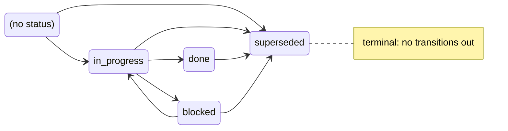
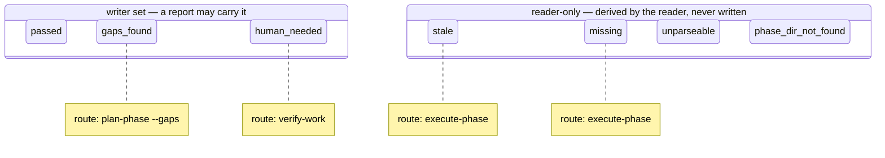
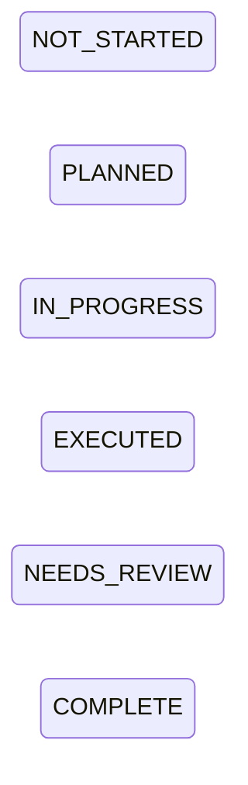

<!-- gsd:derived source=scripts/gen-state-machines.cjs — regenerated, do not hand-edit -->

# State machines

Lifecycle diagrams of the closed status vocabularies, generated from the code constants that own
them. Regenerate with `node scripts/gen-state-machines.cjs --write`; `--check` (part of
`npm run lint:generated-sync`) fails when a vocabulary changes without regeneration.

## Plan status

Source: `PLAN_STATUSES` and `PLAN_STATUS_TRANSITIONS` in `src/plan-status.cts`. The code defines the
transitions as a table, so they are drawn. `(no status)` is the table's `none` origin — a plan whose
frontmatter declares no `status` (not started, which is valid).

| From | Allowed next |
|------|--------------|
| (no status) | `in_progress`, `superseded` |
| `in_progress` | `done`, `blocked`, `superseded` |
| `done` | `superseded` |
| `blocked` | `in_progress`, `superseded` |
| `superseded` | — |

## VerificationStatus

Source: `VERIFICATION_STATUS`, `VERIFIER_STATUSES` and `VERIFICATION_ROUTES` in `src/verification.cts`.
**The code defines no transitions between these values** — a status is read from a report (writer
set) or derived by the reader (reader-only) — so only the states are drawn, grouped by who may produce
them. A note is the routing table's next command, not a transition.

| Value | Produced by | Route (`VERIFICATION_ROUTES`) |
|-------|-------------|-------------------------------|
| `passed` | writer set | — |
| `gaps_found` | writer set | `plan-phase --gaps` |
| `human_needed` | writer set | `verify-work` |
| `stale` | reader-only | `execute-phase` |
| `missing` | reader-only | `execute-phase` |
| `unparseable` | reader-only | — |
| `phase_dir_not_found` | reader-only | — |

## PhaseStatus

Source: `PHASE_STATUS` in `src/phase-status.cts`, in declaration order. **The code defines no
transitions**: a phase status is not stored, it is computed from facts (plan/summary counts, the
completion verdict, the verification status) by `phaseStatusFromFacts`, and nothing in the code
constrains how it changes from one reading to the next. Only the states are drawn.

| Value |
|-------|
| `NOT_STARTED` |
| `PLANNED` |
| `IN_PROGRESS` |
| `EXECUTED` |
| `NEEDS_REVIEW` |
| `COMPLETE` |
