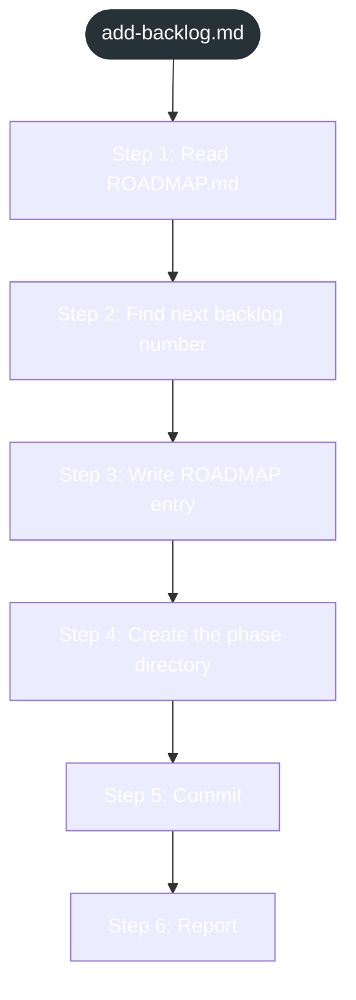

<!-- gsd:derived source=scripts/gen-workflow-maps.cjs — regenerated, do not hand-edit -->

# add-backlog

Источник: `gsd-core/workflows/add-backlog.md`. Единицы: 6 разделов H2. Спавнов: 0. Точки цикла: нет.

> **Переходы в прозе** (фразы «перейди к …»): всего 0; не называют реальный шаг и не рисуются — **0**; названы по имени шага и нарисованы пунктиром `goto` — 0.

Карта построена из разметки workflow: узел — реальный `<step>`, `gsd:section` или раздел H2; рёбра — порядок
документа, условие шага/секции на входящем ребре, переходы по имени шага. Описание обозначений —
в [README](README.md).

## Поток

## Единицы

| # | Единица | Вид | Условие | Спавны | Точки цикла | Читает |
|---|---|---|---|---|---|---|
| 1 | `Step 1: Read ROADMAP.md` | H2 |  |  |  |  |
| 2 | `Step 2: Find next backlog number` | H2 |  |  |  |  |
| 3 | `Step 3: Write ROADMAP entry` | H2 |  |  |  |  |
| 4 | `Step 4: Create the phase directory` | H2 |  |  |  |  |
| 5 | `Step 5: Commit` | H2 |  |  |  |  |
| 6 | `Step 6: Report` | H2 |  |  |  |  |

## Дефекты

Дефектов нет.
