<!-- gsd:derived source=scripts/gen-workflow-maps.cjs — regenerated, do not hand-edit -->

# ai-integration-phase

Источник: `gsd-core/workflows/ai-integration-phase.md`. Единицы: 12 разделов H2. Спавнов: 0. Точки цикла: нет.

> **Переходы в прозе** (фразы «перейди к …»): всего 1; не называют реальный шаг и не рисуются — **0**; названы по имени шага и нарисованы пунктиром `goto` — 1.

Карта построена из разметки workflow: узел — реальный `<step>`, `gsd:section` или раздел H2; рёбра — порядок
документа, условие шага/секции на входящем ребре, переходы по имени шага. Описание обозначений —
в [README](README.md).

## Поток

```mermaid
flowchart TB
  wf_root(["ai-integration-phase.md"]):::root
  u_heading_1__Initialize["1. Initialize"]
  u_heading_2__Parse_and_Validate_Phase["2. Parse and Validate Phase"]
  u_heading_3__Check_Prerequisites["3. Check Prerequisites"]
  u_heading_4__Check_Existing_AI_SPEC["4. Check Existing AI-SPEC"]
  u_heading_5__Spawn_gsd_framework_selector["5. Spawn gsd-framework-selector"]
  u_heading_6__Initialize_AI_SPEC_md["6. Initialize AI-SPEC.md"]
  u_heading_7__Spawn_gsd_ai_researcher["7. Spawn gsd-ai-researcher"]
  u_heading_8__Spawn_gsd_domain_researcher["8. Spawn gsd-domain-researcher"]
  u_heading_9__Spawn_gsd_eval_planner["9. Spawn gsd-eval-planner"]
  u_heading_10__Validate_AI_SPEC_Completeness["10. Validate AI-SPEC Completeness"]
  u_heading_11__Commit["11. Commit"]
  u_heading_12__Display_Completion["12. Display Completion"]
  wf_root --> u_heading_1__Initialize
  u_heading_1__Initialize --> u_heading_2__Parse_and_Validate_Phase
  u_heading_2__Parse_and_Validate_Phase --> u_heading_3__Check_Prerequisites
  u_heading_3__Check_Prerequisites --> u_heading_4__Check_Existing_AI_SPEC
  u_heading_4__Check_Existing_AI_SPEC --> u_heading_5__Spawn_gsd_framework_selector
  u_heading_5__Spawn_gsd_framework_selector --> u_heading_6__Initialize_AI_SPEC_md
  u_heading_6__Initialize_AI_SPEC_md --> u_heading_7__Spawn_gsd_ai_researcher
  u_heading_7__Spawn_gsd_ai_researcher --> u_heading_8__Spawn_gsd_domain_researcher
  u_heading_8__Spawn_gsd_domain_researcher --> u_heading_9__Spawn_gsd_eval_planner
  u_heading_9__Spawn_gsd_eval_planner --> u_heading_10__Validate_AI_SPEC_Completeness
  u_heading_10__Validate_AI_SPEC_Completeness --> u_heading_11__Commit
  u_heading_11__Commit --> u_heading_12__Display_Completion
  u_heading_4__Check_Existing_AI_SPEC -.->|"goto"| u_heading_5__Spawn_gsd_framework_selector
  classDef missing fill:#fdecea,stroke:#d33,stroke-dasharray:4 3
  classDef unparsed fill:#f5f5f5,stroke:#999999,stroke-dasharray:4 3,color:#555
  classDef conditional fill:#fff8e1,stroke:#b28704
  classDef root fill:#263238,color:#ffffff,stroke:#263238
  classDef agent fill:#e8f0fe,stroke:#3367d6
  classDef builtin fill:#eeeeee,stroke:#777777
  classDef capability fill:#e6f4ea,stroke:#2e7d32
  classDef dynamic fill:#f2f2f2,stroke:#888,stroke-dasharray:2 2
  classDef point fill:#f3e8fd,stroke:#8e24aa
  classDef workflow fill:#ffffff,stroke:#555555
```

## Единицы

| # | Единица | Вид | Условие | Спавны | Точки цикла | Читает |
|---|---|---|---|---|---|---|
| 1 | `1. Initialize` | H2 |  |  |  |  |
| 2 | `2. Parse and Validate Phase` | H2 |  |  |  |  |
| 3 | `3. Check Prerequisites` | H2 |  |  |  |  |
| 4 | `4. Check Existing AI-SPEC` | H2 |  |  |  |  |
| 5 | `5. Spawn gsd-framework-selector` | H2 |  |  |  |  |
| 6 | `6. Initialize AI-SPEC.md` | H2 |  |  |  |  |
| 7 | `7. Spawn gsd-ai-researcher` | H2 |  |  |  |  |
| 8 | `8. Spawn gsd-domain-researcher` | H2 |  |  |  |  |
| 9 | `9. Spawn gsd-eval-planner` | H2 |  |  |  |  |
| 10 | `10. Validate AI-SPEC Completeness` | H2 |  |  |  |  |
| 11 | `11. Commit` | H2 |  |  |  |  |
| 12 | `12. Display Completion` | H2 |  |  |  |  |

## Дефекты

Дефектов нет.
