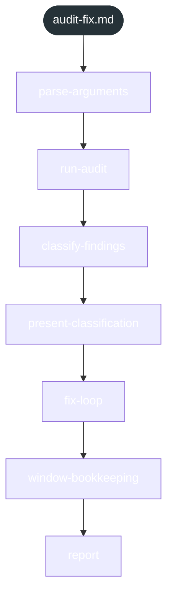
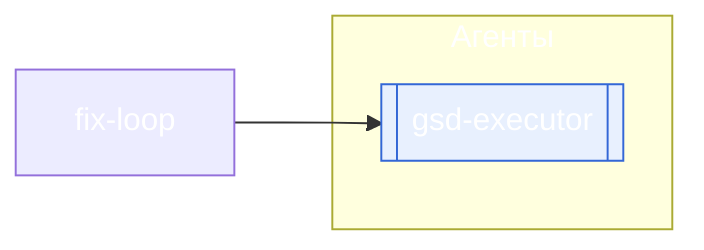

<!-- gsd:derived source=scripts/gen-workflow-maps.cjs — regenerated, do not hand-edit -->

# audit-fix

Источник: `gsd-core/workflows/audit-fix.md`. Единицы: 7 шагов `<step>`. Спавнов: 1 (агенты: `gsd-executor`). Точки цикла: нет.

> **Переходы в прозе** (фразы «перейди к …»): всего 2; не называют реальный шаг и не рисуются — **2**; названы по имени шага и нарисованы пунктиром `goto` — 0.

Карта построена из разметки workflow: узел — реальный `<step>`, `gsd:section` или раздел H2; рёбра — порядок
документа, условие шага/секции на входящем ребре, переходы по имени шага. Описание обозначений —
в [README](README.md).

## Поток

## Агенты и точки цикла

## Единицы

| # | Единица | Вид | Условие | Спавны | Точки цикла | Читает |
|---|---|---|---|---|---|---|
| 1 | `parse-arguments` | step |  |  |  |  |
| 2 | `run-audit` | step |  |  |  |  |
| 3 | `classify-findings` | step |  |  |  |  |
| 4 | `present-classification` | step |  |  |  |  |
| 5 | `fix-loop` | step |  | `gsd-executor` |  |  |
| 6 | `window-bookkeeping` | step |  |  |  |  |
| 7 | `report` | step |  |  |  |  |

## Дефекты

Дефектов нет.
