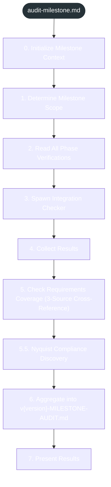
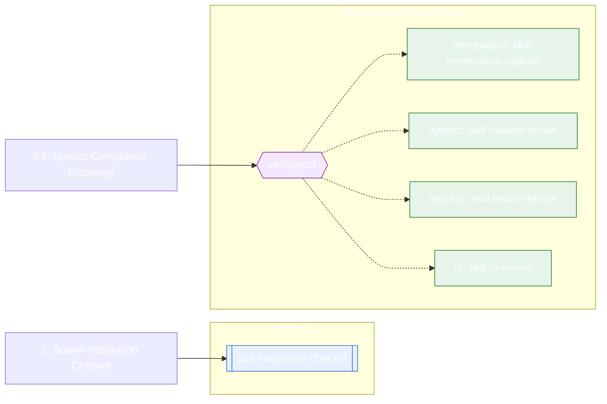

<!-- gsd:derived source=scripts/gen-workflow-maps.cjs — regenerated, do not hand-edit -->

# audit-milestone

Источник: `gsd-core/workflows/audit-milestone.md`. Единицы: 9 разделов H2. Спавнов: 1 (агенты: `gsd-integration-checker`). Точки цикла: `verify:post`.

> **Переходы в прозе** (фразы «перейди к …»): всего 0; не называют реальный шаг и не рисуются — **0**; названы по имени шага и нарисованы пунктиром `goto` — 0.

Карта построена из разметки workflow: узел — реальный `<step>`, `gsd:section` или раздел H2; рёбра — порядок
документа, условие шага/секции на входящем ребре, переходы по имени шага. Описание обозначений —
в [README](README.md).

## Поток

## Агенты и точки цикла

## Единицы

| # | Единица | Вид | Условие | Спавны | Точки цикла | Читает |
|---|---|---|---|---|---|---|
| 1 | `0. Initialize Milestone Context` | H2 |  |  |  |  |
| 2 | `1. Determine Milestone Scope` | H2 |  |  |  |  |
| 3 | `2. Read All Phase Verifications` | H2 |  |  |  |  |
| 4 | `3. Spawn Integration Checker` | H2 |  | `gsd-integration-checker` |  |  |
| 5 | `4. Collect Results` | H2 |  |  |  |  |
| 6 | `5. Check Requirements Coverage (3-Source Cross-Reference)` | H2 |  |  |  |  |
| 7 | `5.5. Nyquist Compliance Discovery` | H2 |  |  | `verify:post` |  |
| 8 | `6. Aggregate into v{version}-MILESTONE-AUDIT.md` | H2 |  |  |  |  |
| 9 | `7. Present Results` | H2 |  |  |  |  |

## Дефекты

Дефектов нет.
