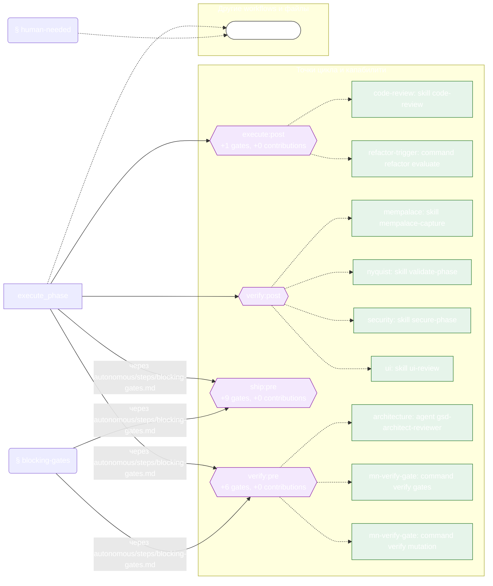

<!-- gsd:derived source=scripts/gen-workflow-maps.cjs — regenerated, do not hand-edit -->

# autonomous

Источник: `gsd-core/workflows/autonomous.md`. Единицы: 7 шагов `<step>`, 10 секций `gsd:section`. Спавнов: 0. Точки цикла: `execute:post`, `verify:post`, `ship:pre`, `verify:pre`.

> **Переходы в прозе** (фразы «перейди к …»): всего 34; не называют реальный шаг и не рисуются — **18**; названы по имени шага и нарисованы пунктиром `goto` — 16.

Карта построена из разметки workflow: узел — реальный `<step>`, `gsd:section` или раздел H2; рёбра — порядок
документа, условие шага/секции на входящем ребре, переходы по имени шага. Описание обозначений —
в [README](README.md).

## Поток

```mermaid
flowchart TB
  wf_root(["autonomous.md"]):::root
  u_step_initialize["initialize"]
  u_section_converge_fail_fast("§ converge-fail-fast"):::conditional
  u_section_converge_banner("§ converge-banner"):::conditional
  u_step_discover_phases["discover_phases"]
  u_step_execute_phase["execute_phase"]
  u_section_spec_phase("§ spec-phase")
  u_section_converge_dispatch_bg("§ converge-dispatch-bg"):::conditional
  u_section_converge_dispatch_inline("§ converge-dispatch-inline"):::conditional
  u_section_converge_loop("§ converge-loop"):::conditional
  u_section_blocking_gates("§ blocking-gates")
  u_section_human_needed("§ human-needed")
  u_section_gaps_found("§ gaps-found")
  u_step_smart_discuss["smart_discuss"]
  u_step_iterate["iterate"]
  u_section_phase_budget("§ phase-budget")
  u_step_lifecycle["lifecycle"]
  u_step_handle_blocker["handle_blocker"]
  wf_root --> u_step_initialize
  u_step_initialize -->|"when#58; state#58;plan-strategy-converge"| u_section_converge_fail_fast
  u_section_converge_fail_fast -->|"when#58; state#58;plan-strategy-converge"| u_section_converge_banner
  u_section_converge_banner --> u_step_discover_phases
  u_step_discover_phases --> u_step_execute_phase
  u_step_execute_phase --> u_section_spec_phase
  u_section_spec_phase -->|"when#58; state#58;plan-strategy-converge"| u_section_converge_dispatch_bg
  u_section_converge_dispatch_bg -->|"when#58; state#58;plan-strategy-converge"| u_section_converge_dispatch_inline
  u_section_converge_dispatch_inline -->|"when#58; state#58;plan-strategy-converge"| u_section_converge_loop
  u_section_converge_loop --> u_section_blocking_gates
  u_section_blocking_gates --> u_section_human_needed
  u_section_human_needed --> u_section_gaps_found
  u_section_gaps_found --> u_step_smart_discuss
  u_step_smart_discuss --> u_step_iterate
  u_step_iterate --> u_section_phase_budget
  u_section_phase_budget --> u_step_lifecycle
  u_step_lifecycle --> u_step_handle_blocker
  u_step_execute_phase -.->|"goto"| u_step_handle_blocker
  u_step_execute_phase -.->|"goto"| u_step_iterate
  u_step_iterate -.->|"goto"| u_step_lifecycle
  u_step_iterate -.->|"goto"| u_step_handle_blocker
  u_step_iterate -.->|"goto"| u_step_execute_phase
  u_step_lifecycle -.->|"goto"| u_step_handle_blocker
  wf_root -.->|"goto"| u_step_handle_blocker
  classDef missing fill:#fdecea,stroke:#d33,stroke-dasharray:4 3
  classDef unparsed fill:#f5f5f5,stroke:#999999,stroke-dasharray:4 3,color:#555
  classDef conditional fill:#fff8e1,stroke:#b28704
  classDef root fill:#263238,color:#ffffff,stroke:#263238
  classDef agent fill:#e8f0fe,stroke:#3367d6
  classDef builtin fill:#eeeeee,stroke:#777777
  classDef capability fill:#e6f4ea,stroke:#2e7d32
  classDef dynamic fill:#f2f2f2,stroke:#888,stroke-dasharray:2 2
  classDef point fill:#f3e8fd,stroke:#8e24aa
  classDef workflow fill:#ffffff,stroke:#555555
```

## Агенты и точки цикла

## Единицы

| # | Единица | Вид | Условие | Спавны | Точки цикла | Читает |
|---|---|---|---|---|---|---|
| 1 | `initialize` | step |  |  |  | `autonomous/steps/converge-fail-fast.md`, `autonomous/steps/converge-banner.md` |
| 2 | `converge-fail-fast` | section | when: state:plan-strategy-converge |  |  | `autonomous/steps/converge-fail-fast.md` |
| 3 | `converge-banner` | section | when: state:plan-strategy-converge |  |  | `autonomous/steps/converge-banner.md` |
| 4 | `discover_phases` | step |  |  |  |  |
| 5 | `execute_phase` | step |  |  | `execute:post`, `verify:post`, `ship:pre`, `verify:pre` | `autonomous/steps/spec-phase.md`, `autonomous/steps/converge-dispatch-bg.md`, `autonomous/steps/converge-dispatch-inline.md`, `autonomous/steps/converge-loop.md`, `autonomous/steps/blocking-gates.md`, `transition.md`, `autonomous/steps/human-needed.md`, `autonomous/steps/gaps-found.md` |
| 6 | `spec-phase` | section |  |  |  | `autonomous/steps/spec-phase.md` |
| 7 | `converge-dispatch-bg` | section | when: state:plan-strategy-converge |  |  | `autonomous/steps/converge-dispatch-bg.md` |
| 8 | `converge-dispatch-inline` | section | when: state:plan-strategy-converge |  |  | `autonomous/steps/converge-dispatch-inline.md` |
| 9 | `converge-loop` | section | when: state:plan-strategy-converge |  |  | `autonomous/steps/converge-loop.md` |
| 10 | `blocking-gates` | section |  |  | `ship:pre`, `verify:pre` | `autonomous/steps/blocking-gates.md` |
| 11 | `human-needed` | section |  |  |  | `autonomous/steps/human-needed.md` |
| 12 | `gaps-found` | section |  |  |  | `autonomous/steps/gaps-found.md` |
| 13 | `smart_discuss` | step |  |  |  |  |
| 14 | `iterate` | step |  |  |  | `autonomous/steps/phase-budget.md` |
| 15 | `phase-budget` | section |  |  |  | `autonomous/steps/phase-budget.md` |
| 16 | `lifecycle` | step |  |  |  |  |
| 17 | `handle_blocker` | step |  |  |  |  |

## Дефекты

Дефектов нет.
