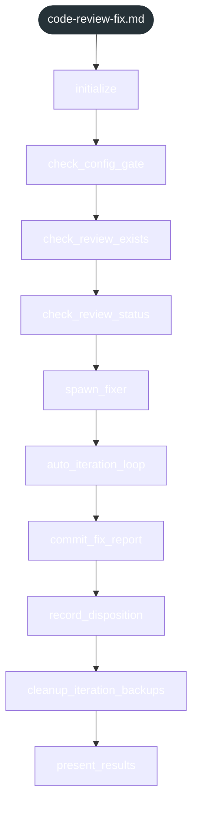
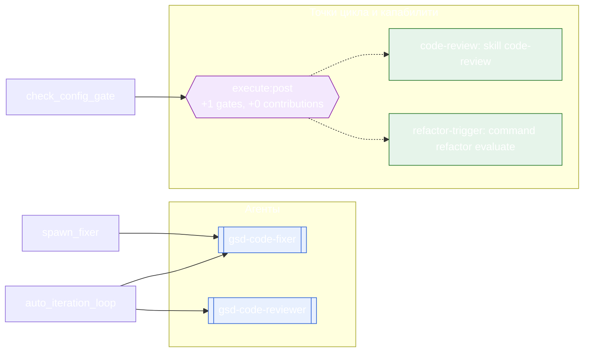

<!-- gsd:derived source=scripts/gen-workflow-maps.cjs — regenerated, do not hand-edit -->

# code-review-fix

Источник: `gsd-core/workflows/code-review-fix.md`. Единицы: 10 шагов `<step>`. Спавнов: 3 (агенты: `gsd-code-fixer`, `gsd-code-reviewer`). Точки цикла: `execute:post`.

> **Переходы в прозе** (фразы «перейди к …»): всего 0; не называют реальный шаг и не рисуются — **0**; названы по имени шага и нарисованы пунктиром `goto` — 0.

Карта построена из разметки workflow: узел — реальный `<step>`, `gsd:section` или раздел H2; рёбра — порядок
документа, условие шага/секции на входящем ребре, переходы по имени шага. Описание обозначений —
в [README](README.md).

## Поток

## Агенты и точки цикла

## Единицы

| # | Единица | Вид | Условие | Спавны | Точки цикла | Читает |
|---|---|---|---|---|---|---|
| 1 | `initialize` | step |  |  |  |  |
| 2 | `check_config_gate` | step |  |  | `execute:post` |  |
| 3 | `check_review_exists` | step |  |  |  |  |
| 4 | `check_review_status` | step |  |  |  |  |
| 5 | `spawn_fixer` | step |  | `gsd-code-fixer` |  |  |
| 6 | `auto_iteration_loop` | step |  | `gsd-code-reviewer`, `gsd-code-fixer` |  |  |
| 7 | `commit_fix_report` | step |  |  |  |  |
| 8 | `record_disposition` | step |  |  |  | `execute-phase/steps/code-review-disposition.md` |
| 9 | `cleanup_iteration_backups` | step |  |  |  |  |
| 10 | `present_results` | step |  |  |  |  |

## Дефекты

Дефектов нет.
