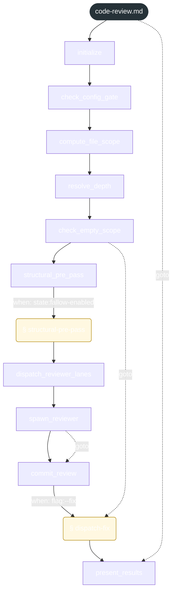
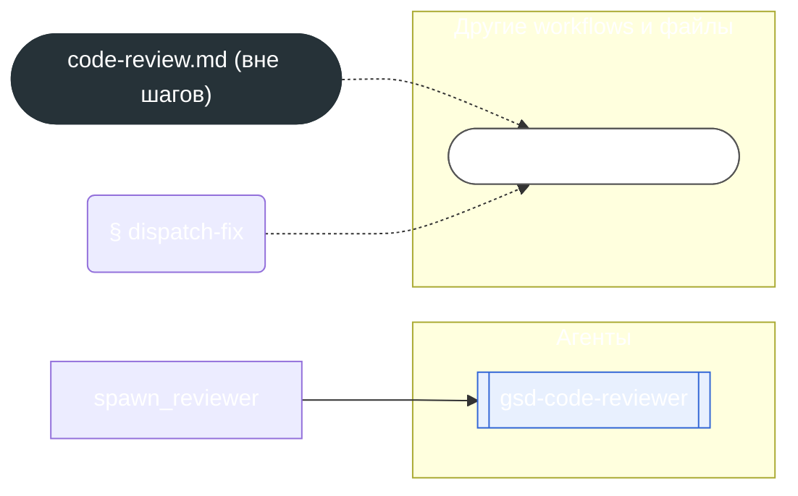

<!-- gsd:derived source=scripts/gen-workflow-maps.cjs — regenerated, do not hand-edit -->

# code-review

Источник: `gsd-core/workflows/code-review.md`. Единицы: 10 шагов `<step>`, 2 секции `gsd:section`. Спавнов: 1 (агенты: `gsd-code-reviewer`). Точки цикла: нет.

> **Переходы в прозе** (фразы «перейди к …»): всего 4; не называют реальный шаг и не рисуются — **0**; названы по имени шага и нарисованы пунктиром `goto` — 4.

Карта построена из разметки workflow: узел — реальный `<step>`, `gsd:section` или раздел H2; рёбра — порядок
документа, условие шага/секции на входящем ребре, переходы по имени шага. Описание обозначений —
в [README](README.md).

## Поток

## Агенты и точки цикла

## Единицы

| # | Единица | Вид | Условие | Спавны | Точки цикла | Читает |
|---|---|---|---|---|---|---|
| — | (вне единиц) | — | — |  |  | `code-review/steps/dispatch-fix.md` |
| 1 | `initialize` | step |  |  |  |  |
| 2 | `check_config_gate` | step |  |  |  |  |
| 3 | `compute_file_scope` | step |  |  |  |  |
| 4 | `resolve_depth` | step |  |  |  |  |
| 5 | `check_empty_scope` | step |  |  |  |  |
| 6 | `structural_pre_pass` | step |  |  |  | `code-review/steps/structural-pre-pass.md` |
| 7 | `structural-pre-pass` | section | when: state:fallow-enabled |  |  | `code-review/steps/structural-pre-pass.md` |
| 8 | `dispatch_reviewer_lanes` | step |  |  |  |  |
| 9 | `spawn_reviewer` | step |  | `gsd-code-reviewer` |  |  |
| 10 | `commit_review` | step |  |  |  |  |
| 11 | `dispatch-fix` | section | when: flag:--fix |  |  | `code-review/steps/dispatch-fix.md` |
| 12 | `present_results` | step |  |  |  |  |

## Дефекты

Дефектов нет.
