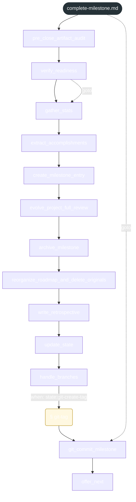

<!-- gsd:derived source=scripts/gen-workflow-maps.cjs — regenerated, do not hand-edit -->

# complete-milestone

Источник: `gsd-core/workflows/complete-milestone.md`. Единицы: 13 шагов `<step>`, 1 секция `gsd:section`. Спавнов: 0. Точки цикла: нет.

> **Переходы в прозе** (фразы «перейди к …»): всего 5; не называют реальный шаг и не рисуются — **3**; названы по имени шага и нарисованы пунктиром `goto` — 2.

Карта построена из разметки workflow: узел — реальный `<step>`, `gsd:section` или раздел H2; рёбра — порядок
документа, условие шага/секции на входящем ребре, переходы по имени шага. Описание обозначений —
в [README](README.md).

## Поток

## Единицы

| # | Единица | Вид | Условие | Спавны | Точки цикла | Читает |
|---|---|---|---|---|---|---|
| — | (вне единиц) | — | — |  |  | `complete-milestone/detail/elaboration.md`, `complete-milestone/steps/git-tag.md` |
| 1 | `pre_close_artifact_audit` | step |  |  |  | `complete-milestone/detail/elaboration.md` |
| 2 | `verify_readiness` | step |  |  |  |  |
| 3 | `gather_stats` | step |  |  |  |  |
| 4 | `extract_accomplishments` | step |  |  |  |  |
| 5 | `create_milestone_entry` | step |  |  |  |  |
| 6 | `evolve_project_full_review` | step |  |  |  |  |
| 7 | `archive_milestone` | step |  |  |  |  |
| 8 | `reorganize_roadmap_and_delete_originals` | step |  |  |  |  |
| 9 | `write_retrospective` | step |  |  |  |  |
| 10 | `update_state` | step |  |  |  |  |
| 11 | `handle_branches` | step |  |  |  | `complete-milestone/detail/elaboration.md` |
| 12 | `git-tag` | section | when: state:git-create-tag |  |  | `complete-milestone/steps/git-tag.md` |
| 13 | `git_commit_milestone` | step |  |  |  |  |
| 14 | `offer_next` | step |  |  |  |  |

## Дефекты

Дефектов нет.
