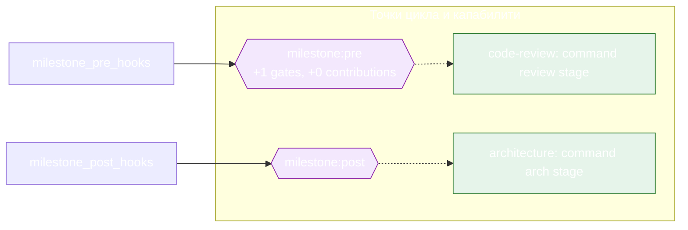

<!-- gsd:derived source=scripts/gen-workflow-maps.cjs — regenerated, do not hand-edit -->

# complete-milestone

Источник: `gsd-core/workflows/complete-milestone.md`. Единицы: 15 шагов `<step>`, 2 секции `gsd:section`. Спавнов: 0. Точки цикла: `milestone:pre`, `milestone:post`.

> **Переходы в прозе** (фразы «перейди к …»): всего 6; не называют реальный шаг и не рисуются — **3**; названы по имени шага и нарисованы пунктиром `goto` — 3.

Карта построена из разметки workflow: узел — реальный `<step>`, `gsd:section` или раздел H2; рёбра — порядок
документа, условие шага/секции на входящем ребре, переходы по имени шага. Описание обозначений —
в [README](README.md).

## Поток

```mermaid
flowchart TB
  wf_root(["complete-milestone.md"]):::root
  u_step_pre_close_artifact_audit["pre_close_artifact_audit"]
  u_step_verify_readiness["verify_readiness"]
  u_step_milestone_pre_hooks["milestone_pre_hooks"]
  u_step_gather_stats["gather_stats"]
  u_step_extract_accomplishments["extract_accomplishments"]
  u_step_create_milestone_entry["create_milestone_entry"]
  u_section_project_md_evolution_review("§ project-md-evolution-review"):::conditional
  u_step_archive_milestone["archive_milestone"]
  u_step_reorganize_roadmap_and_delete_originals["reorganize_roadmap_and_delete_originals"]
  u_step_write_retrospective["write_retrospective"]
  u_step_update_state["update_state"]
  u_step_handle_branches["handle_branches"]
  u_section_git_tag("§ git-tag"):::conditional
  u_step_push_release_tags["push_release_tags"]
  u_step_git_commit_milestone["git_commit_milestone"]
  u_step_milestone_post_hooks["milestone_post_hooks"]
  u_step_offer_next["offer_next"]
  wf_root --> u_step_pre_close_artifact_audit
  u_step_pre_close_artifact_audit --> u_step_verify_readiness
  u_step_verify_readiness --> u_step_milestone_pre_hooks
  u_step_milestone_pre_hooks --> u_step_gather_stats
  u_step_gather_stats --> u_step_extract_accomplishments
  u_step_extract_accomplishments --> u_step_create_milestone_entry
  u_step_create_milestone_entry -->|"when#58; state#58;flat-mode"| u_section_project_md_evolution_review
  u_section_project_md_evolution_review --> u_step_archive_milestone
  u_step_archive_milestone --> u_step_reorganize_roadmap_and_delete_originals
  u_step_reorganize_roadmap_and_delete_originals --> u_step_write_retrospective
  u_step_write_retrospective --> u_step_update_state
  u_step_update_state --> u_step_handle_branches
  u_step_handle_branches -->|"when#58; state#58;git-create-tag"| u_section_git_tag
  u_section_git_tag --> u_step_push_release_tags
  u_step_push_release_tags --> u_step_git_commit_milestone
  u_step_git_commit_milestone --> u_step_milestone_post_hooks
  u_step_milestone_post_hooks --> u_step_offer_next
  u_step_verify_readiness -.->|"goto"| u_step_milestone_pre_hooks
  wf_root -.->|"goto"| u_step_archive_milestone
  wf_root -.->|"goto"| u_step_git_commit_milestone
  classDef missing fill:#fdecea,stroke:#d33,stroke-dasharray:4 3
  classDef unparsed fill:#f5f5f5,stroke:#999999,stroke-dasharray:4 3,color:#555
  classDef conditional fill:#fff8e1,stroke:#b28704
  classDef root fill:#263238,color:#ffffff,stroke:#263238
  classDef agent fill:#e8f0fe,stroke:#3367d6
  classDef builtin fill:#eeeeee,stroke:#777777
  classDef capability fill:#e6f4ea,stroke:#2e7d32
  classDef dynamic fill:#f2f2f2,stroke:#888,stroke-dasharray:2 2
  classDef point fill:#f3e8fd,stroke:#8e24aa
  classDef workflow fill:#ffffff,stroke:#555555
```

## Агенты и точки цикла

## Единицы

| # | Единица | Вид | Условие | Спавны | Точки цикла | Читает |
|---|---|---|---|---|---|---|
| — | (вне единиц) | — | — |  |  | `complete-milestone/detail/elaboration.md`, `complete-milestone/steps/project-md-evolution-review.md`, `complete-milestone/steps/git-tag.md` |
| 1 | `pre_close_artifact_audit` | step |  |  |  | `complete-milestone/detail/elaboration.md` |
| 2 | `verify_readiness` | step |  |  |  |  |
| 3 | `milestone_pre_hooks` | step |  |  | `milestone:pre` |  |
| 4 | `gather_stats` | step |  |  |  |  |
| 5 | `extract_accomplishments` | step |  |  |  |  |
| 6 | `create_milestone_entry` | step |  |  |  |  |
| 7 | `project-md-evolution-review` | section | when: state:flat-mode |  |  | `complete-milestone/steps/project-md-evolution-review.md` |
| 8 | `archive_milestone` | step |  |  |  | `complete-milestone/steps/release-map.md` |
| 9 | `reorganize_roadmap_and_delete_originals` | step |  |  |  |  |
| 10 | `write_retrospective` | step |  |  |  |  |
| 11 | `update_state` | step |  |  |  |  |
| 12 | `handle_branches` | step |  |  |  | `complete-milestone/detail/elaboration.md` |
| 13 | `git-tag` | section | when: state:git-create-tag |  |  | `complete-milestone/steps/git-tag.md` |
| 14 | `push_release_tags` | step |  |  |  | `complete-milestone/steps/release-map.md` |
| 15 | `git_commit_milestone` | step |  |  |  |  |
| 16 | `milestone_post_hooks` | step |  |  | `milestone:post` |  |
| 17 | `offer_next` | step |  |  |  |  |

## Дефекты

Дефектов нет.
