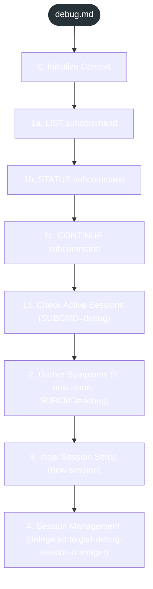
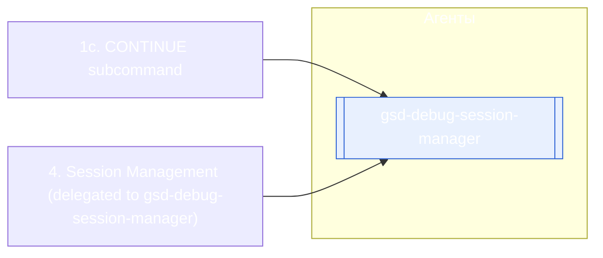

<!-- gsd:derived source=scripts/gen-workflow-maps.cjs — regenerated, do not hand-edit -->

# debug

Источник: `gsd-core/workflows/debug.md`. Единицы: 8 разделов H2. Спавнов: 3 (агенты: `gsd-debug-session-manager`). Точки цикла: нет.

> **Переходы в прозе** (фразы «перейди к …»): всего 3; не называют реальный шаг и не рисуются — **3**; названы по имени шага и нарисованы пунктиром `goto` — 0.

Карта построена из разметки workflow: узел — реальный `<step>`, `gsd:section` или раздел H2; рёбра — порядок
документа, условие шага/секции на входящем ребре, переходы по имени шага. Описание обозначений —
в [README](README.md).

## Поток

## Агенты и точки цикла

## Единицы

| # | Единица | Вид | Условие | Спавны | Точки цикла | Читает |
|---|---|---|---|---|---|---|
| 1 | `0. Initialize Context` | H2 |  |  |  |  |
| 2 | `1a. LIST subcommand` | H2 |  |  |  |  |
| 3 | `1b. STATUS subcommand` | H2 |  |  |  |  |
| 4 | `1c. CONTINUE subcommand` | H2 |  | `gsd-debug-session-manager` |  |  |
| 5 | `1d. Check Active Sessions (SUBCMD=debug)` | H2 |  |  |  |  |
| 6 | `2. Gather Symptoms (if new issue, SUBCMD=debug)` | H2 |  |  |  |  |
| 7 | `3. Initial Session Setup (new session)` | H2 |  |  |  |  |
| 8 | `4. Session Management (delegated to gsd-debug-session-manager)` | H2 |  | `gsd-debug-session-manager` |  |  |

## Дефекты

Дефектов нет.
