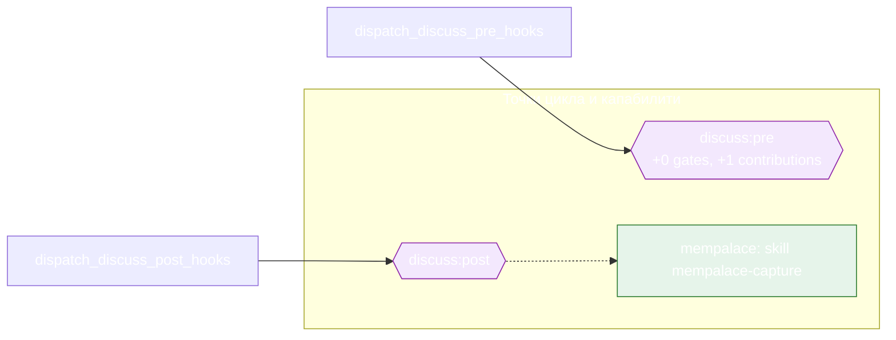

<!-- gsd:derived source=scripts/gen-workflow-maps.cjs — regenerated, do not hand-edit -->

# discuss-phase

Источник: `gsd-core/workflows/discuss-phase.md`. Единицы: 17 шагов `<step>`. Спавнов: 0. Точки цикла: `discuss:pre`, `discuss:post`.

> **Переходы в прозе** (фразы «перейди к …»): всего 10; не называют реальный шаг и не рисуются — **3**; названы по имени шага и нарисованы пунктиром `goto` — 7.

Карта построена из разметки workflow: узел — реальный `<step>`, `gsd:section` или раздел H2; рёбра — порядок
документа, условие шага/секции на входящем ребре, переходы по имени шага. Описание обозначений —
в [README](README.md).

## Поток

```mermaid
flowchart TB
  wf_root(["discuss-phase.md"]):::root
  u_step_initialize["initialize"]
  u_step_check_blocking_antipatterns["check_blocking_antipatterns"]
  u_step_check_spec["check_spec"]
  u_step_check_existing["check_existing"]
  u_step_load_prior_context["load_prior_context"]
  u_step_cross_reference_todos["cross_reference_todos"]
  u_step_scout_codebase["scout_codebase"]
  u_step_dispatch_discuss_pre_hooks["dispatch_discuss_pre_hooks"]
  u_step_analyze_phase["analyze_phase"]
  u_step_present_gray_areas["present_gray_areas"]
  u_step_discuss_areas["discuss_areas"]
  u_step_write_context["write_context"]
  u_step_dispatch_discuss_post_hooks["dispatch_discuss_post_hooks"]
  u_step_confirm_creation["confirm_creation"]
  u_step_git_commit["git_commit"]
  u_step_update_state["update_state"]
  u_step_auto_advance["auto_advance"]
  wf_root --> u_step_initialize
  u_step_initialize --> u_step_check_blocking_antipatterns
  u_step_check_blocking_antipatterns --> u_step_check_spec
  u_step_check_spec --> u_step_check_existing
  u_step_check_existing --> u_step_load_prior_context
  u_step_load_prior_context --> u_step_cross_reference_todos
  u_step_cross_reference_todos --> u_step_scout_codebase
  u_step_scout_codebase --> u_step_dispatch_discuss_pre_hooks
  u_step_dispatch_discuss_pre_hooks --> u_step_analyze_phase
  u_step_analyze_phase --> u_step_present_gray_areas
  u_step_present_gray_areas --> u_step_discuss_areas
  u_step_discuss_areas --> u_step_write_context
  u_step_write_context --> u_step_dispatch_discuss_post_hooks
  u_step_dispatch_discuss_post_hooks --> u_step_confirm_creation
  u_step_confirm_creation --> u_step_git_commit
  u_step_git_commit --> u_step_update_state
  u_step_update_state --> u_step_auto_advance
  u_step_initialize -.->|"goto"| u_step_check_blocking_antipatterns
  u_step_check_blocking_antipatterns -.->|"goto"| u_step_check_spec
  u_step_check_existing -.->|"goto"| u_step_load_prior_context
  u_step_dispatch_discuss_pre_hooks -.->|"goto"| u_step_analyze_phase
  u_step_present_gray_areas -.->|"goto"| u_step_discuss_areas
  u_step_dispatch_discuss_post_hooks -.->|"goto"| u_step_confirm_creation
  classDef missing fill:#fdecea,stroke:#d33,stroke-dasharray:4 3
  classDef unparsed fill:#f5f5f5,stroke:#999999,stroke-dasharray:4 3,color:#555
  classDef conditional fill:#fff8e1,stroke:#b28704
  classDef root fill:#263238,color:#ffffff,stroke:#263238
  classDef agent fill:#e8f0fe,stroke:#3367d6
  classDef builtin fill:#eeeeee,stroke:#777777
  classDef capability fill:#e6f4ea,stroke:#2e7d32
  classDef dynamic fill:#f2f2f2,stroke:#888,stroke-dasharray:2 2
  classDef point fill:#f3e8fd,stroke:#8e24aa
  classDef workflow fill:#ffffff,stroke:#555555
```

## Агенты и точки цикла

## Единицы

| # | Единица | Вид | Условие | Спавны | Точки цикла | Читает |
|---|---|---|---|---|---|---|
| 1 | `initialize` | step |  |  |  |  |
| 2 | `check_blocking_antipatterns` | step |  |  |  |  |
| 3 | `check_spec` | step |  |  |  |  |
| 4 | `check_existing` | step |  |  |  |  |
| 5 | `load_prior_context` | step |  |  |  |  |
| 6 | `cross_reference_todos` | step |  |  |  |  |
| 7 | `scout_codebase` | step |  |  |  |  |
| 8 | `dispatch_discuss_pre_hooks` | step |  |  | `discuss:pre` |  |
| 9 | `analyze_phase` | step |  |  |  |  |
| 10 | `present_gray_areas` | step |  |  |  |  |
| 11 | `discuss_areas` | step |  |  |  |  |
| 12 | `write_context` | step |  |  |  |  |
| 13 | `dispatch_discuss_post_hooks` | step |  |  | `discuss:post` |  |
| 14 | `confirm_creation` | step |  |  |  |  |
| 15 | `git_commit` | step |  |  |  |  |
| 16 | `update_state` | step |  |  |  |  |
| 17 | `auto_advance` | step |  |  |  |  |

## Дефекты

Дефектов нет.
