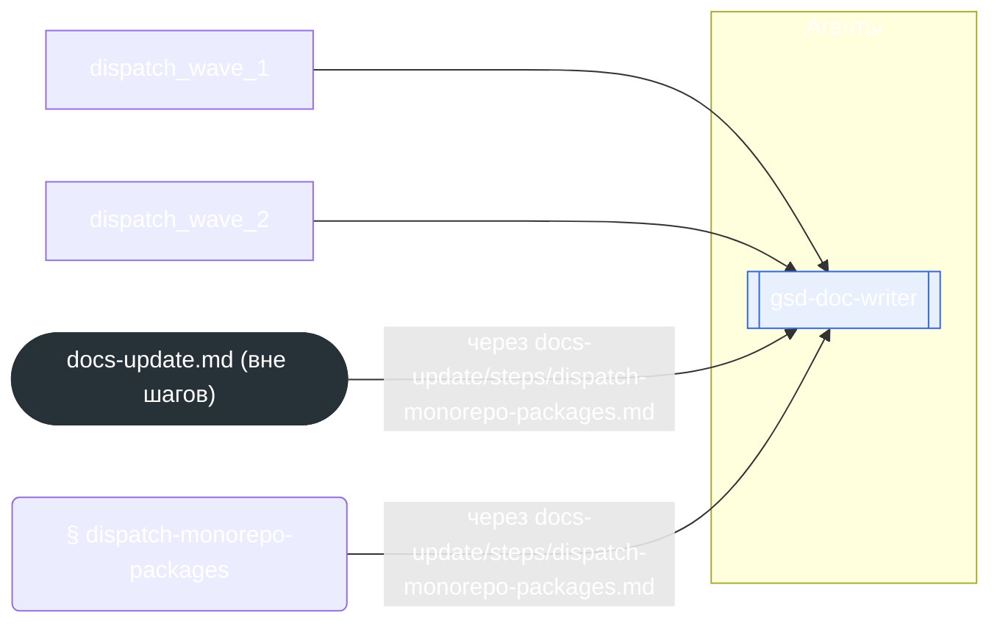

<!-- gsd:derived source=scripts/gen-workflow-maps.cjs — regenerated, do not hand-edit -->

# docs-update

Источник: `gsd-core/workflows/docs-update.md`. Единицы: 16 шагов `<step>`, 1 секция `gsd:section`. Спавнов: 11 (агенты: `gsd-doc-writer`). Точки цикла: нет.

> **Переходы в прозе** (фразы «перейди к …»): всего 22; не называют реальный шаг и не рисуются — **6**; названы по имени шага и нарисованы пунктиром `goto` — 16.

Карта построена из разметки workflow: узел — реальный `<step>`, `gsd:section` или раздел H2; рёбра — порядок
документа, условие шага/секции на входящем ребре, переходы по имени шага. Описание обозначений —
в [README](README.md).

## Поток

```mermaid
flowchart TB
  wf_root(["docs-update.md"]):::root
  u_step_init_context["init_context"]
  u_step_classify_project["classify_project"]
  u_step_build_doc_queue["build_doc_queue"]
  u_step_resolve_modes["resolve_modes"]
  u_step_preservation_check["preservation_check"]
  u_step_dispatch_wave_1["dispatch_wave_1"]:::conditional
  u_step_collect_wave_1["collect_wave_1"]
  u_step_dispatch_wave_2["dispatch_wave_2"]:::conditional
  u_step_collect_wave_2["collect_wave_2"]
  u_section_dispatch_monorepo_packages("§ dispatch-monorepo-packages"):::conditional
  u_step_sequential_generation["sequential_generation"]:::conditional
  u_step_verify_docs["verify_docs"]
  u_step_fix_loop["fix_loop"]
  u_step_verify_only_report["verify_only_report"]
  u_step_scan_for_secrets["scan_for_secrets"]
  u_step_commit_docs["commit_docs"]
  u_step_report["report"]
  wf_root --> u_step_init_context
  u_step_init_context --> u_step_classify_project
  u_step_classify_project --> u_step_build_doc_queue
  u_step_build_doc_queue --> u_step_resolve_modes
  u_step_resolve_modes --> u_step_preservation_check
  u_step_preservation_check -->|"если#58; Task tool is available"| u_step_dispatch_wave_1
  u_step_dispatch_wave_1 --> u_step_collect_wave_1
  u_step_collect_wave_1 -->|"если#58; Task tool is available"| u_step_dispatch_wave_2
  u_step_dispatch_wave_2 --> u_step_collect_wave_2
  u_step_collect_wave_2 -->|"when#58; state#58;is-monorepo"| u_section_dispatch_monorepo_packages
  u_section_dispatch_monorepo_packages -->|"если#58; Task tool is NOT available (e.g. Antigravity, Codex, Copilot)"| u_step_sequential_generation
  u_step_sequential_generation --> u_step_verify_docs
  u_step_verify_docs --> u_step_fix_loop
  u_step_fix_loop --> u_step_verify_only_report
  u_step_verify_only_report --> u_step_scan_for_secrets
  u_step_scan_for_secrets --> u_step_commit_docs
  u_step_commit_docs --> u_step_report
  u_step_build_doc_queue -.->|"goto"| u_step_resolve_modes
  u_step_preservation_check -.->|"goto"| u_step_dispatch_wave_1
  u_step_preservation_check -.->|"goto"| u_step_verify_only_report
  u_step_dispatch_wave_1 -.->|"goto"| u_step_collect_wave_1
  u_step_collect_wave_1 -.->|"goto"| u_step_dispatch_wave_2
  u_step_dispatch_wave_2 -.->|"goto"| u_step_collect_wave_2
  wf_root -.->|"goto"| u_step_commit_docs
  u_step_sequential_generation -.->|"goto"| u_step_verify_docs
  u_step_verify_docs -.->|"goto"| u_step_scan_for_secrets
  u_step_verify_docs -.->|"goto"| u_step_fix_loop
  u_step_fix_loop -.->|"goto"| u_step_scan_for_secrets
  u_step_scan_for_secrets -.->|"goto"| u_step_commit_docs
  classDef missing fill:#fdecea,stroke:#d33,stroke-dasharray:4 3
  classDef unparsed fill:#f5f5f5,stroke:#999999,stroke-dasharray:4 3,color:#555
  classDef conditional fill:#fff8e1,stroke:#b28704
  classDef root fill:#263238,color:#ffffff,stroke:#263238
  classDef agent fill:#e8f0fe,stroke:#3367d6
  classDef builtin fill:#eeeeee,stroke:#777777
  classDef capability fill:#e6f4ea,stroke:#2e7d32
  classDef dynamic fill:#f2f2f2,stroke:#888,stroke-dasharray:2 2
  classDef point fill:#f3e8fd,stroke:#8e24aa
  classDef workflow fill:#ffffff,stroke:#555555
```

## Агенты и точки цикла

## Единицы

| # | Единица | Вид | Условие | Спавны | Точки цикла | Читает |
|---|---|---|---|---|---|---|
| — | (вне единиц) | — | — | `gsd-doc-writer` |  | `docs-update/detail/elaboration.md`, `docs-update/steps/dispatch-monorepo-packages.md` |
| 1 | `init_context` | step |  |  |  |  |
| 2 | `classify_project` | step |  |  |  |  |
| 3 | `build_doc_queue` | step |  |  |  |  |
| 4 | `resolve_modes` | step |  |  |  |  |
| 5 | `preservation_check` | step |  |  |  |  |
| 6 | `dispatch_wave_1` | step | если: Task tool is available | `gsd-doc-writer` |  |  |
| 7 | `collect_wave_1` | step |  |  |  |  |
| 8 | `dispatch_wave_2` | step | если: Task tool is available | `gsd-doc-writer` |  |  |
| 9 | `collect_wave_2` | step |  |  |  |  |
| 10 | `dispatch-monorepo-packages` | section | when: state:is-monorepo | `gsd-doc-writer` |  | `docs-update/steps/dispatch-monorepo-packages.md` |
| 11 | `sequential_generation` | step | если: Task tool is NOT available (e.g. Antigravity, Codex, Copilot) |  |  | `docs-update/detail/elaboration.md` |
| 12 | `verify_docs` | step |  |  |  |  |
| 13 | `fix_loop` | step |  |  |  | `docs-update/detail/elaboration.md` |
| 14 | `verify_only_report` | step |  |  |  | `docs-update/detail/elaboration.md` |
| 15 | `scan_for_secrets` | step |  |  |  |  |
| 16 | `commit_docs` | step |  |  |  |  |
| 17 | `report` | step |  |  |  |  |

## Дефекты

Дефектов нет.
