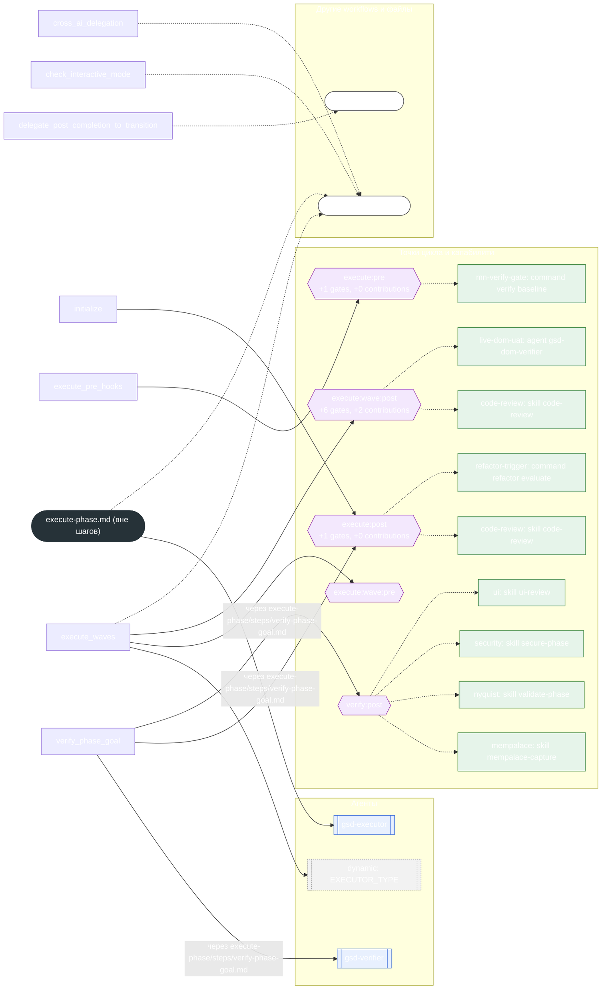

<!-- gsd:derived source=scripts/gen-workflow-maps.cjs — regenerated, do not hand-edit -->

# execute-phase

Источник: `gsd-core/workflows/execute-phase.md`. Единицы: 18 шагов `<step>`, 3 секции `gsd:section`. Спавнов: 3 (агенты: `gsd-executor`, `gsd-verifier`). Точки цикла: `execute:post`, `execute:pre`, `execute:wave:pre`, `execute:wave:post`, `verify:post`.

> **Переходы в прозе** (фразы «перейди к …»): всего 17; не называют реальный шаг и не рисуются — **12**; названы по имени шага и нарисованы пунктиром `goto` — 5.

Карта построена из разметки workflow: узел — реальный `<step>`, `gsd:section` или раздел H2; рёбра — порядок
документа, условие шага/секции на входящем ребре, переходы по имени шага. Описание обозначений —
в [README](README.md).

## Поток

```mermaid
flowchart TB
  wf_root(["execute-phase.md"]):::root
  u_step_parse_args["parse_args"]
  u_step_initialize["initialize"]
  u_step_safe_resume_gate["safe_resume_gate"]
  u_step_check_blocking_antipatterns["check_blocking_antipatterns"]
  u_step_check_interactive_mode["check_interactive_mode"]
  u_step_handle_branching["handle_branching"]
  u_step_validate_phase["validate_phase"]
  u_step_discover_and_group_plans["discover_and_group_plans"]
  u_step_execute_pre_hooks["execute_pre_hooks"]
  u_step_cross_ai_delegation["cross_ai_delegation"]
  u_step_execute_waves["execute_waves"]
  u_step_checkpoint_handling["checkpoint_handling"]
  u_step_aggregate_results["aggregate_results"]
  u_section_partial_wave("§ partial-wave"):::conditional
  u_step_verify_phase_goal["verify_phase_goal"]
  u_section_gap_closure_artifacts("§ gap-closure-artifacts"):::conditional
  u_section_regression_gate("§ regression-gate"):::conditional
  u_step_update_roadmap["update_roadmap"]
  u_step_auto_copy_learnings["auto_copy_learnings"]
  u_step_close_phase_todos["close_phase_todos"]
  u_step_delegate_post_completion_to_transition["delegate_post_completion_to_transition"]
  wf_root --> u_step_parse_args
  u_step_parse_args --> u_step_initialize
  u_step_initialize --> u_step_safe_resume_gate
  u_step_safe_resume_gate --> u_step_check_blocking_antipatterns
  u_step_check_blocking_antipatterns --> u_step_check_interactive_mode
  u_step_check_interactive_mode --> u_step_handle_branching
  u_step_handle_branching --> u_step_validate_phase
  u_step_validate_phase --> u_step_discover_and_group_plans
  u_step_discover_and_group_plans --> u_step_execute_pre_hooks
  u_step_execute_pre_hooks --> u_step_cross_ai_delegation
  u_step_cross_ai_delegation --> u_step_execute_waves
  u_step_execute_waves --> u_step_checkpoint_handling
  u_step_checkpoint_handling --> u_step_aggregate_results
  u_step_aggregate_results -->|"when#58; flag#58;#45;#45;wave"| u_section_partial_wave
  u_section_partial_wave --> u_step_verify_phase_goal
  u_step_verify_phase_goal -->|"when#58; state#58;gap-closure-phase"| u_section_gap_closure_artifacts
  u_section_gap_closure_artifacts -->|"when#58; state#58;has-prior-phases"| u_section_regression_gate
  u_section_regression_gate --> u_step_update_roadmap
  u_step_update_roadmap --> u_step_auto_copy_learnings
  u_step_auto_copy_learnings --> u_step_close_phase_todos
  u_step_close_phase_todos --> u_step_delegate_post_completion_to_transition
  u_step_check_blocking_antipatterns -.->|"goto"| u_step_check_interactive_mode
  u_step_check_interactive_mode -.->|"goto"| u_step_handle_branching
  u_step_execute_pre_hooks -.->|"goto"| u_step_cross_ai_delegation
  u_step_cross_ai_delegation -.->|"goto"| u_step_execute_waves
  u_step_verify_phase_goal -.->|"goto"| u_step_update_roadmap
  classDef missing fill:#fdecea,stroke:#d33,stroke-dasharray:4 3
  classDef unparsed fill:#f5f5f5,stroke:#999999,stroke-dasharray:4 3,color:#555
  classDef conditional fill:#fff8e1,stroke:#b28704
  classDef root fill:#263238,color:#ffffff,stroke:#263238
  classDef agent fill:#e8f0fe,stroke:#3367d6
  classDef builtin fill:#eeeeee,stroke:#777777
  classDef capability fill:#e6f4ea,stroke:#2e7d32
  classDef dynamic fill:#f2f2f2,stroke:#888,stroke-dasharray:2 2
  classDef point fill:#f3e8fd,stroke:#8e24aa
  classDef workflow fill:#ffffff,stroke:#555555
```

## Агенты и точки цикла

## Единицы

| # | Единица | Вид | Условие | Спавны | Точки цикла | Читает |
|---|---|---|---|---|---|---|
| — | (вне единиц) | — | — | `gsd-executor` |  | `execute-phase/detail/elaboration.md`, `execute-phase/steps/partial-wave.md` |
| 1 | `parse_args` | step |  |  |  |  |
| 2 | `initialize` | step |  |  | `execute:post` |  |
| 3 | `safe_resume_gate` | step |  |  |  |  |
| 4 | `check_blocking_antipatterns` | step |  |  |  |  |
| 5 | `check_interactive_mode` | step |  |  |  | `execute-phase/detail/elaboration.md` |
| 6 | `handle_branching` | step |  |  |  |  |
| 7 | `validate_phase` | step |  |  |  |  |
| 8 | `discover_and_group_plans` | step |  |  |  |  |
| 9 | `execute_pre_hooks` | step |  |  | `execute:pre` | `execute-phase/steps/execute-pre-gate-hooks.md` |
| 10 | `cross_ai_delegation` | step |  |  |  | `execute-phase/detail/elaboration.md` |
| 11 | `execute_waves` | step |  | `{EXECUTOR_TYPE}` | `execute:wave:pre`, `execute:wave:post` | `execute-phase/steps/per-plan-worktree-gate.md`, `execute-phase/steps/per-plan-executor-routing.md`, `execute-phase/steps/tdd-applicability-resolution.md`, `execute-plan.md`, `execute-phase/steps/completion-reconciliation.md`, `execute-phase/steps/post-merge-gate.md`, `execute-phase/steps/wave-post-gate-hooks.md` |
| 12 | `checkpoint_handling` | step |  |  |  |  |
| 13 | `aggregate_results` | step |  |  |  |  |
| 14 | `partial-wave` | section | when: flag:--wave |  |  | `execute-phase/steps/partial-wave.md` |
| 15 | `verify_phase_goal` | step |  | `gsd-verifier` | `execute:post`, `verify:post` | `execute-phase/steps/verify-phase-goal.md` |
| 16 | `gap-closure-artifacts` | section | when: state:gap-closure-phase |  |  | `execute-phase/steps/gap-closure-artifacts.md` |
| 17 | `regression-gate` | section | when: state:has-prior-phases |  |  | `execute-phase/steps/regression-gate.md` |
| 18 | `update_roadmap` | step |  |  |  |  |
| 19 | `auto_copy_learnings` | step |  |  |  |  |
| 20 | `close_phase_todos` | step |  |  |  |  |
| 21 | `delegate_post_completion_to_transition` | step |  |  |  | `transition.md` |

## Дефекты

Дефектов нет.
