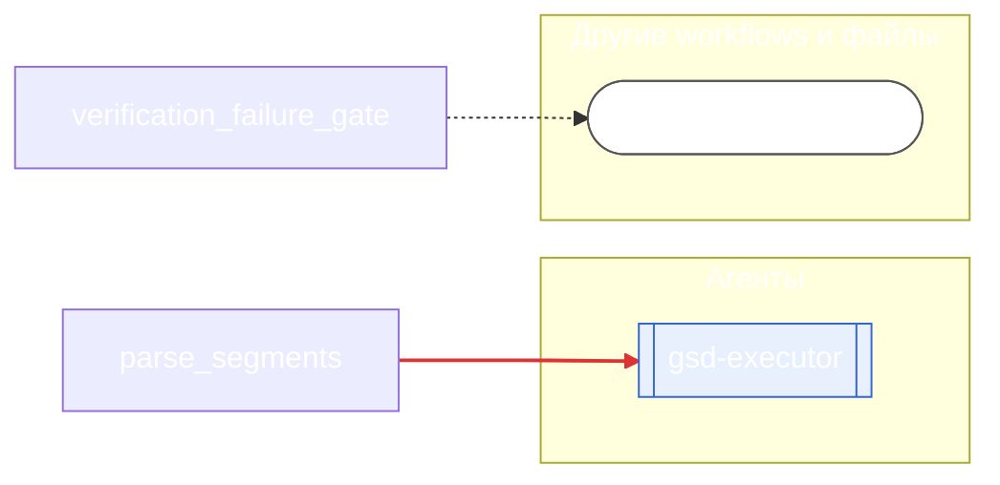

<!-- gsd:derived source=scripts/gen-workflow-maps.cjs — regenerated, do not hand-edit -->

# execute-plan

Источник: `gsd-core/workflows/execute-plan.md`. Единицы: 24 шага `<step>`. Спавнов: 1 (агенты: `gsd-executor`). Точки цикла: нет.

> **Переходы в прозе** (фразы «перейди к …»): всего 3; не называют реальный шаг и не рисуются — **3**; названы по имени шага и нарисованы пунктиром `goto` — 0.

Карта построена из разметки workflow: узел — реальный `<step>`, `gsd:section` или раздел H2; рёбра — порядок
документа, условие шага/секции на входящем ребре, переходы по имени шага. Описание обозначений —
в [README](README.md).

## Поток

```mermaid
flowchart TB
  wf_root(["execute-plan.md"]):::root
  u_step_init_context["init_context"]
  u_step_identify_plan["identify_plan"]
  u_step_record_start_time["record_start_time"]
  u_step_parse_segments["parse_segments"]
  u_step_init_agent_tracking["init_agent_tracking"]
  u_step_segment_execution["segment_execution"]
  u_step_load_prompt["load_prompt"]
  u_step_previous_phase_check["previous_phase_check"]
  u_step_execute["execute"]
  u_step_checkpoint_protocol["checkpoint_protocol"]
  u_step_checkpoint_return_for_orchestrator["checkpoint_return_for_orchestrator"]
  u_step_verification_failure_gate["verification_failure_gate"]
  u_step_record_completion_time["record_completion_time"]
  u_step_generate_user_setup["generate_user_setup"]
  u_step_create_summary["create_summary"]
  u_step_update_current_position["update_current_position"]
  u_step_extract_decisions_and_issues["extract_decisions_and_issues"]
  u_step_update_session_continuity["update_session_continuity"]
  u_step_issues_review_gate["issues_review_gate"]
  u_step_update_roadmap["update_roadmap"]
  u_step_update_requirements["update_requirements"]
  u_step_git_commit_metadata["git_commit_metadata"]
  u_step_update_codebase_map["update_codebase_map"]
  u_step_offer_next["offer_next"]
  wf_root --> u_step_init_context
  u_step_init_context --> u_step_identify_plan
  u_step_identify_plan --> u_step_record_start_time
  u_step_record_start_time --> u_step_parse_segments
  u_step_parse_segments --> u_step_init_agent_tracking
  u_step_init_agent_tracking --> u_step_segment_execution
  u_step_segment_execution --> u_step_load_prompt
  u_step_load_prompt --> u_step_previous_phase_check
  u_step_previous_phase_check --> u_step_execute
  u_step_execute --> u_step_checkpoint_protocol
  u_step_checkpoint_protocol --> u_step_checkpoint_return_for_orchestrator
  u_step_checkpoint_return_for_orchestrator --> u_step_verification_failure_gate
  u_step_verification_failure_gate --> u_step_record_completion_time
  u_step_record_completion_time --> u_step_generate_user_setup
  u_step_generate_user_setup --> u_step_create_summary
  u_step_create_summary --> u_step_update_current_position
  u_step_update_current_position --> u_step_extract_decisions_and_issues
  u_step_extract_decisions_and_issues --> u_step_update_session_continuity
  u_step_update_session_continuity --> u_step_issues_review_gate
  u_step_issues_review_gate --> u_step_update_roadmap
  u_step_update_roadmap --> u_step_update_requirements
  u_step_update_requirements --> u_step_git_commit_metadata
  u_step_git_commit_metadata --> u_step_update_codebase_map
  u_step_update_codebase_map --> u_step_offer_next
  classDef missing fill:#fdecea,stroke:#d33,stroke-dasharray:4 3
  classDef unparsed fill:#f5f5f5,stroke:#999999,stroke-dasharray:4 3,color:#555
  classDef conditional fill:#fff8e1,stroke:#b28704
  classDef root fill:#263238,color:#ffffff,stroke:#263238
  classDef agent fill:#e8f0fe,stroke:#3367d6
  classDef builtin fill:#eeeeee,stroke:#777777
  classDef capability fill:#e6f4ea,stroke:#2e7d32
  classDef dynamic fill:#f2f2f2,stroke:#888,stroke-dasharray:2 2
  classDef point fill:#f3e8fd,stroke:#8e24aa
  classDef workflow fill:#ffffff,stroke:#555555
```



## Агенты и точки цикла



## Единицы

| # | Единица | Вид | Условие | Спавны | Точки цикла | Читает |
|---|---|---|---|---|---|---|
| 1 | `init_context` | step |  |  |  |  |
| 2 | `identify_plan` | step |  |  |  |  |
| 3 | `record_start_time` | step |  |  |  |  |
| 4 | `parse_segments` | step |  | `gsd-executor` |  |  |
| 5 | `init_agent_tracking` | step |  |  |  |  |
| 6 | `segment_execution` | step |  |  |  |  |
| 7 | `load_prompt` | step |  |  |  |  |
| 8 | `previous_phase_check` | step |  |  |  |  |
| 9 | `execute` | step |  |  |  |  |
| 10 | `checkpoint_protocol` | step |  |  |  |  |
| 11 | `checkpoint_return_for_orchestrator` | step |  |  |  |  |
| 12 | `verification_failure_gate` | step |  |  |  | `node-repair.md` |
| 13 | `record_completion_time` | step |  |  |  |  |
| 14 | `generate_user_setup` | step |  |  |  |  |
| 15 | `create_summary` | step |  |  |  |  |
| 16 | `update_current_position` | step |  |  |  |  |
| 17 | `extract_decisions_and_issues` | step |  |  |  |  |
| 18 | `update_session_continuity` | step |  |  |  |  |
| 19 | `issues_review_gate` | step |  |  |  |  |
| 20 | `update_roadmap` | step |  |  |  |  |
| 21 | `update_requirements` | step |  |  |  |  |
| 22 | `git_commit_metadata` | step |  |  |  |  |
| 23 | `update_codebase_map` | step |  |  |  |  |
| 24 | `offer_next` | step |  |  |  |  |

## Дефекты

- `spawn-in-prose`: вызов Agent(… gsd-executor) (gsd-core/workflows/execute-plan.md:146) записан в прозе, а не в блоке кода (если рядом блок кода — проверьте парность ограничителей ```)
