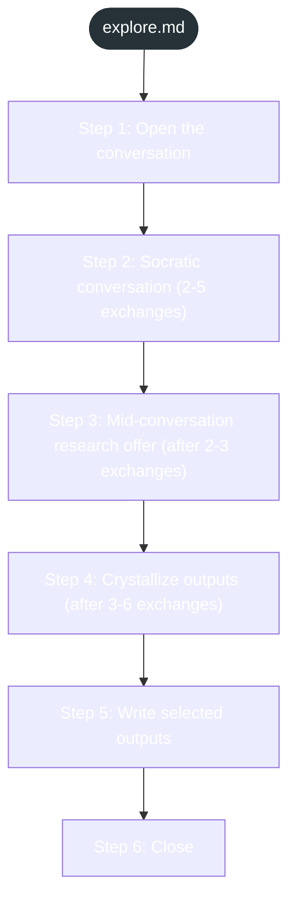
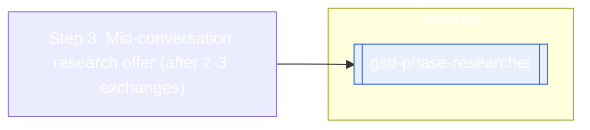

<!-- gsd:derived source=scripts/gen-workflow-maps.cjs — regenerated, do not hand-edit -->

# explore

Источник: `gsd-core/workflows/explore.md`. Единицы: 6 разделов H2. Спавнов: 1 (агенты: `gsd-phase-researcher`). Точки цикла: нет.

> **Переходы в прозе** (фразы «перейди к …»): всего 3; не называют реальный шаг и не рисуются — **3**; названы по имени шага и нарисованы пунктиром `goto` — 0.

Карта построена из разметки workflow: узел — реальный `<step>`, `gsd:section` или раздел H2; рёбра — порядок
документа, условие шага/секции на входящем ребре, переходы по имени шага. Описание обозначений —
в [README](README.md).

## Поток

## Агенты и точки цикла

## Единицы

| # | Единица | Вид | Условие | Спавны | Точки цикла | Читает |
|---|---|---|---|---|---|---|
| 1 | `Step 1: Open the conversation` | H2 |  |  |  |  |
| 2 | `Step 2: Socratic conversation (2-5 exchanges)` | H2 |  |  |  |  |
| 3 | `Step 3: Mid-conversation research offer (after 2-3 exchanges)` | H2 |  | `gsd-phase-researcher` |  |  |
| 4 | `Step 4: Crystallize outputs (after 3-6 exchanges)` | H2 |  |  |  |  |
| 5 | `Step 5: Write selected outputs` | H2 |  |  |  |  |
| 6 | `Step 6: Close` | H2 |  |  |  |  |

## Дефекты

Дефектов нет.
