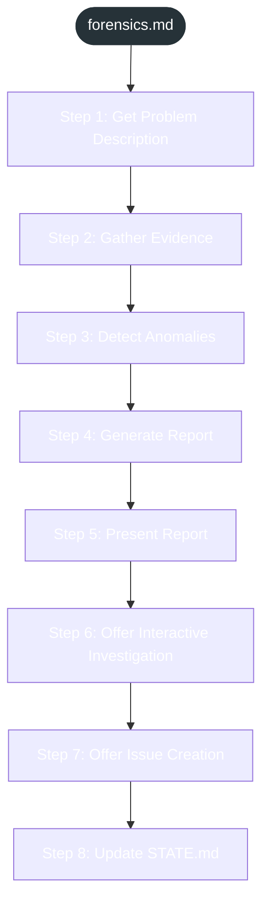

<!-- gsd:derived source=scripts/gen-workflow-maps.cjs — regenerated, do not hand-edit -->

# forensics

Источник: `gsd-core/workflows/forensics.md`. Единицы: 8 разделов H2. Спавнов: 0. Точки цикла: нет.

> **Переходы в прозе** (фразы «перейди к …»): всего 0; не называют реальный шаг и не рисуются — **0**; названы по имени шага и нарисованы пунктиром `goto` — 0.

Карта построена из разметки workflow: узел — реальный `<step>`, `gsd:section` или раздел H2; рёбра — порядок
документа, условие шага/секции на входящем ребре, переходы по имени шага. Описание обозначений —
в [README](README.md).

## Поток

## Единицы

| # | Единица | Вид | Условие | Спавны | Точки цикла | Читает |
|---|---|---|---|---|---|---|
| 1 | `Step 1: Get Problem Description` | H2 |  |  |  |  |
| 2 | `Step 2: Gather Evidence` | H2 |  |  |  |  |
| 3 | `Step 3: Detect Anomalies` | H2 |  |  |  |  |
| 4 | `Step 4: Generate Report` | H2 |  |  |  |  |
| 5 | `Step 5: Present Report` | H2 |  |  |  |  |
| 6 | `Step 6: Offer Interactive Investigation` | H2 |  |  |  |  |
| 7 | `Step 7: Offer Issue Creation` | H2 |  |  |  |  |
| 8 | `Step 8: Update STATE.md` | H2 |  |  |  |  |

## Дефекты

Дефектов нет.
