<!-- gsd:derived source=scripts/gen-workflow-maps.cjs — regenerated, do not hand-edit -->

# graduation

Источник: `gsd-core/workflows/graduation.md`. Единицы: 10 разделов H2. Спавнов: 0. Точки цикла: нет.

> **Переходы в прозе** (фразы «перейди к …»): всего 1; не называют реальный шаг и не рисуются — **0**; названы по имени шага и нарисованы пунктиром `goto` — 1.

Карта построена из разметки workflow: узел — реальный `<step>`, `gsd:section` или раздел H2; рёбра — порядок
документа, условие шага/секции на входящем ребре, переходы по имени шага. Описание обозначений —
в [README](README.md).

## Поток

```mermaid
flowchart TB
  wf_root(["graduation.md"]):::root
  u_heading_Configuration["Configuration"]
  u_heading_Step_1__Guard_Checks["Step 1#58; Guard Checks"]
  u_heading_Step_2__Collect_LEARNINGS_md_Files["Step 2#58; Collect LEARNINGS.md Files"]
  u_heading_Step_3__Cluster_by_Lexical_Similarity["Step 3#58; Cluster by Lexical Similarity"]
  u_heading_Step_4__Check_graduation_backlog_in_STATE_md["Step 4#58; Check graduation_backlog in STATE.md"]
  u_heading_Step_5__Surface_Promotion_Candidates["Step 5#58; Surface Promotion Candidates"]
  u_heading_Step_6__HITL_u2014_Process_Each_Cluster["Step 6#58; HITL — Process Each Cluster"]
  u_heading_Step_7__Completion_Report["Step 7#58; Completion Report"]
  u_heading_First_Run_Behaviour["First-Run Behaviour"]
  u_heading_No_Op_Conditions__silent_skip_["No-Op Conditions (silent skip)"]
  wf_root --> u_heading_Configuration
  u_heading_Configuration --> u_heading_Step_1__Guard_Checks
  u_heading_Step_1__Guard_Checks --> u_heading_Step_2__Collect_LEARNINGS_md_Files
  u_heading_Step_2__Collect_LEARNINGS_md_Files --> u_heading_Step_3__Cluster_by_Lexical_Similarity
  u_heading_Step_3__Cluster_by_Lexical_Similarity --> u_heading_Step_4__Check_graduation_backlog_in_STATE_md
  u_heading_Step_4__Check_graduation_backlog_in_STATE_md --> u_heading_Step_5__Surface_Promotion_Candidates
  u_heading_Step_5__Surface_Promotion_Candidates --> u_heading_Step_6__HITL_u2014_Process_Each_Cluster
  u_heading_Step_6__HITL_u2014_Process_Each_Cluster --> u_heading_Step_7__Completion_Report
  u_heading_Step_7__Completion_Report --> u_heading_First_Run_Behaviour
  u_heading_First_Run_Behaviour --> u_heading_No_Op_Conditions__silent_skip_
  u_heading_Step_6__HITL_u2014_Process_Each_Cluster -.->|"goto"| u_heading_Step_7__Completion_Report
  classDef missing fill:#fdecea,stroke:#d33,stroke-dasharray:4 3
  classDef unparsed fill:#f5f5f5,stroke:#999999,stroke-dasharray:4 3,color:#555
  classDef conditional fill:#fff8e1,stroke:#b28704
  classDef root fill:#263238,color:#ffffff,stroke:#263238
  classDef agent fill:#e8f0fe,stroke:#3367d6
  classDef builtin fill:#eeeeee,stroke:#777777
  classDef capability fill:#e6f4ea,stroke:#2e7d32
  classDef dynamic fill:#f2f2f2,stroke:#888,stroke-dasharray:2 2
  classDef point fill:#f3e8fd,stroke:#8e24aa
  classDef workflow fill:#ffffff,stroke:#555555
```

## Единицы

| # | Единица | Вид | Условие | Спавны | Точки цикла | Читает |
|---|---|---|---|---|---|---|
| 1 | `Configuration` | H2 |  |  |  |  |
| 2 | `Step 1: Guard Checks` | H2 |  |  |  |  |
| 3 | `Step 2: Collect LEARNINGS.md Files` | H2 |  |  |  |  |
| 4 | `Step 3: Cluster by Lexical Similarity` | H2 |  |  |  |  |
| 5 | `Step 4: Check graduation_backlog in STATE.md` | H2 |  |  |  |  |
| 6 | `Step 5: Surface Promotion Candidates` | H2 |  |  |  |  |
| 7 | `Step 6: HITL — Process Each Cluster` | H2 |  |  |  |  |
| 8 | `Step 7: Completion Report` | H2 |  |  |  |  |
| 9 | `First-Run Behaviour` | H2 |  |  |  |  |
| 10 | `No-Op Conditions (silent skip)` | H2 |  |  |  |  |

## Дефекты

Дефектов нет.
