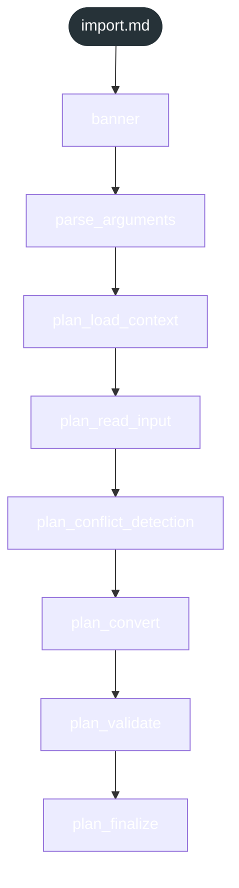
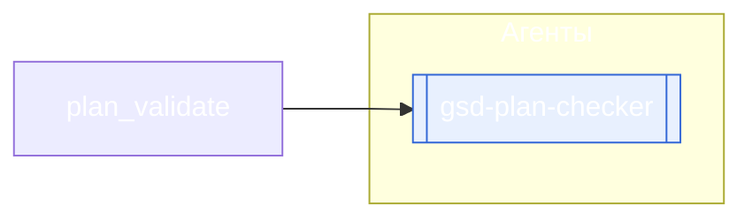

<!-- gsd:derived source=scripts/gen-workflow-maps.cjs — regenerated, do not hand-edit -->

# import

Источник: `gsd-core/workflows/import.md`. Единицы: 8 шагов `<step>`. Спавнов: 1 (агенты: `gsd-plan-checker`). Точки цикла: нет.

> **Переходы в прозе** (фразы «перейди к …»): всего 0; не называют реальный шаг и не рисуются — **0**; названы по имени шага и нарисованы пунктиром `goto` — 0.

Карта построена из разметки workflow: узел — реальный `<step>`, `gsd:section` или раздел H2; рёбра — порядок
документа, условие шага/секции на входящем ребре, переходы по имени шага. Описание обозначений —
в [README](README.md).

## Поток

## Агенты и точки цикла

## Единицы

| # | Единица | Вид | Условие | Спавны | Точки цикла | Читает |
|---|---|---|---|---|---|---|
| 1 | `banner` | step |  |  |  |  |
| 2 | `parse_arguments` | step |  |  |  |  |
| 3 | `plan_load_context` | step |  |  |  |  |
| 4 | `plan_read_input` | step |  |  |  |  |
| 5 | `plan_conflict_detection` | step |  |  |  |  |
| 6 | `plan_convert` | step |  |  |  |  |
| 7 | `plan_validate` | step |  | `gsd-plan-checker` |  |  |
| 8 | `plan_finalize` | step |  |  |  |  |

## Дефекты

Дефектов нет.
