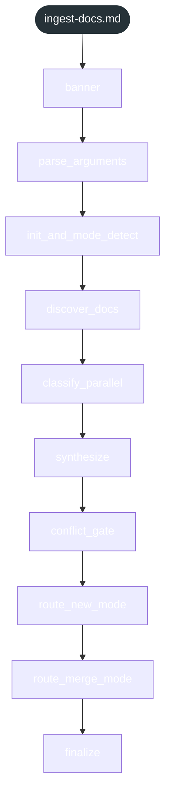
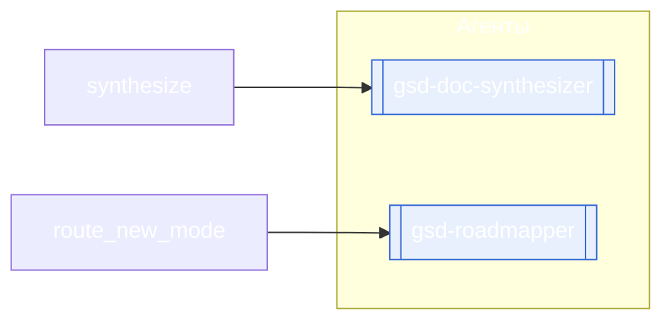

<!-- gsd:derived source=scripts/gen-workflow-maps.cjs — regenerated, do not hand-edit -->

# ingest-docs

Источник: `gsd-core/workflows/ingest-docs.md`. Единицы: 10 шагов `<step>`. Спавнов: 2 (агенты: `gsd-doc-synthesizer`, `gsd-roadmapper`). Точки цикла: нет.

> **Переходы в прозе** (фразы «перейди к …»): всего 2; не называют реальный шаг и не рисуются — **2**; названы по имени шага и нарисованы пунктиром `goto` — 0.

Карта построена из разметки workflow: узел — реальный `<step>`, `gsd:section` или раздел H2; рёбра — порядок
документа, условие шага/секции на входящем ребре, переходы по имени шага. Описание обозначений —
в [README](README.md).

## Поток

## Агенты и точки цикла

## Единицы

| # | Единица | Вид | Условие | Спавны | Точки цикла | Читает |
|---|---|---|---|---|---|---|
| 1 | `banner` | step |  |  |  |  |
| 2 | `parse_arguments` | step |  |  |  |  |
| 3 | `init_and_mode_detect` | step |  |  |  |  |
| 4 | `discover_docs` | step |  |  |  |  |
| 5 | `classify_parallel` | step |  |  |  |  |
| 6 | `synthesize` | step |  | `gsd-doc-synthesizer` |  |  |
| 7 | `conflict_gate` | step |  |  |  |  |
| 8 | `route_new_mode` | step |  | `gsd-roadmapper` |  |  |
| 9 | `route_merge_mode` | step |  |  |  |  |
| 10 | `finalize` | step |  |  |  |  |

## Дефекты

Дефектов нет.
