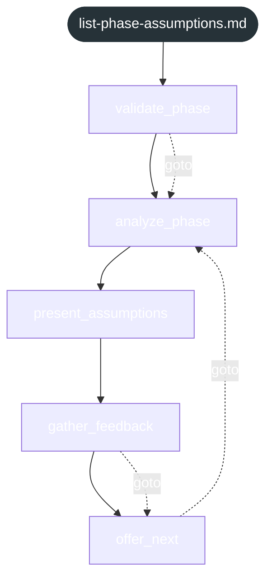

<!-- gsd:derived source=scripts/gen-workflow-maps.cjs — regenerated, do not hand-edit -->

# list-phase-assumptions

Источник: `gsd-core/workflows/list-phase-assumptions.md`. Единицы: 5 шагов `<step>`. Спавнов: 0. Точки цикла: нет.

> **Переходы в прозе** (фразы «перейди к …»): всего 3; не называют реальный шаг и не рисуются — **0**; названы по имени шага и нарисованы пунктиром `goto` — 3.

Карта построена из разметки workflow: узел — реальный `<step>`, `gsd:section` или раздел H2; рёбра — порядок
документа, условие шага/секции на входящем ребре, переходы по имени шага. Описание обозначений —
в [README](README.md).

## Поток

## Единицы

| # | Единица | Вид | Условие | Спавны | Точки цикла | Читает |
|---|---|---|---|---|---|---|
| 1 | `validate_phase` | step |  |  |  |  |
| 2 | `analyze_phase` | step |  |  |  |  |
| 3 | `present_assumptions` | step |  |  |  |  |
| 4 | `gather_feedback` | step |  |  |  |  |
| 5 | `offer_next` | step |  |  |  |  |

## Дефекты

Дефектов нет.
