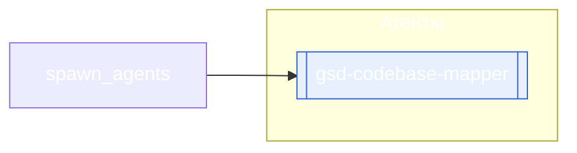

<!-- gsd:derived source=scripts/gen-workflow-maps.cjs — regenerated, do not hand-edit -->

# map-codebase

Источник: `gsd-core/workflows/map-codebase.md`. Единицы: 13 шагов `<step>`. Спавнов: 4 (агенты: `gsd-codebase-mapper`). Точки цикла: нет.

> **Переходы в прозе** (фразы «перейди к …»): всего 12; не называют реальный шаг и не рисуются — **1**; названы по имени шага и нарисованы пунктиром `goto` — 11.

Карта построена из разметки workflow: узел — реальный `<step>`, `gsd:section` или раздел H2; рёбра — порядок
документа, условие шага/секции на входящем ребре, переходы по имени шага. Описание обозначений —
в [README](README.md).

## Поток

```mermaid
flowchart TB
  wf_root(["map-codebase.md"]):::root
  u_step_parse_paths_flag["parse_paths_flag"]
  u_step_init_context["init_context"]
  u_step_check_existing["check_existing"]
  u_step_create_structure["create_structure"]
  u_step_detect_runtime_capabilities["detect_runtime_capabilities"]
  u_step_spawn_agents["spawn_agents"]:::conditional
  u_step_collect_confirmations["collect_confirmations"]
  u_step_sequential_mapping["sequential_mapping"]:::conditional
  u_step_verify_output["verify_output"]
  u_step_stamp_codebase_map["stamp_codebase_map"]
  u_step_scan_for_secrets["scan_for_secrets"]
  u_step_commit_codebase_map["commit_codebase_map"]
  u_step_offer_next["offer_next"]
  wf_root --> u_step_parse_paths_flag
  u_step_parse_paths_flag --> u_step_init_context
  u_step_init_context --> u_step_check_existing
  u_step_check_existing --> u_step_create_structure
  u_step_create_structure --> u_step_detect_runtime_capabilities
  u_step_detect_runtime_capabilities -->|"если#58; Agent tool is available"| u_step_spawn_agents
  u_step_spawn_agents --> u_step_collect_confirmations
  u_step_collect_confirmations -->|"если#58; Agent tool is NOT available (e.g. Antigravity, Codex)"| u_step_sequential_mapping
  u_step_sequential_mapping --> u_step_verify_output
  u_step_verify_output --> u_step_stamp_codebase_map
  u_step_stamp_codebase_map --> u_step_scan_for_secrets
  u_step_scan_for_secrets --> u_step_commit_codebase_map
  u_step_commit_codebase_map --> u_step_offer_next
  u_step_check_existing -.->|"goto"| u_step_create_structure
  u_step_check_existing -.->|"goto"| u_step_spawn_agents
  u_step_create_structure -.->|"goto"| u_step_spawn_agents
  u_step_spawn_agents -.->|"goto"| u_step_collect_confirmations
  u_step_collect_confirmations -.->|"goto"| u_step_verify_output
  u_step_sequential_mapping -.->|"goto"| u_step_verify_output
  u_step_verify_output -.->|"goto"| u_step_stamp_codebase_map
  u_step_stamp_codebase_map -.->|"goto"| u_step_scan_for_secrets
  u_step_scan_for_secrets -.->|"goto"| u_step_commit_codebase_map
  u_step_commit_codebase_map -.->|"goto"| u_step_offer_next
  classDef missing fill:#fdecea,stroke:#d33,stroke-dasharray:4 3
  classDef unparsed fill:#f2f2f2,stroke:#888,stroke-dasharray:4 3
  classDef conditional fill:#fff8e1,stroke:#b28704
  classDef root fill:#263238,color:#ffffff,stroke:#263238
  classDef agent fill:#e8f0fe,stroke:#3367d6
  classDef builtin fill:#eeeeee,stroke:#777777
  classDef capability fill:#e6f4ea,stroke:#2e7d32
  classDef dynamic fill:#f2f2f2,stroke:#888,stroke-dasharray:2 2
  classDef point fill:#f3e8fd,stroke:#8e24aa
  classDef workflow fill:#ffffff,stroke:#555555
```

## Агенты и точки цикла

## Единицы

| # | Единица | Вид | Условие | Спавны | Точки цикла | Читает |
|---|---|---|---|---|---|---|
| 1 | `parse_paths_flag` | step |  |  |  |  |
| 2 | `init_context` | step |  |  |  |  |
| 3 | `check_existing` | step |  |  |  |  |
| 4 | `create_structure` | step |  |  |  |  |
| 5 | `detect_runtime_capabilities` | step |  |  |  |  |
| 6 | `spawn_agents` | step | если: Agent tool is available | `gsd-codebase-mapper` |  |  |
| 7 | `collect_confirmations` | step |  |  |  |  |
| 8 | `sequential_mapping` | step | если: Agent tool is NOT available (e.g. Antigravity, Codex) |  |  |  |
| 9 | `verify_output` | step |  |  |  |  |
| 10 | `stamp_codebase_map` | step |  |  |  |  |
| 11 | `scan_for_secrets` | step |  |  |  |  |
| 12 | `commit_codebase_map` | step |  |  |  |  |
| 13 | `offer_next` | step |  |  |  |  |

## Дефекты

Дефектов нет.
