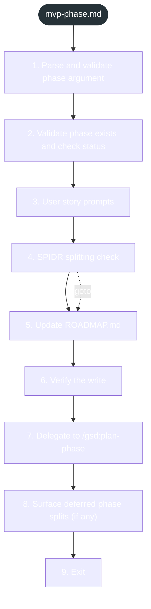

<!-- gsd:derived source=scripts/gen-workflow-maps.cjs — regenerated, do not hand-edit -->

# mvp-phase

Источник: `gsd-core/workflows/mvp-phase.md`. Единицы: 9 разделов H2. Спавнов: 0. Точки цикла: нет.

> **Переходы в прозе** (фразы «перейди к …»): всего 4; не называют реальный шаг и не рисуются — **2**; названы по имени шага и нарисованы пунктиром `goto` — 2.

Карта построена из разметки workflow: узел — реальный `<step>`, `gsd:section` или раздел H2; рёбра — порядок
документа, условие шага/секции на входящем ребре, переходы по имени шага. Описание обозначений —
в [README](README.md).

## Поток

## Единицы

| # | Единица | Вид | Условие | Спавны | Точки цикла | Читает |
|---|---|---|---|---|---|---|
| 1 | `1. Parse and validate phase argument` | H2 |  |  |  |  |
| 2 | `2. Validate phase exists and check status` | H2 |  |  |  |  |
| 3 | `3. User story prompts` | H2 |  |  |  |  |
| 4 | `4. SPIDR splitting check` | H2 |  |  |  |  |
| 5 | `5. Update ROADMAP.md` | H2 |  |  |  |  |
| 6 | `6. Verify the write` | H2 |  |  |  |  |
| 7 | `7. Delegate to /gsd:plan-phase` | H2 |  |  |  |  |
| 8 | `8. Surface deferred phase splits (if any)` | H2 |  |  |  |  |
| 9 | `9. Exit` | H2 |  |  |  |  |

## Дефекты

Дефектов нет.
