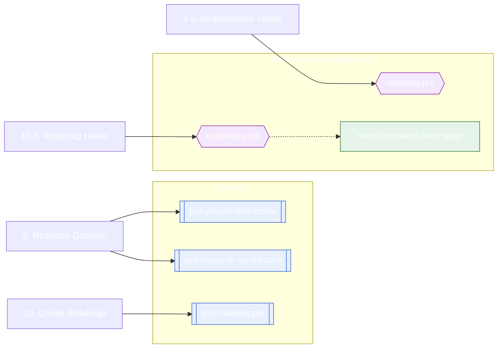

<!-- gsd:derived source=scripts/gen-workflow-maps.cjs — regenerated, do not hand-edit -->

# new-milestone

Источник: `gsd-core/workflows/new-milestone.md`. Единицы: 17 разделов H2, 2 секции `gsd:section`. Спавнов: 3 (агенты: `gsd-project-researcher`, `gsd-research-synthesizer`, `gsd-roadmapper`). Точки цикла: `roadmap:pre`, `roadmap:post`.

> **Переходы в прозе** (фразы «перейди к …»): всего 4; не называют реальный шаг и не рисуются — **2**; названы по имени шага и нарисованы пунктиром `goto` — 2.

Карта построена из разметки workflow: узел — реальный `<step>`, `gsd:section` или раздел H2; рёбра — порядок
документа, условие шага/секции на входящем ребре, переходы по имени шага. Описание обозначений —
в [README](README.md).

## Поток

```mermaid
flowchart TB
  subgraph g_1["1. Load Context"]
    u_heading_1__Load_Context["1. Load Context"]
  end
  subgraph g_2["2. Gather Milestone Goals"]
    u_heading_2__Gather_Milestone_Goals["2. Gather Milestone Goals"]
    u_heading_2_5__Scan_Planted_Seeds["2.5. Scan Planted Seeds"]
    u_heading_2_7__Inherit_From_the_Previous_Milestone["2.7. Inherit From the Previous Milestone"]
  end
  subgraph g_3["3. Determine Milestone Version"]
    u_heading_3__Determine_Milestone_Version["3. Determine Milestone Version"]
    u_heading_3_5__Verify_Milestone_Understanding["3.5. Verify Milestone Understanding"]
  end
  subgraph g_4["4. Update PROJECT.md"]
    u_heading_4__Update_PROJECT_md["4. Update PROJECT.md"]
    u_section_project_md_milestone_write("§ project-md-milestone-write"):::conditional
  end
  subgraph g_5["5. Update STATE.md"]
    u_heading_5__Update_STATE_md["5. Update STATE.md"]
  end
  subgraph g_6["6. Cleanup and Commit"]
    u_heading_6__Cleanup_and_Commit["6. Cleanup and Commit"]
  end
  subgraph g_7["7. Load Context and Resolve Models"]
    u_heading_7__Load_Context_and_Resolve_Models["7. Load Context and Resolve Models"]
    u_section_reset_phase_safety("§ reset-phase-safety"):::conditional
  end
  subgraph g_8["8. Research Decision"]
    u_heading_8__Research_Decision["8. Research Decision"]
  end
  subgraph g_9["9. Define Requirements"]
    u_heading_9__Define_Requirements["9. Define Requirements"]
    u_heading_9_5__Requirements_Hooks["9.5. Requirements Hooks"]
  end
  subgraph g_10["10. Create Roadmap"]
    u_heading_10__Create_Roadmap["10. Create Roadmap"]
    u_heading_10_5__Link_Pending_Todos_to_Roadmap_Phases["10.5. Link Pending Todos to Roadmap Phases"]
    u_heading_10_6__Roadmap_Hooks["10.6. Roadmap Hooks"]
  end
  subgraph g_11["11. Done"]
    u_heading_11__Done["11. Done"]
  end
  wf_root(["new-milestone.md"]):::root
  wf_root --> u_heading_1__Load_Context
  u_heading_1__Load_Context --> u_heading_2__Gather_Milestone_Goals
  u_heading_2__Gather_Milestone_Goals --> u_heading_2_5__Scan_Planted_Seeds
  u_heading_2_5__Scan_Planted_Seeds --> u_heading_2_7__Inherit_From_the_Previous_Milestone
  u_heading_2_7__Inherit_From_the_Previous_Milestone --> u_heading_3__Determine_Milestone_Version
  u_heading_3__Determine_Milestone_Version --> u_heading_3_5__Verify_Milestone_Understanding
  u_heading_3_5__Verify_Milestone_Understanding --> u_heading_4__Update_PROJECT_md
  u_heading_4__Update_PROJECT_md -->|"when#58; state#58;flat-mode"| u_section_project_md_milestone_write
  u_section_project_md_milestone_write --> u_heading_5__Update_STATE_md
  u_heading_5__Update_STATE_md --> u_heading_6__Cleanup_and_Commit
  u_heading_6__Cleanup_and_Commit --> u_heading_7__Load_Context_and_Resolve_Models
  u_heading_7__Load_Context_and_Resolve_Models -->|"when#58; flag#58;#45;#45;reset-phase-numbers"| u_section_reset_phase_safety
  u_section_reset_phase_safety --> u_heading_8__Research_Decision
  u_heading_8__Research_Decision --> u_heading_9__Define_Requirements
  u_heading_9__Define_Requirements --> u_heading_9_5__Requirements_Hooks
  u_heading_9_5__Requirements_Hooks --> u_heading_10__Create_Roadmap
  u_heading_10__Create_Roadmap --> u_heading_10_5__Link_Pending_Todos_to_Roadmap_Phases
  u_heading_10_5__Link_Pending_Todos_to_Roadmap_Phases --> u_heading_10_6__Roadmap_Hooks
  u_heading_10_6__Roadmap_Hooks --> u_heading_11__Done
  u_heading_3_5__Verify_Milestone_Understanding -.->|"goto"| u_heading_4__Update_PROJECT_md
  u_heading_8__Research_Decision -.->|"goto"| u_heading_9__Define_Requirements
  classDef missing fill:#fdecea,stroke:#d33,stroke-dasharray:4 3
  classDef unparsed fill:#f5f5f5,stroke:#999999,stroke-dasharray:4 3,color:#555
  classDef conditional fill:#fff8e1,stroke:#b28704
  classDef root fill:#263238,color:#ffffff,stroke:#263238
  classDef agent fill:#e8f0fe,stroke:#3367d6
  classDef builtin fill:#eeeeee,stroke:#777777
  classDef capability fill:#e6f4ea,stroke:#2e7d32
  classDef dynamic fill:#f2f2f2,stroke:#888,stroke-dasharray:2 2
  classDef point fill:#f3e8fd,stroke:#8e24aa
  classDef workflow fill:#ffffff,stroke:#555555
```

## Агенты и точки цикла

## Единицы

| # | Единица | Вид | Условие | Спавны | Точки цикла | Читает |
|---|---|---|---|---|---|---|
| 1 | `1. Load Context` | H2 |  |  |  |  |
| 2 | `2. Gather Milestone Goals` | H2 |  |  |  |  |
| 3 | `2.5. Scan Planted Seeds` | H2 |  |  |  |  |
| 4 | `2.7. Inherit From the Previous Milestone` | H2 |  |  |  |  |
| 5 | `3. Determine Milestone Version` | H2 |  |  |  |  |
| 6 | `3.5. Verify Milestone Understanding` | H2 |  |  |  |  |
| 7 | `4. Update PROJECT.md` | H2 |  |  |  | `new-milestone/steps/project-md-milestone-write.md` |
| 8 | `project-md-milestone-write` | section | when: state:flat-mode |  |  | `new-milestone/steps/project-md-milestone-write.md` |
| 9 | `5. Update STATE.md` | H2 |  |  |  |  |
| 10 | `6. Cleanup and Commit` | H2 |  |  |  |  |
| 11 | `7. Load Context and Resolve Models` | H2 |  |  |  | `new-milestone/steps/reset-phase-safety.md` |
| 12 | `reset-phase-safety` | section | when: flag:--reset-phase-numbers |  |  | `new-milestone/steps/reset-phase-safety.md` |
| 13 | `8. Research Decision` | H2 |  | `gsd-project-researcher`, `gsd-research-synthesizer` |  |  |
| 14 | `9. Define Requirements` | H2 |  |  |  |  |
| 15 | `9.5. Requirements Hooks` | H2 |  |  | `roadmap:pre` |  |
| 16 | `10. Create Roadmap` | H2 |  | `gsd-roadmapper` |  |  |
| 17 | `10.5. Link Pending Todos to Roadmap Phases` | H2 |  |  |  |  |
| 18 | `10.6. Roadmap Hooks` | H2 |  |  | `roadmap:post` |  |
| 19 | `11. Done` | H2 |  |  |  |  |

## Дефекты

Дефектов нет.
