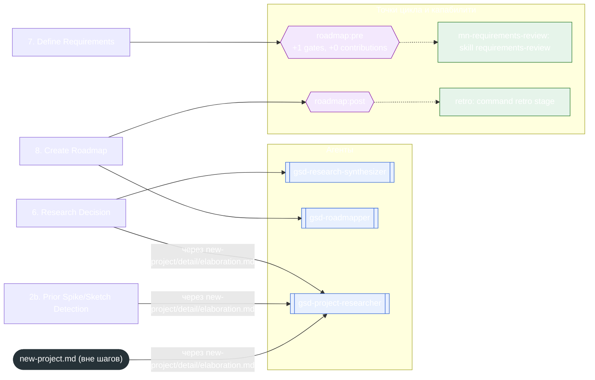

<!-- gsd:derived source=scripts/gen-workflow-maps.cjs — regenerated, do not hand-edit -->

# new-project

Источник: `gsd-core/workflows/new-project.md`. Единицы: 13 разделов H2, 3 секции `gsd:section`. Спавнов: 15 (агенты: `gsd-research-synthesizer`, `gsd-roadmapper`, `gsd-project-researcher`). Точки цикла: `roadmap:pre`, `roadmap:post`.

> **Переходы в прозе** (фразы «перейди к …»): всего 10; не называют реальный шаг и не рисуются — **5**; названы по имени шага и нарисованы пунктиром `goto` — 5.

Карта построена из разметки workflow: узел — реальный `<step>`, `gsd:section` или раздел H2; рёбра — порядок
документа, условие шага/секции на входящем ребре, переходы по имени шага. Описание обозначений —
в [README](README.md).

## Поток

```mermaid
flowchart TB
  subgraph g_1["auto-mode-detection"]
    u_section_auto_mode_detection("§ auto-mode-detection"):::conditional
  end
  subgraph g_2["1. Setup"]
    u_heading_1__Setup["1. Setup"]
  end
  subgraph g_3["2. Brownfield Offer"]
    u_heading_2__Brownfield_Offer["2. Brownfield Offer"]
    u_section_codebase_map_offer("§ codebase-map-offer"):::conditional
    u_section_auto_mode_config("§ auto-mode-config"):::conditional
    u_heading_2b__Prior_Spike_Sketch_Detection["2b. Prior Spike/Sketch Detection"]
  end
  subgraph g_4["3. Deep Questioning"]
    u_heading_3__Deep_Questioning["3. Deep Questioning"]
  end
  subgraph g_5["4. Write PROJECT.md"]
    u_heading_4__Write_PROJECT_md["4. Write PROJECT.md"]
  end
  subgraph g_6["5. Workflow Preferences"]
    u_heading_5__Workflow_Preferences["5. Workflow Preferences"]
    u_heading_5_1__Sub_Repo_Detection["5.1. Sub-Repo Detection"]
    u_heading_5_5__Resolve_Model_Profile["5.5. Resolve Model Profile"]
  end
  subgraph g_7["6. Research Decision"]
    u_heading_6__Research_Decision["6. Research Decision"]
  end
  subgraph g_8["7. Define Requirements"]
    u_heading_7__Define_Requirements["7. Define Requirements"]
    u_heading_7_5__Project_Structure_Mode["7.5. Project Structure Mode"]
  end
  subgraph g_9["8. Create Roadmap"]
    u_heading_8__Create_Roadmap["8. Create Roadmap"]
  end
  subgraph g_10["9. Done"]
    u_heading_9__Done["9. Done"]
  end
  wf_root(["new-project.md"]):::root
  wf_root -->|"when#58; flag#58;#45;#45;auto"| u_section_auto_mode_detection
  u_section_auto_mode_detection --> u_heading_1__Setup
  u_heading_1__Setup --> u_heading_2__Brownfield_Offer
  u_heading_2__Brownfield_Offer -->|"when#58; state#58;needs-codebase-map"| u_section_codebase_map_offer
  u_section_codebase_map_offer -->|"when#58; flag#58;#45;#45;auto"| u_section_auto_mode_config
  u_section_auto_mode_config --> u_heading_2b__Prior_Spike_Sketch_Detection
  u_heading_2b__Prior_Spike_Sketch_Detection --> u_heading_3__Deep_Questioning
  u_heading_3__Deep_Questioning --> u_heading_4__Write_PROJECT_md
  u_heading_4__Write_PROJECT_md --> u_heading_5__Workflow_Preferences
  u_heading_5__Workflow_Preferences --> u_heading_5_1__Sub_Repo_Detection
  u_heading_5_1__Sub_Repo_Detection --> u_heading_5_5__Resolve_Model_Profile
  u_heading_5_5__Resolve_Model_Profile --> u_heading_6__Research_Decision
  u_heading_6__Research_Decision --> u_heading_7__Define_Requirements
  u_heading_7__Define_Requirements --> u_heading_7_5__Project_Structure_Mode
  u_heading_7_5__Project_Structure_Mode --> u_heading_8__Create_Roadmap
  u_heading_8__Create_Roadmap --> u_heading_9__Done
  u_heading_2__Brownfield_Offer -.->|"goto"| u_heading_4__Write_PROJECT_md
  u_heading_2__Brownfield_Offer -.->|"goto"| u_heading_3__Deep_Questioning
  u_heading_3__Deep_Questioning -.->|"goto"| u_heading_4__Write_PROJECT_md
  u_heading_5__Workflow_Preferences -.->|"goto"| u_heading_5_5__Resolve_Model_Profile
  u_heading_6__Research_Decision -.->|"goto"| u_heading_7__Define_Requirements
  classDef missing fill:#fdecea,stroke:#d33,stroke-dasharray:4 3
  classDef unparsed fill:#f5f5f5,stroke:#999999,stroke-dasharray:4 3,color:#555
  classDef conditional fill:#fff8e1,stroke:#b28704
  classDef root fill:#263238,color:#ffffff,stroke:#263238
  classDef agent fill:#e8f0fe,stroke:#3367d6
  classDef builtin fill:#eeeeee,stroke:#777777
  classDef capability fill:#e6f4ea,stroke:#2e7d32
  classDef dynamic fill:#f2f2f2,stroke:#888,stroke-dasharray:2 2
  classDef point fill:#f3e8fd,stroke:#8e24aa
  classDef workflow fill:#ffffff,stroke:#555555
```

## Агенты и точки цикла

## Единицы

| # | Единица | Вид | Условие | Спавны | Точки цикла | Читает |
|---|---|---|---|---|---|---|
| — | (вне единиц) | — | — | `gsd-project-researcher` |  | `new-project/steps/auto-mode-detection.md`, `new-project/detail/elaboration.md` |
| 1 | `auto-mode-detection` | section | when: flag:--auto |  |  | `new-project/steps/auto-mode-detection.md` |
| 2 | `1. Setup` | H2 |  |  |  |  |
| 3 | `2. Brownfield Offer` | H2 |  |  |  | `new-project/steps/codebase-map-offer.md`, `new-project/steps/auto-mode-config.md` |
| 4 | `codebase-map-offer` | section | when: state:needs-codebase-map |  |  | `new-project/steps/codebase-map-offer.md` |
| 5 | `auto-mode-config` | section | when: flag:--auto |  |  | `new-project/steps/auto-mode-config.md` |
| 6 | `2b. Prior Spike/Sketch Detection` | H2 |  | `gsd-project-researcher` |  | `new-project/detail/elaboration.md` |
| 7 | `3. Deep Questioning` | H2 |  |  |  |  |
| 8 | `4. Write PROJECT.md` | H2 |  |  |  |  |
| 9 | `5. Workflow Preferences` | H2 |  |  |  |  |
| 10 | `5.1. Sub-Repo Detection` | H2 |  |  |  |  |
| 11 | `5.5. Resolve Model Profile` | H2 |  |  |  |  |
| 12 | `6. Research Decision` | H2 |  | `gsd-research-synthesizer`, `gsd-project-researcher` |  | `new-project/detail/elaboration.md` |
| 13 | `7. Define Requirements` | H2 |  |  | `roadmap:pre` |  |
| 14 | `7.5. Project Structure Mode` | H2 |  |  |  |  |
| 15 | `8. Create Roadmap` | H2 |  | `gsd-roadmapper` | `roadmap:post` |  |
| 16 | `9. Done` | H2 |  |  |  |  |

## Дефекты

Дефектов нет.
