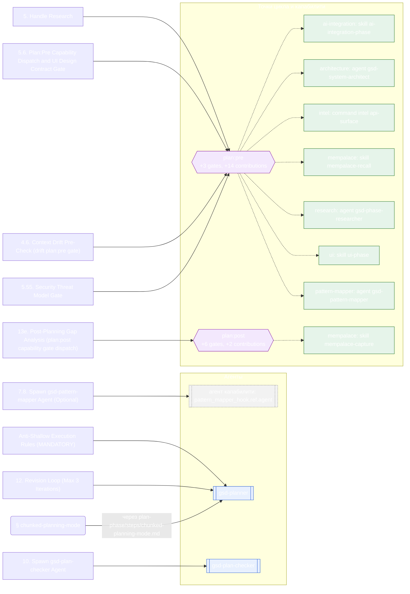

<!-- gsd:derived source=scripts/gen-workflow-maps.cjs — regenerated, do not hand-edit -->

# plan-phase

Источник: `gsd-core/workflows/plan-phase.md`. Единицы: 41 раздел H2, 6 секций `gsd:section`. Спавнов: 10 (агенты: `gsd-planner`, `gsd-plan-checker`). Точки цикла: `plan:pre`, `plan:post`.

> **Переходы в прозе** (фразы «перейди к …»): всего 45; не называют реальный шаг и не рисуются — **9**; названы по имени шага и нарисованы пунктиром `goto` — 36.

Карта построена из разметки workflow: узел — реальный `<step>`, `gsd:section` или раздел H2; рёбра — порядок
документа, условие шага/секции на входящем ребре, переходы по имени шага. Описание обозначений —
в [README](README.md).

## Поток

```mermaid
flowchart TB
  subgraph g_1["0. Git Branch Invariant"]
    u_heading_0__Git_Branch_Invariant["0. Git Branch Invariant"]
    u_heading_0_5__Compact_Content_Gate["0.5. Compact Content Gate"]
  end
  subgraph g_2["1. Initialize"]
    u_heading_1__Initialize["1. Initialize"]
    u_heading_1_5__Closed_Phase_Gate___3569_["1.5. Closed-Phase Gate (#35;3569)"]
  end
  subgraph g_3["2. Parse and Normalize Arguments"]
    u_heading_2__Parse_and_Normalize_Arguments["2. Parse and Normalize Arguments"]
    u_section_reviews_prerequisite("§ reviews-prerequisite"):::conditional
  end
  subgraph g_4["3. Validate Phase"]
    u_heading_3__Validate_Phase["3. Validate Phase"]
    u_section_prd_express_gate("§ prd-express-gate"):::conditional
    u_section_adr_ingest_express_path("§ adr-ingest-express-path"):::conditional
  end
  subgraph g_5["4. Load CONTEXT.md"]
    u_heading_4__Load_CONTEXT_md["4. Load CONTEXT.md"]
    u_heading_4_5__Resolve_AI_SPEC_Artifact["4.5. Resolve AI-SPEC Artifact"]
    u_heading_4_6__Context_Drift_Pre_Check__drift_plan_pre_gate_["4.6. Context Drift Pre-Check (drift plan#58;pre gate)"]
  end
  subgraph g_6["5. Handle Research"]
    u_heading_5__Handle_Research["5. Handle Research"]
    u_section_research_only_modifiers("§ research-only-modifiers"):::conditional
    u_section_research_only_early_exit("§ research-only-early-exit"):::conditional
    u_heading_5_5__Create_Validation_Strategy["5.5. Create Validation Strategy"]
    u_heading_5_55__Security_Threat_Model_Gate["5.55. Security Threat Model Gate"]
    u_heading_5_6__Plan_Pre_Capability_Dispatch_and_UI_Design_Contract_Gate["5.6. Plan#58;Pre Capability Dispatch and UI Design Contract Gate"]
    u_heading_5_65__Codebase_Map_Freshness_Pre_Check__drift_plan_pre_gate_["5.65. Codebase Map Freshness Pre-Check (drift plan#58;pre gate)"]
  end
  subgraph g_7["6. Check Existing Plans"]
    u_heading_6__Check_Existing_Plans["6. Check Existing Plans"]
  end
  subgraph g_8["7. Use Context Paths from INIT"]
    u_heading_7__Use_Context_Paths_from_INIT["7. Use Context Paths from INIT"]
    u_heading_7_5__Verify_Nyquist_Artifacts["7.5. Verify Nyquist Artifacts"]
    u_heading_7_8__Spawn_gsd_pattern_mapper_Agent__Optional_["7.8. Spawn gsd-pattern-mapper Agent (Optional)"]
    u_heading_7_9__Regenerate_API_SURFACE_md__intel_gate_["7.9. Regenerate API-SURFACE.md (intel gate)"]
    u_heading_7_95__Spec_less_Probe_Fallback__gate_["7.95. Spec-less Probe Fallback (gate)"]
    u_heading_7_99__Bounded_Stall_Detection_Helpers___2650_["7.99. Bounded Stall-Detection Helpers (#35;2650)"]
  end
  subgraph g_9["8. Spawn gsd-planner Agent"]
    u_heading_8__Spawn_gsd_planner_Agent["8. Spawn gsd-planner Agent"]
    u_heading_Anti_Shallow_Execution_Rules__MANDATORY_["Anti-Shallow Execution Rules (MANDATORY)"]
    u_section_chunked_planning_mode("§ chunked-planning-mode"):::conditional
  end
  subgraph g_10["9. Handle Planner Return"]
    u_heading_9__Handle_Planner_Return["9. Handle Planner Return"]
    u_heading_9a__Filesystem_Fallback__Planner_["9a. Filesystem Fallback (Planner)"]
    u_heading_9b__Handle_Phase_Split_Recommendation["9b. Handle Phase Split Recommendation"]
    u_heading_9c__Handle_Source_Audit_Gaps["9c. Handle Source Audit Gaps"]
  end
  subgraph g_11["10. Spawn gsd-plan-checker Agent"]
    u_heading_10__Spawn_gsd_plan_checker_Agent["10. Spawn gsd-plan-checker Agent"]
  end
  subgraph g_12["11. Handle Checker Return"]
    u_heading_11__Handle_Checker_Return["11. Handle Checker Return"]
    u_heading_11a__Filesystem_Fallback__Checker_["11a. Filesystem Fallback (Checker)"]
    u_heading_11b__Refute_Findings__conditional_["11b. Refute Findings (conditional)"]
  end
  subgraph g_13["12. Revision Loop (Max 3 Iterations)"]
    u_heading_12__Revision_Loop__Max_3_Iterations_["12. Revision Loop (Max 3 Iterations)"]
    u_heading_12_5__Plan_Bounce__Optional_External_Refinement_["12.5. Plan Bounce (Optional External Refinement)"]
  end
  subgraph g_14["13. Requirements Coverage Gate"]
    u_heading_13__Requirements_Coverage_Gate["13. Requirements Coverage Gate"]
    u_heading_13a__Decision_Coverage_Gate["13a. Decision Coverage Gate"]
    u_heading_13b__Record_Planning_Completion_in_STATE_md["13b. Record Planning Completion in STATE.md"]
    u_heading_13c__Annotate_ROADMAP_with_Wave_Dependencies_and_Cross_cutting_Constraints["13c. Annotate ROADMAP with Wave Dependencies and Cross-cutting Constraints"]
    u_heading_13d__Commit_Plans_if_commit_docs_is_true["13d. Commit Plans if commit_docs is true"]
    u_heading_13e__Post_Planning_Gap_Analysis__plan_post_capability_gate_dispatch_["13e. Post-Planning Gap Analysis (plan#58;post capability gate dispatch)"]
  end
  subgraph g_15["14. Present Final Status"]
    u_heading_14__Present_Final_Status["14. Present Final Status"]
  end
  subgraph g_16["15. Auto-Advance Check"]
    u_heading_15__Auto_Advance_Check["15. Auto-Advance Check"]
  end
  wf_root(["plan-phase.md"]):::root
  wf_root --> u_heading_0__Git_Branch_Invariant
  u_heading_0__Git_Branch_Invariant --> u_heading_0_5__Compact_Content_Gate
  u_heading_0_5__Compact_Content_Gate --> u_heading_1__Initialize
  u_heading_1__Initialize --> u_heading_1_5__Closed_Phase_Gate___3569_
  u_heading_1_5__Closed_Phase_Gate___3569_ --> u_heading_2__Parse_and_Normalize_Arguments
  u_heading_2__Parse_and_Normalize_Arguments -->|"when#58; flag#58;#45;#45;reviews"| u_section_reviews_prerequisite
  u_section_reviews_prerequisite --> u_heading_3__Validate_Phase
  u_heading_3__Validate_Phase -->|"when#58; flag#58;#45;#45;prd"| u_section_prd_express_gate
  u_section_prd_express_gate -->|"when#58; flag#58;#45;#45;ingest"| u_section_adr_ingest_express_path
  u_section_adr_ingest_express_path --> u_heading_4__Load_CONTEXT_md
  u_heading_4__Load_CONTEXT_md --> u_heading_4_5__Resolve_AI_SPEC_Artifact
  u_heading_4_5__Resolve_AI_SPEC_Artifact --> u_heading_4_6__Context_Drift_Pre_Check__drift_plan_pre_gate_
  u_heading_4_6__Context_Drift_Pre_Check__drift_plan_pre_gate_ --> u_heading_5__Handle_Research
  u_heading_5__Handle_Research -->|"when#58; flag#58;#45;#45;research-phase"| u_section_research_only_modifiers
  u_section_research_only_modifiers -->|"when#58; flag#58;#45;#45;research-phase"| u_section_research_only_early_exit
  u_section_research_only_early_exit --> u_heading_5_5__Create_Validation_Strategy
  u_heading_5_5__Create_Validation_Strategy --> u_heading_5_55__Security_Threat_Model_Gate
  u_heading_5_55__Security_Threat_Model_Gate --> u_heading_5_6__Plan_Pre_Capability_Dispatch_and_UI_Design_Contract_Gate
  u_heading_5_6__Plan_Pre_Capability_Dispatch_and_UI_Design_Contract_Gate --> u_heading_5_65__Codebase_Map_Freshness_Pre_Check__drift_plan_pre_gate_
  u_heading_5_65__Codebase_Map_Freshness_Pre_Check__drift_plan_pre_gate_ --> u_heading_6__Check_Existing_Plans
  u_heading_6__Check_Existing_Plans --> u_heading_7__Use_Context_Paths_from_INIT
  u_heading_7__Use_Context_Paths_from_INIT --> u_heading_7_5__Verify_Nyquist_Artifacts
  u_heading_7_5__Verify_Nyquist_Artifacts --> u_heading_7_8__Spawn_gsd_pattern_mapper_Agent__Optional_
  u_heading_7_8__Spawn_gsd_pattern_mapper_Agent__Optional_ --> u_heading_7_9__Regenerate_API_SURFACE_md__intel_gate_
  u_heading_7_9__Regenerate_API_SURFACE_md__intel_gate_ --> u_heading_7_95__Spec_less_Probe_Fallback__gate_
  u_heading_7_95__Spec_less_Probe_Fallback__gate_ --> u_heading_7_99__Bounded_Stall_Detection_Helpers___2650_
  u_heading_7_99__Bounded_Stall_Detection_Helpers___2650_ --> u_heading_8__Spawn_gsd_planner_Agent
  u_heading_8__Spawn_gsd_planner_Agent --> u_heading_Anti_Shallow_Execution_Rules__MANDATORY_
  u_heading_Anti_Shallow_Execution_Rules__MANDATORY_ -->|"when#58; state#58;chunked-mode"| u_section_chunked_planning_mode
  u_section_chunked_planning_mode --> u_heading_9__Handle_Planner_Return
  u_heading_9__Handle_Planner_Return --> u_heading_9a__Filesystem_Fallback__Planner_
  u_heading_9a__Filesystem_Fallback__Planner_ --> u_heading_9b__Handle_Phase_Split_Recommendation
  u_heading_9b__Handle_Phase_Split_Recommendation --> u_heading_9c__Handle_Source_Audit_Gaps
  u_heading_9c__Handle_Source_Audit_Gaps --> u_heading_10__Spawn_gsd_plan_checker_Agent
  u_heading_10__Spawn_gsd_plan_checker_Agent --> u_heading_11__Handle_Checker_Return
  u_heading_11__Handle_Checker_Return --> u_heading_11a__Filesystem_Fallback__Checker_
  u_heading_11a__Filesystem_Fallback__Checker_ --> u_heading_11b__Refute_Findings__conditional_
  u_heading_11b__Refute_Findings__conditional_ --> u_heading_12__Revision_Loop__Max_3_Iterations_
  u_heading_12__Revision_Loop__Max_3_Iterations_ --> u_heading_12_5__Plan_Bounce__Optional_External_Refinement_
  u_heading_12_5__Plan_Bounce__Optional_External_Refinement_ --> u_heading_13__Requirements_Coverage_Gate
  u_heading_13__Requirements_Coverage_Gate --> u_heading_13a__Decision_Coverage_Gate
  u_heading_13a__Decision_Coverage_Gate --> u_heading_13b__Record_Planning_Completion_in_STATE_md
  u_heading_13b__Record_Planning_Completion_in_STATE_md --> u_heading_13c__Annotate_ROADMAP_with_Wave_Dependencies_and_Cross_cutting_Constraints
  u_heading_13c__Annotate_ROADMAP_with_Wave_Dependencies_and_Cross_cutting_Constraints --> u_heading_13d__Commit_Plans_if_commit_docs_is_true
  u_heading_13d__Commit_Plans_if_commit_docs_is_true --> u_heading_13e__Post_Planning_Gap_Analysis__plan_post_capability_gate_dispatch_
  u_heading_13e__Post_Planning_Gap_Analysis__plan_post_capability_gate_dispatch_ --> u_heading_14__Present_Final_Status
  u_heading_14__Present_Final_Status --> u_heading_15__Auto_Advance_Check
  u_heading_4__Load_CONTEXT_md -.->|"goto"| u_heading_5__Handle_Research
  u_heading_5__Handle_Research -.->|"goto"| u_heading_6__Check_Existing_Plans
  u_heading_5_5__Create_Validation_Strategy -.->|"goto"| u_heading_6__Check_Existing_Plans
  u_heading_5_55__Security_Threat_Model_Gate -.->|"goto"| u_heading_5_6__Plan_Pre_Capability_Dispatch_and_UI_Design_Contract_Gate
  u_heading_5_6__Plan_Pre_Capability_Dispatch_and_UI_Design_Contract_Gate -.->|"goto"| u_heading_6__Check_Existing_Plans
  u_heading_5_65__Codebase_Map_Freshness_Pre_Check__drift_plan_pre_gate_ -.->|"goto"| u_heading_6__Check_Existing_Plans
  u_heading_7_5__Verify_Nyquist_Artifacts -.->|"goto"| u_heading_7_8__Spawn_gsd_pattern_mapper_Agent__Optional_
  u_heading_7_8__Spawn_gsd_pattern_mapper_Agent__Optional_ -.->|"goto"| u_heading_8__Spawn_gsd_planner_Agent
  u_heading_7_9__Regenerate_API_SURFACE_md__intel_gate_ -.->|"goto"| u_heading_8__Spawn_gsd_planner_Agent
  u_heading_9__Handle_Planner_Return -.->|"goto"| u_heading_13__Requirements_Coverage_Gate
  u_heading_9a__Filesystem_Fallback__Planner_ -.->|"goto"| u_heading_8__Spawn_gsd_planner_Agent
  u_heading_9c__Handle_Source_Audit_Gaps -.->|"goto"| u_heading_10__Spawn_gsd_plan_checker_Agent
  u_heading_11__Handle_Checker_Return -.->|"goto"| u_heading_11b__Refute_Findings__conditional_
  u_heading_11__Handle_Checker_Return -.->|"goto"| u_heading_13__Requirements_Coverage_Gate
  u_heading_11a__Filesystem_Fallback__Checker_ -.->|"goto"| u_heading_13__Requirements_Coverage_Gate
  u_heading_11a__Filesystem_Fallback__Checker_ -.->|"goto"| u_heading_10__Spawn_gsd_plan_checker_Agent
  u_heading_11b__Refute_Findings__conditional_ -.->|"goto"| u_heading_12__Revision_Loop__Max_3_Iterations_
  u_heading_12__Revision_Loop__Max_3_Iterations_ -.->|"goto"| u_heading_13__Requirements_Coverage_Gate
  u_heading_13__Requirements_Coverage_Gate -.->|"goto"| u_heading_14__Present_Final_Status
  u_heading_13a__Decision_Coverage_Gate -.->|"goto"| u_heading_13b__Record_Planning_Completion_in_STATE_md
  classDef missing fill:#fdecea,stroke:#d33,stroke-dasharray:4 3
  classDef unparsed fill:#f5f5f5,stroke:#999999,stroke-dasharray:4 3,color:#555
  classDef conditional fill:#fff8e1,stroke:#b28704
  classDef root fill:#263238,color:#ffffff,stroke:#263238
  classDef agent fill:#e8f0fe,stroke:#3367d6
  classDef builtin fill:#eeeeee,stroke:#777777
  classDef capability fill:#e6f4ea,stroke:#2e7d32
  classDef dynamic fill:#f2f2f2,stroke:#888,stroke-dasharray:2 2
  classDef point fill:#f3e8fd,stroke:#8e24aa
  classDef workflow fill:#ffffff,stroke:#555555
```

## Агенты и точки цикла

## Единицы

| # | Единица | Вид | Условие | Спавны | Точки цикла | Читает |
|---|---|---|---|---|---|---|
| — | (вне единиц) | — | — |  |  | `plan-phase/steps/windows-troubleshooting.md` |
| 1 | `0. Git Branch Invariant` | H2 |  |  |  |  |
| 2 | `0.5. Compact Content Gate` | H2 |  |  |  | `plan-phase/detail/elaboration.md` |
| 3 | `1. Initialize` | H2 |  |  |  |  |
| 4 | `1.5. Closed-Phase Gate (#3569)` | H2 |  |  |  | `plan-phase/steps/closed-phase-gate.md` |
| 5 | `2. Parse and Normalize Arguments` | H2 |  |  |  | `plan-phase/steps/reviews-prerequisite.md` |
| 6 | `reviews-prerequisite` | section | when: flag:--reviews |  |  | `plan-phase/steps/reviews-prerequisite.md` |
| 7 | `3. Validate Phase` | H2 |  |  |  | `plan-phase/steps/prd-express-gate.md`, `plan-phase/steps/adr-ingest-express-path.md` |
| 8 | `prd-express-gate` | section | when: flag:--prd |  |  | `plan-phase/steps/prd-express-gate.md` |
| 9 | `adr-ingest-express-path` | section | when: flag:--ingest |  |  | `plan-phase/steps/adr-ingest-express-path.md` |
| 10 | `4. Load CONTEXT.md` | H2 |  |  |  |  |
| 11 | `4.5. Resolve AI-SPEC Artifact` | H2 |  |  |  |  |
| 12 | `4.6. Context Drift Pre-Check (drift plan:pre gate)` | H2 |  |  | `plan:pre` |  |
| 13 | `5. Handle Research` | H2 |  | `research_hook.ref.agent` | `plan:pre` | `plan-phase/steps/research-only-modifiers.md`, `plan-phase/steps/research-only-early-exit.md` |
| 14 | `research-only-modifiers` | section | when: flag:--research-phase |  |  | `plan-phase/steps/research-only-modifiers.md` |
| 15 | `research-only-early-exit` | section | when: flag:--research-phase |  |  | `plan-phase/steps/research-only-early-exit.md` |
| 16 | `5.5. Create Validation Strategy` | H2 |  |  |  |  |
| 17 | `5.55. Security Threat Model Gate` | H2 |  |  | `plan:pre` |  |
| 18 | `5.6. Plan:Pre Capability Dispatch and UI Design Contract Gate` | H2 |  | `ref.agent` | `plan:pre` |  |
| 19 | `5.65. Codebase Map Freshness Pre-Check (drift plan:pre gate)` | H2 |  |  |  |  |
| 20 | `6. Check Existing Plans` | H2 |  |  |  |  |
| 21 | `7. Use Context Paths from INIT` | H2 |  |  |  |  |
| 22 | `7.5. Verify Nyquist Artifacts` | H2 |  |  |  |  |
| 23 | `7.8. Spawn gsd-pattern-mapper Agent (Optional)` | H2 |  | `pattern_mapper_hook.ref.agent` |  |  |
| 24 | `7.9. Regenerate API-SURFACE.md (intel gate)` | H2 |  |  |  |  |
| 25 | `7.95. Spec-less Probe Fallback (gate)` | H2 |  |  |  |  |
| 26 | `7.99. Bounded Stall-Detection Helpers (#2650)` | H2 |  |  |  | `plan-phase/steps/stall-detection-helpers.md` |
| 27 | `8. Spawn gsd-planner Agent` | H2 |  |  |  |  |
| 28 | `Anti-Shallow Execution Rules (MANDATORY)` | H2 |  | `gsd-planner` |  | `plan-phase/steps/chunked-planning-mode.md` |
| 29 | `chunked-planning-mode` | section | when: state:chunked-mode | `gsd-planner` |  | `plan-phase/steps/chunked-planning-mode.md` |
| 30 | `9. Handle Planner Return` | H2 |  |  |  |  |
| 31 | `9a. Filesystem Fallback (Planner)` | H2 |  |  |  | `plan-phase/detail/elaboration.md` |
| 32 | `9b. Handle Phase Split Recommendation` | H2 |  |  |  | `plan-phase/detail/elaboration.md` |
| 33 | `9c. Handle Source Audit Gaps` | H2 |  |  |  | `plan-phase/detail/elaboration.md` |
| 34 | `10. Spawn gsd-plan-checker Agent` | H2 |  | `gsd-plan-checker` |  |  |
| 35 | `11. Handle Checker Return` | H2 |  |  |  | `plan-phase/detail/elaboration.md` |
| 36 | `11a. Filesystem Fallback (Checker)` | H2 |  |  |  | `plan-phase/detail/elaboration.md` |
| 37 | `11b. Refute Findings (conditional)` | H2 |  |  |  |  |
| 38 | `12. Revision Loop (Max 3 Iterations)` | H2 |  | `gsd-planner` |  |  |
| 39 | `12.5. Plan Bounce (Optional External Refinement)` | H2 |  |  |  | `plan-phase/detail/elaboration.md` |
| 40 | `13. Requirements Coverage Gate` | H2 |  |  |  |  |
| 41 | `13a. Decision Coverage Gate` | H2 |  |  |  |  |
| 42 | `13b. Record Planning Completion in STATE.md` | H2 |  |  |  |  |
| 43 | `13c. Annotate ROADMAP with Wave Dependencies and Cross-cutting Constraints` | H2 |  |  |  |  |
| 44 | `13d. Commit Plans if commit_docs is true` | H2 |  |  |  |  |
| 45 | `13e. Post-Planning Gap Analysis (plan:post capability gate dispatch)` | H2 |  |  | `plan:post` |  |
| 46 | `14. Present Final Status` | H2 |  |  |  |  |
| 47 | `15. Auto-Advance Check` | H2 |  |  |  | `plan-phase/steps/auto-advance-check.md` |

## Дефекты

Дефектов нет.
