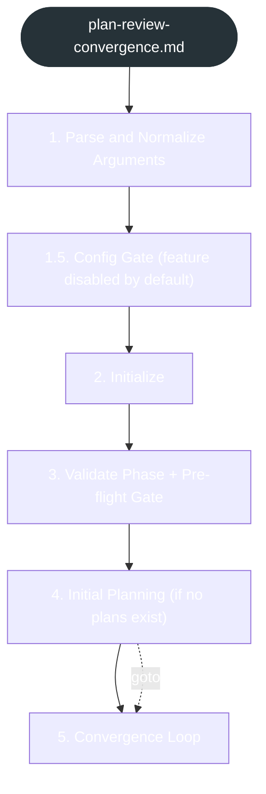

<!-- gsd:derived source=scripts/gen-workflow-maps.cjs — regenerated, do not hand-edit -->

# plan-review-convergence

Источник: `gsd-core/workflows/plan-review-convergence.md`. Единицы: 6 разделов H2. Спавнов: 0. Точки цикла: нет.

> **Переходы в прозе** (фразы «перейди к …»): всего 4; не называют реальный шаг и не рисуются — **3**; названы по имени шага и нарисованы пунктиром `goto` — 1.

Карта построена из разметки workflow: узел — реальный `<step>`, `gsd:section` или раздел H2; рёбра — порядок
документа, условие шага/секции на входящем ребре, переходы по имени шага. Описание обозначений —
в [README](README.md).

## Поток

## Единицы

| # | Единица | Вид | Условие | Спавны | Точки цикла | Читает |
|---|---|---|---|---|---|---|
| 1 | `1. Parse and Normalize Arguments` | H2 |  |  |  |  |
| 2 | `1.5. Config Gate (feature disabled by default)` | H2 |  |  |  |  |
| 3 | `2. Initialize` | H2 |  |  |  |  |
| 4 | `3. Validate Phase + Pre-flight Gate` | H2 |  |  |  |  |
| 5 | `4. Initial Planning (if no plans exist)` | H2 |  |  |  |  |
| 6 | `5. Convergence Loop` | H2 |  |  |  |  |

## Дефекты

Дефектов нет.
