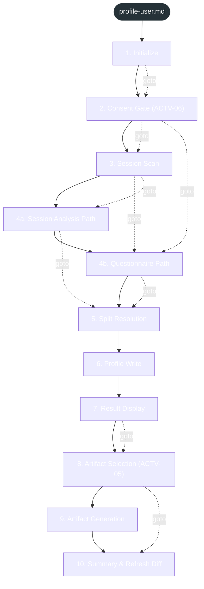

<!-- gsd:derived source=scripts/gen-workflow-maps.cjs — regenerated, do not hand-edit -->

# profile-user

Источник: `gsd-core/workflows/profile-user.md`. Единицы: 11 разделов H2. Спавнов: 0. Точки цикла: нет.

> **Переходы в прозе** (фразы «перейди к …»): всего 16; не называют реальный шаг и не рисуются — **4**; названы по имени шага и нарисованы пунктиром `goto` — 12.

Карта построена из разметки workflow: узел — реальный `<step>`, `gsd:section` или раздел H2; рёбра — порядок
документа, условие шага/секции на входящем ребре, переходы по имени шага. Описание обозначений —
в [README](README.md).

## Поток

## Единицы

| # | Единица | Вид | Условие | Спавны | Точки цикла | Читает |
|---|---|---|---|---|---|---|
| 1 | `1. Initialize` | H2 |  |  |  |  |
| 2 | `2. Consent Gate (ACTV-06)` | H2 |  |  |  |  |
| 3 | `3. Session Scan` | H2 |  |  |  |  |
| 4 | `4a. Session Analysis Path` | H2 |  |  |  |  |
| 5 | `4b. Questionnaire Path` | H2 |  |  |  |  |
| 6 | `5. Split Resolution` | H2 |  |  |  |  |
| 7 | `6. Profile Write` | H2 |  |  |  |  |
| 8 | `7. Result Display` | H2 |  |  |  |  |
| 9 | `8. Artifact Selection (ACTV-05)` | H2 |  |  |  |  |
| 10 | `9. Artifact Generation` | H2 |  |  |  |  |
| 11 | `10. Summary & Refresh Diff` | H2 |  |  |  |  |

## Дефекты

Дефектов нет.
