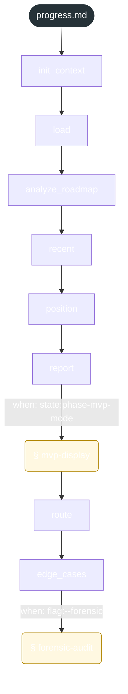

<!-- gsd:derived source=scripts/gen-workflow-maps.cjs — regenerated, do not hand-edit -->

# progress

Источник: `gsd-core/workflows/progress.md`. Единицы: 8 шагов `<step>`, 2 секции `gsd:section`. Спавнов: 0. Точки цикла: нет.

> **Переходы в прозе** (фразы «перейди к …»): всего 16; не называют реальный шаг и не рисуются — **16**; названы по имени шага и нарисованы пунктиром `goto` — 0.

Карта построена из разметки workflow: узел — реальный `<step>`, `gsd:section` или раздел H2; рёбра — порядок
документа, условие шага/секции на входящем ребре, переходы по имени шага. Описание обозначений —
в [README](README.md).

## Поток

## Единицы

| # | Единица | Вид | Условие | Спавны | Точки цикла | Читает |
|---|---|---|---|---|---|---|
| — | (вне единиц) | — | — |  |  | `progress/steps/mvp-display.md`, `progress/steps/forensic-audit.md` |
| 1 | `init_context` | step |  |  |  |  |
| 2 | `load` | step |  |  |  |  |
| 3 | `analyze_roadmap` | step |  |  |  |  |
| 4 | `recent` | step |  |  |  |  |
| 5 | `position` | step |  |  |  |  |
| 6 | `report` | step |  |  |  |  |
| 7 | `mvp-display` | section | when: state:phase-mvp-mode |  |  | `progress/steps/mvp-display.md` |
| 8 | `route` | step |  |  |  |  |
| 9 | `edge_cases` | step |  |  |  |  |
| 10 | `forensic-audit` | section | when: flag:--forensic |  |  | `progress/steps/forensic-audit.md` |

## Дефекты

Дефектов нет.
