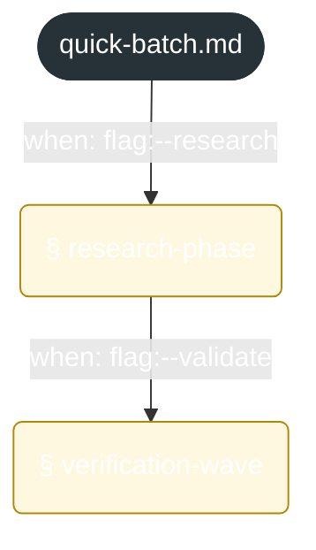
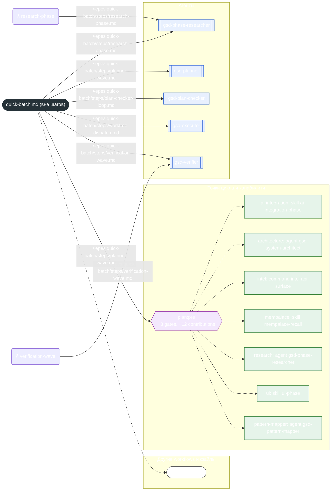

<!-- gsd:derived source=scripts/gen-workflow-maps.cjs — regenerated, do not hand-edit -->

# quick-batch

Источник: `gsd-core/workflows/quick-batch.md`. Единицы: 2 секции `gsd:section`. Спавнов: 10 (агенты: `gsd-phase-researcher`, `gsd-planner`, `gsd-plan-checker`, `gsd-executor`, `gsd-verifier`). Точки цикла: `plan:pre`.

> **Переходы в прозе** (фразы «перейди к …»): всего 1; не называют реальный шаг и не рисуются — **1**; названы по имени шага и нарисованы пунктиром `goto` — 0.

Карта построена из разметки workflow: узел — реальный `<step>`, `gsd:section` или раздел H2; рёбра — порядок
документа, условие шага/секции на входящем ребре, переходы по имени шага. Описание обозначений —
в [README](README.md).

## Поток



## Агенты и точки цикла



## Единицы

| # | Единица | Вид | Условие | Спавны | Точки цикла | Читает |
|---|---|---|---|---|---|---|
| — | (вне единиц) | — | — | `gsd-phase-researcher`, `gsd-planner`, `gsd-plan-checker`, `gsd-executor`, `gsd-verifier` | `plan:pre` | `quick.md`, `quick-batch/steps/resume-mode.md`, `quick-batch/steps/batch-init.md`, `quick-batch/steps/research-phase.md`, `quick-batch/steps/planner-wave.md`, `quick-batch/steps/plan-checker-loop.md`, `quick-batch/steps/worktree-dispatch.md`, `quick-batch/steps/merge-wave.md`, `quick-batch/steps/verification-wave.md`, `quick-batch/steps/completion.md` |
| 1 | `research-phase` | section | when: flag:--research | `gsd-phase-researcher` |  | `quick-batch/steps/research-phase.md` |
| 2 | `verification-wave` | section | when: flag:--validate | `gsd-verifier` |  | `quick-batch/steps/verification-wave.md` |

## Дефекты

- `spawn-in-prose`: вызов Agent(… gsd-plan-checker) (gsd-core/workflows/quick/steps/plan-checker-loop.md:71) записан в прозе, а не в блоке кода (если рядом блок кода — проверьте парность ограничителей ```)
