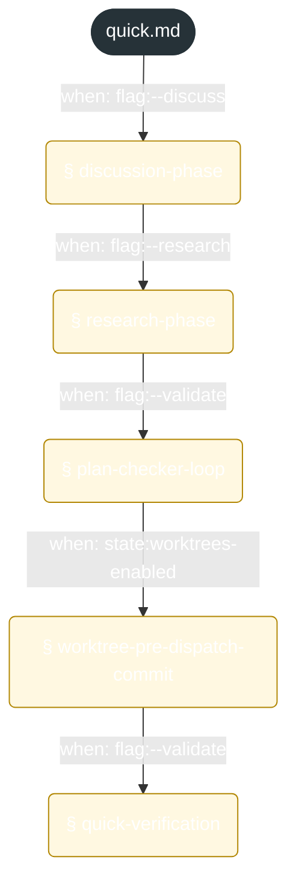
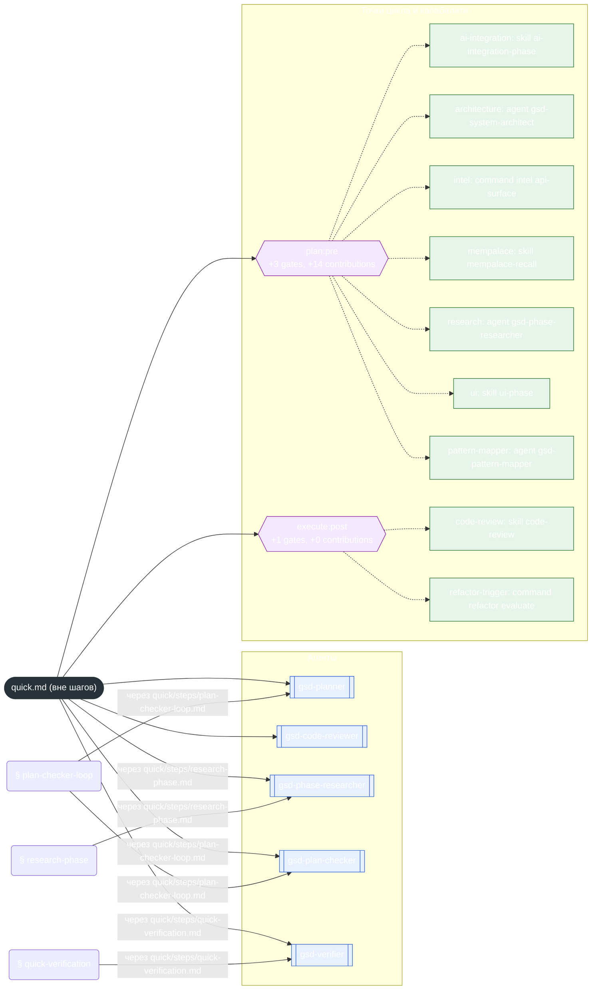

<!-- gsd:derived source=scripts/gen-workflow-maps.cjs — regenerated, do not hand-edit -->

# quick

Источник: `gsd-core/workflows/quick.md`. Единицы: 5 секций `gsd:section`. Спавнов: 10 (агенты: `gsd-planner`, `gsd-code-reviewer`, `gsd-phase-researcher`, `gsd-plan-checker`, `gsd-verifier`). Точки цикла: `plan:pre`, `execute:post`.

> **Переходы в прозе** (фразы «перейди к …»): всего 0; не называют реальный шаг и не рисуются — **0**; названы по имени шага и нарисованы пунктиром `goto` — 0.

Карта построена из разметки workflow: узел — реальный `<step>`, `gsd:section` или раздел H2; рёбра — порядок
документа, условие шага/секции на входящем ребре, переходы по имени шага. Описание обозначений —
в [README](README.md).

## Поток

## Агенты и точки цикла

## Единицы

| # | Единица | Вид | Условие | Спавны | Точки цикла | Читает |
|---|---|---|---|---|---|---|
| — | (вне единиц) | — | — | `gsd-planner`, `gsd-code-reviewer`, `gsd-phase-researcher`, `gsd-plan-checker`, `gsd-verifier` | `plan:pre`, `execute:post` | `quick/steps/discussion-phase.md`, `quick/steps/research-phase.md`, `quick/steps/plan-checker-loop.md`, `quick/steps/worktree-pre-dispatch-commit.md`, `quick/steps/quick-verification.md` |
| 1 | `discussion-phase` | section | when: flag:--discuss |  |  | `quick/steps/discussion-phase.md` |
| 2 | `research-phase` | section | when: flag:--research | `gsd-phase-researcher` |  | `quick/steps/research-phase.md` |
| 3 | `plan-checker-loop` | section | when: flag:--validate | `gsd-plan-checker`, `gsd-planner` |  | `quick/steps/plan-checker-loop.md` |
| 4 | `worktree-pre-dispatch-commit` | section | when: state:worktrees-enabled |  |  | `quick/steps/worktree-pre-dispatch-commit.md` |
| 5 | `quick-verification` | section | when: flag:--validate | `gsd-verifier` |  | `quick/steps/quick-verification.md` |

## Дефекты

Дефектов нет.
