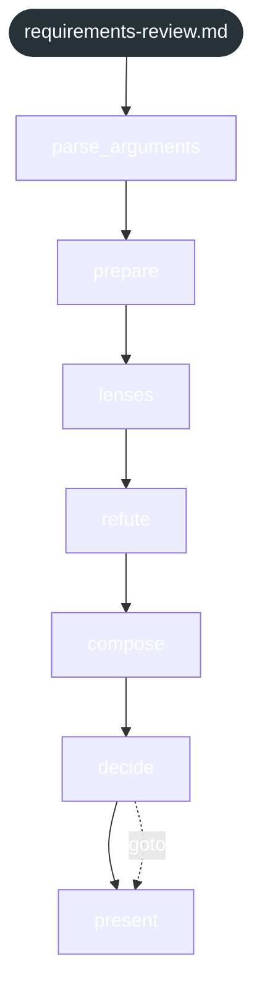
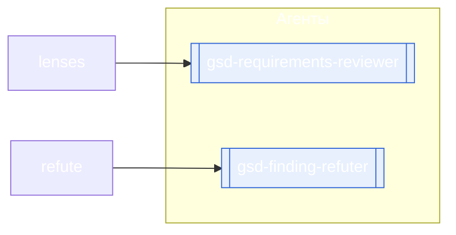

<!-- gsd:derived source=scripts/gen-workflow-maps.cjs — regenerated, do not hand-edit -->

# requirements-review

Источник: `gsd-core/workflows/requirements-review.md`. Единицы: 7 шагов `<step>`. Спавнов: 2 (агенты: `gsd-requirements-reviewer`, `gsd-finding-refuter`). Точки цикла: нет.

> **Переходы в прозе** (фразы «перейди к …»): всего 4; не называют реальный шаг и не рисуются — **2**; названы по имени шага и нарисованы пунктиром `goto` — 2.

Карта построена из разметки workflow: узел — реальный `<step>`, `gsd:section` или раздел H2; рёбра — порядок
документа, условие шага/секции на входящем ребре, переходы по имени шага. Описание обозначений —
в [README](README.md).

## Поток

## Агенты и точки цикла

## Единицы

| # | Единица | Вид | Условие | Спавны | Точки цикла | Читает |
|---|---|---|---|---|---|---|
| 1 | `parse_arguments` | step |  |  |  |  |
| 2 | `prepare` | step |  |  |  |  |
| 3 | `lenses` | step |  | `gsd-requirements-reviewer` |  |  |
| 4 | `refute` | step |  | `gsd-finding-refuter` |  |  |
| 5 | `compose` | step |  |  |  |  |
| 6 | `decide` | step |  |  |  |  |
| 7 | `present` | step |  |  |  |  |

## Дефекты

Дефектов нет.
