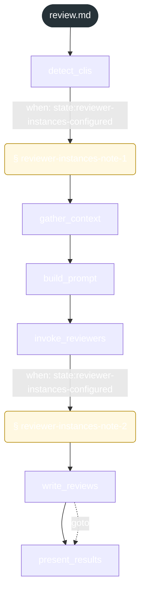

<!-- gsd:derived source=scripts/gen-workflow-maps.cjs — regenerated, do not hand-edit -->

# review

Источник: `gsd-core/workflows/review.md`. Единицы: 6 шагов `<step>`, 2 секции `gsd:section`. Спавнов: 0. Точки цикла: нет.

> **Переходы в прозе** (фразы «перейди к …»): всего 1; не называют реальный шаг и не рисуются — **0**; названы по имени шага и нарисованы пунктиром `goto` — 1.

Карта построена из разметки workflow: узел — реальный `<step>`, `gsd:section` или раздел H2; рёбра — порядок
документа, условие шага/секции на входящем ребре, переходы по имени шага. Описание обозначений —
в [README](README.md).

## Поток

## Единицы

| # | Единица | Вид | Условие | Спавны | Точки цикла | Читает |
|---|---|---|---|---|---|---|
| 1 | `detect_clis` | step |  |  |  | `review/steps/reviewer-instances-note-1.md` |
| 2 | `reviewer-instances-note-1` | section | when: state:reviewer-instances-configured |  |  | `review/steps/reviewer-instances-note-1.md` |
| 3 | `gather_context` | step |  |  |  |  |
| 4 | `build_prompt` | step |  |  |  |  |
| 5 | `invoke_reviewers` | step |  |  |  | `review/steps/reviewer-instances-note-2.md` |
| 6 | `reviewer-instances-note-2` | section | when: state:reviewer-instances-configured |  |  | `review/steps/reviewer-instances-note-2.md` |
| 7 | `write_reviews` | step |  |  |  |  |
| 8 | `present_results` | step |  |  |  |  |

## Дефекты

Дефектов нет.
