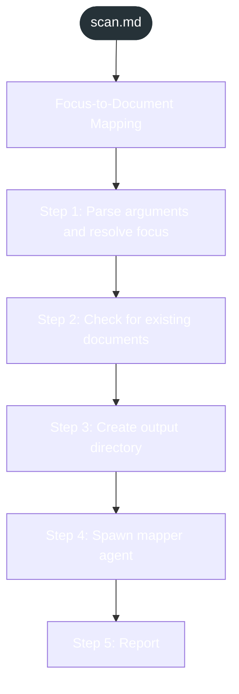
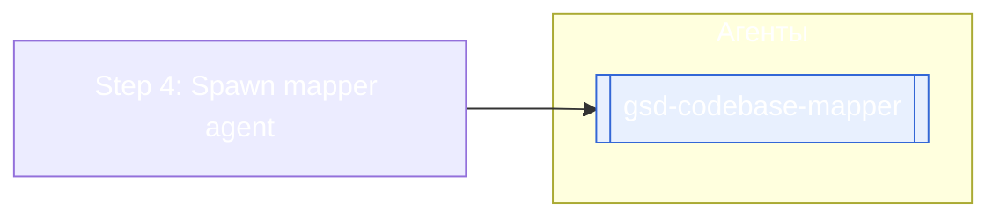

<!-- gsd:derived source=scripts/gen-workflow-maps.cjs — regenerated, do not hand-edit -->

# scan

Источник: `gsd-core/workflows/scan.md`. Единицы: 6 разделов H2. Спавнов: 1 (агенты: `gsd-codebase-mapper`). Точки цикла: нет.

> **Переходы в прозе** (фразы «перейди к …»): всего 0; не называют реальный шаг и не рисуются — **0**; названы по имени шага и нарисованы пунктиром `goto` — 0.

Карта построена из разметки workflow: узел — реальный `<step>`, `gsd:section` или раздел H2; рёбра — порядок
документа, условие шага/секции на входящем ребре, переходы по имени шага. Описание обозначений —
в [README](README.md).

## Поток

## Агенты и точки цикла

## Единицы

| # | Единица | Вид | Условие | Спавны | Точки цикла | Читает |
|---|---|---|---|---|---|---|
| 1 | `Focus-to-Document Mapping` | H2 |  |  |  |  |
| 2 | `Step 1: Parse arguments and resolve focus` | H2 |  |  |  |  |
| 3 | `Step 2: Check for existing documents` | H2 |  |  |  |  |
| 4 | `Step 3: Create output directory` | H2 |  |  |  |  |
| 5 | `Step 4: Spawn mapper agent` | H2 |  | `gsd-codebase-mapper` |  |  |
| 6 | `Step 5: Report` | H2 |  |  |  |  |

## Дефекты

Дефектов нет.
