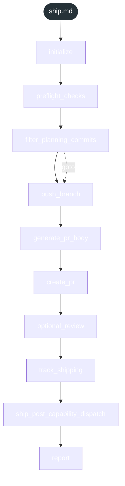
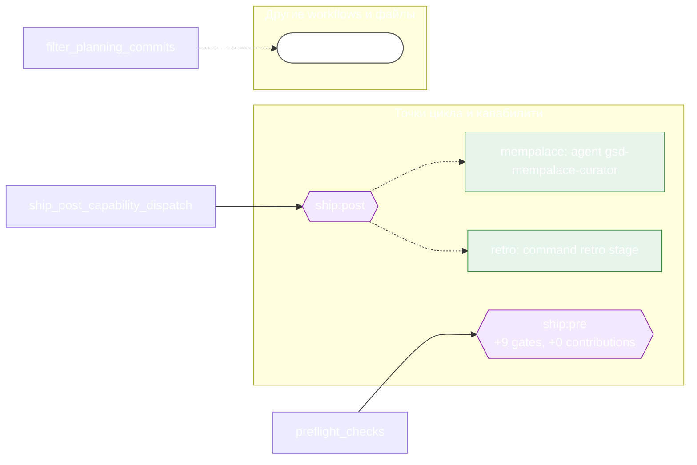

<!-- gsd:derived source=scripts/gen-workflow-maps.cjs — regenerated, do not hand-edit -->

# ship

Источник: `gsd-core/workflows/ship.md`. Единицы: 10 шагов `<step>`. Спавнов: 2. Точки цикла: `ship:pre`, `ship:post`.

> **Переходы в прозе** (фразы «перейди к …»): всего 6; не называют реальный шаг и не рисуются — **5**; названы по имени шага и нарисованы пунктиром `goto` — 1.

Карта построена из разметки workflow: узел — реальный `<step>`, `gsd:section` или раздел H2; рёбра — порядок
документа, условие шага/секции на входящем ребре, переходы по имени шага. Описание обозначений —
в [README](README.md).

## Поток

## Агенты и точки цикла

## Единицы

| # | Единица | Вид | Условие | Спавны | Точки цикла | Читает |
|---|---|---|---|---|---|---|
| 1 | `initialize` | step |  |  |  |  |
| 2 | `preflight_checks` | step |  |  | `ship:pre` |  |
| 3 | `filter_planning_commits` | step |  |  |  | `pr-branch.md` |
| 4 | `push_branch` | step |  |  |  |  |
| 5 | `generate_pr_body` | step |  |  |  |  |
| 6 | `create_pr` | step |  |  |  |  |
| 7 | `optional_review` | step |  |  |  |  |
| 8 | `track_shipping` | step |  |  |  |  |
| 9 | `ship_post_capability_dispatch` | step |  | `ref.agent` | `ship:post` |  |
| 10 | `report` | step |  |  |  |  |

## Дефекты

Дефектов нет.
