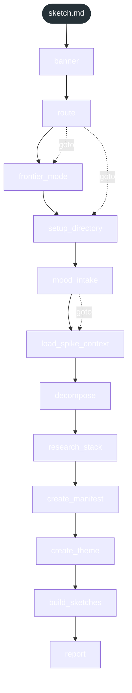

<!-- gsd:derived source=scripts/gen-workflow-maps.cjs — regenerated, do not hand-edit -->

# sketch

Источник: `gsd-core/workflows/sketch.md`. Единицы: 12 шагов `<step>`. Спавнов: 0. Точки цикла: нет.

> **Переходы в прозе** (фразы «перейди к …»): всего 4; не называют реальный шаг и не рисуются — **1**; названы по имени шага и нарисованы пунктиром `goto` — 3.

Карта построена из разметки workflow: узел — реальный `<step>`, `gsd:section` или раздел H2; рёбра — порядок
документа, условие шага/секции на входящем ребре, переходы по имени шага. Описание обозначений —
в [README](README.md).

## Поток

## Единицы

| # | Единица | Вид | Условие | Спавны | Точки цикла | Читает |
|---|---|---|---|---|---|---|
| 1 | `banner` | step |  |  |  |  |
| 2 | `route` | step |  |  |  |  |
| 3 | `frontier_mode` | step |  |  |  |  |
| 4 | `setup_directory` | step |  |  |  |  |
| 5 | `mood_intake` | step |  |  |  |  |
| 6 | `load_spike_context` | step |  |  |  |  |
| 7 | `decompose` | step |  |  |  |  |
| 8 | `research_stack` | step |  |  |  |  |
| 9 | `create_manifest` | step |  |  |  |  |
| 10 | `create_theme` | step |  |  |  |  |
| 11 | `build_sketches` | step |  |  |  |  |
| 12 | `report` | step |  |  |  |  |

## Дефекты

Дефектов нет.
