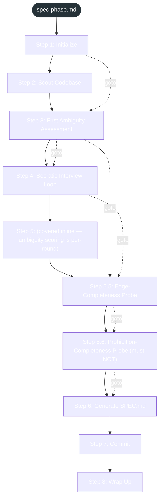

<!-- gsd:derived source=scripts/gen-workflow-maps.cjs — regenerated, do not hand-edit -->

# spec-phase

Источник: `gsd-core/workflows/spec-phase.md`. Единицы: 10 разделов H2. Спавнов: 0. Точки цикла: нет.

> **Переходы в прозе** (фразы «перейди к …»): всего 10; не называют реальный шаг и не рисуются — **2**; названы по имени шага и нарисованы пунктиром `goto` — 8.

Карта построена из разметки workflow: узел — реальный `<step>`, `gsd:section` или раздел H2; рёбра — порядок
документа, условие шага/секции на входящем ребре, переходы по имени шага. Описание обозначений —
в [README](README.md).

## Поток

## Единицы

| # | Единица | Вид | Условие | Спавны | Точки цикла | Читает |
|---|---|---|---|---|---|---|
| 1 | `Step 1: Initialize` | H2 |  |  |  |  |
| 2 | `Step 2: Scout Codebase` | H2 |  |  |  |  |
| 3 | `Step 3: First Ambiguity Assessment` | H2 |  |  |  |  |
| 4 | `Step 4: Socratic Interview Loop` | H2 |  |  |  |  |
| 5 | `Step 5: (covered inline — ambiguity scoring is per-round)` | H2 |  |  |  |  |
| 6 | `Step 5.5: Edge-Completeness Probe` | H2 |  |  |  |  |
| 7 | `Step 5.6: Prohibition-Completeness Probe (must-NOT)` | H2 |  |  |  |  |
| 8 | `Step 6: Generate SPEC.md` | H2 |  |  |  |  |
| 9 | `Step 7: Commit` | H2 |  |  |  |  |
| 10 | `Step 8: Wrap Up` | H2 |  |  |  |  |

## Дефекты

Дефектов нет.
