<!-- gsd:derived source=scripts/gen-workflow-maps.cjs — regenerated, do not hand-edit -->

# spike-wrap-up

Источник: `gsd-core/workflows/spike-wrap-up.md`. Единицы: 14 шагов `<step>`. Спавнов: 0. Точки цикла: нет.

> **Переходы в прозе** (фразы «перейди к …»): всего 0; не называют реальный шаг и не рисуются — **0**; названы по имени шага и нарисованы пунктиром `goto` — 0.

Карта построена из разметки workflow: узел — реальный `<step>`, `gsd:section` или раздел H2; рёбра — порядок
документа, условие шага/секции на входящем ребре, переходы по имени шага. Описание обозначений —
в [README](README.md).

## Поток

```mermaid
flowchart TB
  wf_root(["spike-wrap-up.md"]):::root
  u_step_banner["banner"]
  u_step_gather["gather"]
  u_step_auto_include["auto_include"]
  u_step_group["group"]
  u_step_skill_name["skill_name"]
  u_step_copy_sources["copy_sources"]
  u_step_synthesize["synthesize"]
  u_step_write_skill["write_skill"]
  u_step_write_summary["write_summary"]
  u_step_update_claude_md["update_claude_md"]
  u_step_generate_conventions["generate_conventions"]
  u_step_commit["commit"]
  u_step_report["report"]
  u_step_whats_next["whats_next"]
  wf_root --> u_step_banner
  u_step_banner --> u_step_gather
  u_step_gather --> u_step_auto_include
  u_step_auto_include --> u_step_group
  u_step_group --> u_step_skill_name
  u_step_skill_name --> u_step_copy_sources
  u_step_copy_sources --> u_step_synthesize
  u_step_synthesize --> u_step_write_skill
  u_step_write_skill --> u_step_write_summary
  u_step_write_summary --> u_step_update_claude_md
  u_step_update_claude_md --> u_step_generate_conventions
  u_step_generate_conventions --> u_step_commit
  u_step_commit --> u_step_report
  u_step_report --> u_step_whats_next
  classDef missing fill:#fdecea,stroke:#d33,stroke-dasharray:4 3
  classDef unparsed fill:#f5f5f5,stroke:#999999,stroke-dasharray:4 3,color:#555
  classDef conditional fill:#fff8e1,stroke:#b28704
  classDef root fill:#263238,color:#ffffff,stroke:#263238
  classDef agent fill:#e8f0fe,stroke:#3367d6
  classDef builtin fill:#eeeeee,stroke:#777777
  classDef capability fill:#e6f4ea,stroke:#2e7d32
  classDef dynamic fill:#f2f2f2,stroke:#888,stroke-dasharray:2 2
  classDef point fill:#f3e8fd,stroke:#8e24aa
  classDef workflow fill:#ffffff,stroke:#555555
```

## Единицы

| # | Единица | Вид | Условие | Спавны | Точки цикла | Читает |
|---|---|---|---|---|---|---|
| 1 | `banner` | step |  |  |  |  |
| 2 | `gather` | step |  |  |  |  |
| 3 | `auto_include` | step |  |  |  |  |
| 4 | `group` | step |  |  |  |  |
| 5 | `skill_name` | step |  |  |  |  |
| 6 | `copy_sources` | step |  |  |  |  |
| 7 | `synthesize` | step |  |  |  |  |
| 8 | `write_skill` | step |  |  |  |  |
| 9 | `write_summary` | step |  |  |  |  |
| 10 | `update_claude_md` | step |  |  |  |  |
| 11 | `generate_conventions` | step |  |  |  |  |
| 12 | `commit` | step |  |  |  |  |
| 13 | `report` | step |  |  |  |  |
| 14 | `whats_next` | step |  |  |  |  |

## Дефекты

Дефектов нет.
