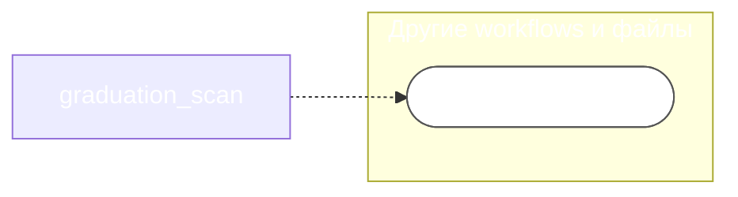

<!-- gsd:derived source=scripts/gen-workflow-maps.cjs — regenerated, do not hand-edit -->

# transition

Источник: `gsd-core/workflows/transition.md`. Единицы: 14 шагов `<step>`, 1 секция `gsd:section`. Спавнов: 0. Точки цикла: нет.

> **Переходы в прозе** (фразы «перейди к …»): всего 5; не называют реальный шаг и не рисуются — **4**; названы по имени шага и нарисованы пунктиром `goto` — 1.

Карта построена из разметки workflow: узел — реальный `<step>`, `gsd:section` или раздел H2; рёбра — порядок
документа, условие шага/секции на входящем ребре, переходы по имени шага. Описание обозначений —
в [README](README.md).

## Поток

```mermaid
flowchart TB
  wf_root(["transition.md"]):::root
  u_step_post_completion_mode["post_completion_mode"]
  u_step_load_project_state["load_project_state"]
  u_step_verify_completion["verify_completion"]
  u_step_cleanup_handoff["cleanup_handoff"]
  u_step_update_roadmap_and_state["update_roadmap_and_state"]
  u_step_archive_prompts["archive_prompts"]
  u_step_evolve_project["evolve_project"]
  u_step_extract_phase_learnings["extract_phase_learnings"]
  u_step_graduation_scan["graduation_scan"]
  u_step_update_current_position_after_transition["update_current_position_after_transition"]
  u_step_update_project_reference["update_project_reference"]
  u_step_review_accumulated_context["review_accumulated_context"]
  u_step_update_session_continuity_after_transition["update_session_continuity_after_transition"]
  u_step_offer_next_phase["offer_next_phase"]
  u_section_workstream_collision_check("§ workstream-collision-check"):::conditional
  wf_root --> u_step_post_completion_mode
  u_step_post_completion_mode --> u_step_load_project_state
  u_step_load_project_state --> u_step_verify_completion
  u_step_verify_completion --> u_step_cleanup_handoff
  u_step_cleanup_handoff --> u_step_update_roadmap_and_state
  u_step_update_roadmap_and_state --> u_step_archive_prompts
  u_step_archive_prompts --> u_step_evolve_project
  u_step_evolve_project --> u_step_extract_phase_learnings
  u_step_extract_phase_learnings --> u_step_graduation_scan
  u_step_graduation_scan --> u_step_update_current_position_after_transition
  u_step_update_current_position_after_transition --> u_step_update_project_reference
  u_step_update_project_reference --> u_step_review_accumulated_context
  u_step_review_accumulated_context --> u_step_update_session_continuity_after_transition
  u_step_update_session_continuity_after_transition --> u_step_offer_next_phase
  u_step_offer_next_phase -->|"when#58; state#58;workstream-active"| u_section_workstream_collision_check
  u_step_verify_completion -.->|"goto"| u_step_cleanup_handoff
  classDef missing fill:#fdecea,stroke:#d33,stroke-dasharray:4 3
  classDef unparsed fill:#f2f2f2,stroke:#888,stroke-dasharray:4 3
  classDef conditional fill:#fff8e1,stroke:#b28704
  classDef root fill:#263238,color:#ffffff,stroke:#263238
  classDef agent fill:#e8f0fe,stroke:#3367d6
  classDef builtin fill:#eeeeee,stroke:#777777
  classDef capability fill:#e6f4ea,stroke:#2e7d32
  classDef dynamic fill:#f2f2f2,stroke:#888,stroke-dasharray:2 2
  classDef point fill:#f3e8fd,stroke:#8e24aa
  classDef workflow fill:#ffffff,stroke:#555555
```

## Агенты и точки цикла

## Единицы

| # | Единица | Вид | Условие | Спавны | Точки цикла | Читает |
|---|---|---|---|---|---|---|
| 1 | `post_completion_mode` | step |  |  |  |  |
| 2 | `load_project_state` | step |  |  |  |  |
| 3 | `verify_completion` | step |  |  |  |  |
| 4 | `cleanup_handoff` | step |  |  |  |  |
| 5 | `update_roadmap_and_state` | step |  |  |  |  |
| 6 | `archive_prompts` | step |  |  |  |  |
| 7 | `evolve_project` | step |  |  |  |  |
| 8 | `extract_phase_learnings` | step |  |  |  |  |
| 9 | `graduation_scan` | step |  |  |  | `graduation.md` |
| 10 | `update_current_position_after_transition` | step |  |  |  |  |
| 11 | `update_project_reference` | step |  |  |  |  |
| 12 | `review_accumulated_context` | step |  |  |  |  |
| 13 | `update_session_continuity_after_transition` | step |  |  |  |  |
| 14 | `offer_next_phase` | step |  |  |  | `transition/steps/workstream-collision-check.md` |
| 15 | `workstream-collision-check` | section | when: state:workstream-active |  |  | `transition/steps/workstream-collision-check.md` |

## Дефекты

Дефектов нет.
