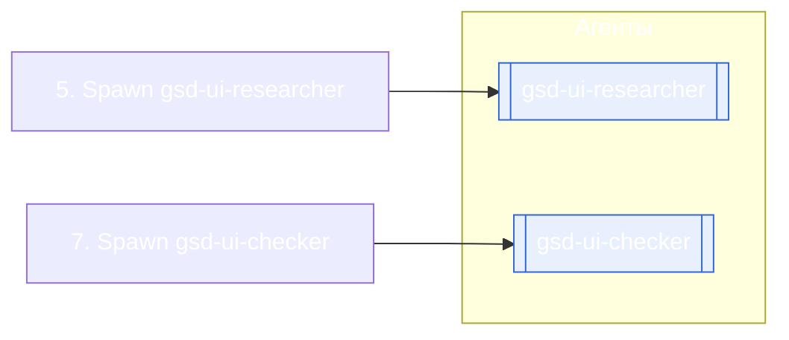

<!-- gsd:derived source=scripts/gen-workflow-maps.cjs — regenerated, do not hand-edit -->

# ui-phase

Источник: `gsd-core/workflows/ui-phase.md`. Единицы: 13 разделов H2. Спавнов: 2 (агенты: `gsd-ui-researcher`, `gsd-ui-checker`). Точки цикла: нет.

> **Переходы в прозе** (фразы «перейди к …»): всего 10; не называют реальный шаг и не рисуются — **3**; названы по имени шага и нарисованы пунктиром `goto` — 7.

Карта построена из разметки workflow: узел — реальный `<step>`, `gsd:section` или раздел H2; рёбра — порядок
документа, условие шага/секции на входящем ребре, переходы по имени шага. Описание обозначений —
в [README](README.md).

## Поток

```mermaid
flowchart TB
  subgraph g_1["1. Initialize"]
    u_heading_1__Initialize["1. Initialize"]
  end
  subgraph g_2["2. Parse and Validate Phase"]
    u_heading_2__Parse_and_Validate_Phase["2. Parse and Validate Phase"]
  end
  subgraph g_3["3. Check Prerequisites"]
    u_heading_3__Check_Prerequisites["3. Check Prerequisites"]
  end
  subgraph g_4["4. Check Existing UI-SPEC"]
    u_heading_4__Check_Existing_UI_SPEC["4. Check Existing UI-SPEC"]
  end
  subgraph g_5["5. Spawn gsd-ui-researcher"]
    u_heading_5__Spawn_gsd_ui_researcher["5. Spawn gsd-ui-researcher"]
  end
  subgraph g_6["6. Handle Researcher Return"]
    u_heading_6__Handle_Researcher_Return["6. Handle Researcher Return"]
  end
  subgraph g_7["7. Spawn gsd-ui-checker"]
    u_heading_7__Spawn_gsd_ui_checker["7. Spawn gsd-ui-checker"]
  end
  subgraph g_8["8. Handle Checker Return"]
    u_heading_8__Handle_Checker_Return["8. Handle Checker Return"]
  end
  subgraph g_9["9. Revision Loop (Max 2 Iterations)"]
    u_heading_9__Revision_Loop__Max_2_Iterations_["9. Revision Loop (Max 2 Iterations)"]
    u_heading_9_5__UI_Consideration_Probe__post_verification_["9.5. UI-Consideration Probe (post-verification)"]
  end
  subgraph g_10["10. Present Final Status"]
    u_heading_10__Present_Final_Status["10. Present Final Status"]
  end
  subgraph g_11["11. Commit (if configured)"]
    u_heading_11__Commit__if_configured_["11. Commit (if configured)"]
  end
  subgraph g_12["12. Update State"]
    u_heading_12__Update_State["12. Update State"]
  end
  wf_root(["ui-phase.md"]):::root
  wf_root --> u_heading_1__Initialize
  u_heading_1__Initialize --> u_heading_2__Parse_and_Validate_Phase
  u_heading_2__Parse_and_Validate_Phase --> u_heading_3__Check_Prerequisites
  u_heading_3__Check_Prerequisites --> u_heading_4__Check_Existing_UI_SPEC
  u_heading_4__Check_Existing_UI_SPEC --> u_heading_5__Spawn_gsd_ui_researcher
  u_heading_5__Spawn_gsd_ui_researcher --> u_heading_6__Handle_Researcher_Return
  u_heading_6__Handle_Researcher_Return --> u_heading_7__Spawn_gsd_ui_checker
  u_heading_7__Spawn_gsd_ui_checker --> u_heading_8__Handle_Checker_Return
  u_heading_8__Handle_Checker_Return --> u_heading_9__Revision_Loop__Max_2_Iterations_
  u_heading_9__Revision_Loop__Max_2_Iterations_ --> u_heading_9_5__UI_Consideration_Probe__post_verification_
  u_heading_9_5__UI_Consideration_Probe__post_verification_ --> u_heading_10__Present_Final_Status
  u_heading_10__Present_Final_Status --> u_heading_11__Commit__if_configured_
  u_heading_11__Commit__if_configured_ --> u_heading_12__Update_State
  u_heading_4__Check_Existing_UI_SPEC -.->|"goto"| u_heading_7__Spawn_gsd_ui_checker
  u_heading_4__Check_Existing_UI_SPEC -.->|"goto"| u_heading_5__Spawn_gsd_ui_researcher
  u_heading_6__Handle_Researcher_Return -.->|"goto"| u_heading_7__Spawn_gsd_ui_checker
  u_heading_8__Handle_Checker_Return -.->|"goto"| u_heading_9_5__UI_Consideration_Probe__post_verification_
  u_heading_8__Handle_Checker_Return -.->|"goto"| u_heading_9__Revision_Loop__Max_2_Iterations_
  u_heading_9__Revision_Loop__Max_2_Iterations_ -.->|"goto"| u_heading_9_5__UI_Consideration_Probe__post_verification_
  classDef missing fill:#fdecea,stroke:#d33,stroke-dasharray:4 3
  classDef unparsed fill:#f2f2f2,stroke:#888,stroke-dasharray:4 3
  classDef conditional fill:#fff8e1,stroke:#b28704
  classDef root fill:#263238,color:#ffffff,stroke:#263238
  classDef agent fill:#e8f0fe,stroke:#3367d6
  classDef builtin fill:#eeeeee,stroke:#777777
  classDef capability fill:#e6f4ea,stroke:#2e7d32
  classDef dynamic fill:#f2f2f2,stroke:#888,stroke-dasharray:2 2
  classDef point fill:#f3e8fd,stroke:#8e24aa
  classDef workflow fill:#ffffff,stroke:#555555
```

## Агенты и точки цикла

## Единицы

| # | Единица | Вид | Условие | Спавны | Точки цикла | Читает |
|---|---|---|---|---|---|---|
| 1 | `1. Initialize` | H2 |  |  |  |  |
| 2 | `2. Parse and Validate Phase` | H2 |  |  |  |  |
| 3 | `3. Check Prerequisites` | H2 |  |  |  |  |
| 4 | `4. Check Existing UI-SPEC` | H2 |  |  |  |  |
| 5 | `5. Spawn gsd-ui-researcher` | H2 |  | `gsd-ui-researcher` |  |  |
| 6 | `6. Handle Researcher Return` | H2 |  |  |  |  |
| 7 | `7. Spawn gsd-ui-checker` | H2 |  | `gsd-ui-checker` |  |  |
| 8 | `8. Handle Checker Return` | H2 |  |  |  |  |
| 9 | `9. Revision Loop (Max 2 Iterations)` | H2 |  |  |  |  |
| 10 | `9.5. UI-Consideration Probe (post-verification)` | H2 |  |  |  |  |
| 11 | `10. Present Final Status` | H2 |  |  |  |  |
| 12 | `11. Commit (if configured)` | H2 |  |  |  |  |
| 13 | `12. Update State` | H2 |  |  |  |  |

## Дефекты

Дефектов нет.
