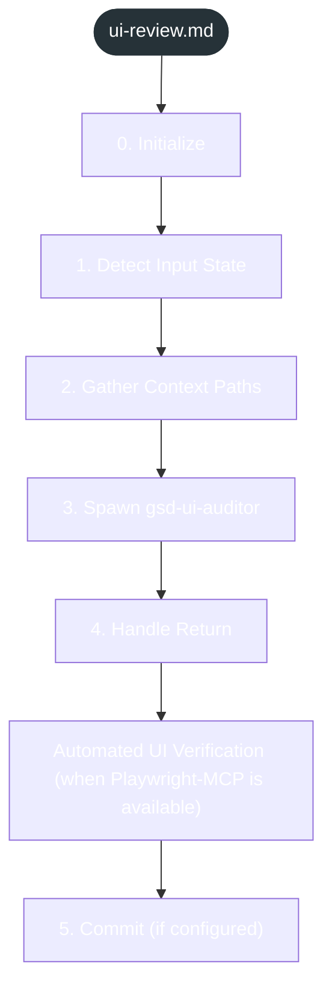
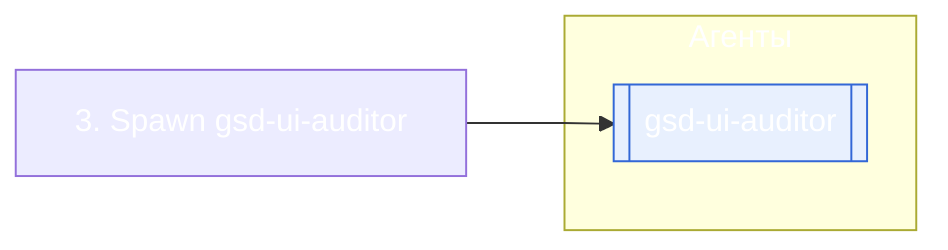

<!-- gsd:derived source=scripts/gen-workflow-maps.cjs — regenerated, do not hand-edit -->

# ui-review

Источник: `gsd-core/workflows/ui-review.md`. Единицы: 7 разделов H2. Спавнов: 1 (агенты: `gsd-ui-auditor`). Точки цикла: нет.

> **Переходы в прозе** (фразы «перейди к …»): всего 0; не называют реальный шаг и не рисуются — **0**; названы по имени шага и нарисованы пунктиром `goto` — 0.

Карта построена из разметки workflow: узел — реальный `<step>`, `gsd:section` или раздел H2; рёбра — порядок
документа, условие шага/секции на входящем ребре, переходы по имени шага. Описание обозначений —
в [README](README.md).

## Поток

## Агенты и точки цикла

## Единицы

| # | Единица | Вид | Условие | Спавны | Точки цикла | Читает |
|---|---|---|---|---|---|---|
| 1 | `0. Initialize` | H2 |  |  |  |  |
| 2 | `1. Detect Input State` | H2 |  |  |  |  |
| 3 | `2. Gather Context Paths` | H2 |  |  |  |  |
| 4 | `3. Spawn gsd-ui-auditor` | H2 |  | `gsd-ui-auditor` |  |  |
| 5 | `4. Handle Return` | H2 |  |  |  |  |
| 6 | `Automated UI Verification (when Playwright-MCP is available)` | H2 |  |  |  |  |
| 7 | `5. Commit (if configured)` | H2 |  |  |  |  |

## Дефекты

Дефектов нет.
