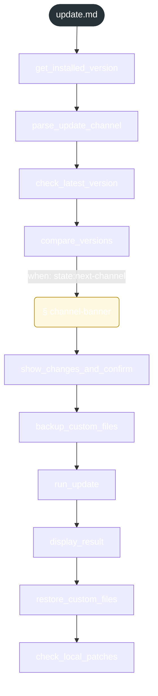

<!-- gsd:derived source=scripts/gen-workflow-maps.cjs — regenerated, do not hand-edit -->

# update

Источник: `gsd-core/workflows/update.md`. Единицы: 10 шагов `<step>`, 1 секция `gsd:section`. Спавнов: 0. Точки цикла: нет.

> **Переходы в прозе** (фразы «перейди к …»): всего 3; не называют реальный шаг и не рисуются — **3**; названы по имени шага и нарисованы пунктиром `goto` — 0.

Карта построена из разметки workflow: узел — реальный `<step>`, `gsd:section` или раздел H2; рёбра — порядок
документа, условие шага/секции на входящем ребре, переходы по имени шага. Описание обозначений —
в [README](README.md).

## Поток

## Единицы

| # | Единица | Вид | Условие | Спавны | Точки цикла | Читает |
|---|---|---|---|---|---|---|
| 1 | `get_installed_version` | step |  |  |  |  |
| 2 | `parse_update_channel` | step |  |  |  |  |
| 3 | `check_latest_version` | step |  |  |  |  |
| 4 | `compare_versions` | step |  |  |  | `update/steps/channel-banner.md` |
| 5 | `channel-banner` | section | when: state:next-channel |  |  | `update/steps/channel-banner.md` |
| 6 | `show_changes_and_confirm` | step |  |  |  |  |
| 7 | `backup_custom_files` | step |  |  |  |  |
| 8 | `run_update` | step |  |  |  |  |
| 9 | `display_result` | step |  |  |  |  |
| 10 | `restore_custom_files` | step |  |  |  |  |
| 11 | `check_local_patches` | step |  |  |  |  |

## Дефекты

Дефектов нет.
