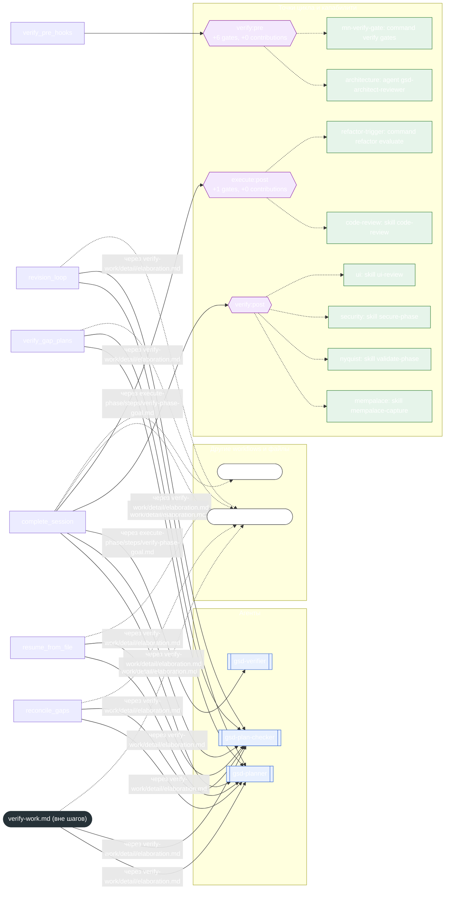

<!-- gsd:derived source=scripts/gen-workflow-maps.cjs — regenerated, do not hand-edit -->

# verify-work

Источник: `gsd-core/workflows/verify-work.md`. Единицы: 17 шагов `<step>`, 2 секции `gsd:section`. Спавнов: 19 (агенты: `gsd-planner`, `gsd-plan-checker`, `gsd-verifier`). Точки цикла: `verify:pre`, `verify:post`, `execute:post`.

> **Переходы в прозе** (фразы «перейди к …»): всего 16; не называют реальный шаг и не рисуются — **2**; названы по имени шага и нарисованы пунктиром `goto` — 14.

Карта построена из разметки workflow: узел — реальный `<step>`, `gsd:section` или раздел H2; рёбра — порядок
документа, условие шага/секции на входящем ребре, переходы по имени шага. Описание обозначений —
в [README](README.md).

## Поток

```mermaid
flowchart TB
  wf_root(["verify-work.md"]):::root
  u_step_initialize["initialize"]
  u_step_verify_pre_hooks["verify_pre_hooks"]
  u_step_check_active_session["check_active_session"]
  u_section_automated_ui_verification("§ automated-ui-verification"):::conditional
  u_step_find_summaries["find_summaries"]
  u_step_extract_tests["extract_tests"]
  u_section_mvp_uat_framing("§ mvp-uat-framing"):::conditional
  u_step_create_uat_file["create_uat_file"]
  u_step_present_test["present_test"]
  u_step_process_response["process_response"]
  u_step_reconcile_gaps["reconcile_gaps"]
  u_step_resume_from_file["resume_from_file"]
  u_step_complete_session["complete_session"]
  u_step_scan_phase_artifacts["scan_phase_artifacts"]
  u_step_diagnose_issues["diagnose_issues"]
  u_step_plan_gap_closure["plan_gap_closure"]
  u_step_verify_gap_plans["verify_gap_plans"]
  u_step_revision_loop["revision_loop"]
  u_step_present_ready["present_ready"]
  wf_root --> u_step_initialize
  u_step_initialize --> u_step_verify_pre_hooks
  u_step_verify_pre_hooks --> u_step_check_active_session
  u_step_check_active_session -->|"when#58; state#58;ui-phase-active"| u_section_automated_ui_verification
  u_section_automated_ui_verification --> u_step_find_summaries
  u_step_find_summaries --> u_step_extract_tests
  u_step_extract_tests -->|"when#58; state#58;phase-mvp-mode"| u_section_mvp_uat_framing
  u_section_mvp_uat_framing --> u_step_create_uat_file
  u_step_create_uat_file --> u_step_present_test
  u_step_present_test --> u_step_process_response
  u_step_process_response --> u_step_reconcile_gaps
  u_step_reconcile_gaps --> u_step_resume_from_file
  u_step_resume_from_file --> u_step_complete_session
  u_step_complete_session --> u_step_scan_phase_artifacts
  u_step_scan_phase_artifacts --> u_step_diagnose_issues
  u_step_diagnose_issues --> u_step_plan_gap_closure
  u_step_plan_gap_closure --> u_step_verify_gap_plans
  u_step_verify_gap_plans --> u_step_revision_loop
  u_step_revision_loop --> u_step_present_ready
  u_step_check_active_session -.->|"goto"| u_step_resume_from_file
  u_step_check_active_session -.->|"goto"| u_step_create_uat_file
  u_step_create_uat_file -.->|"goto"| u_step_present_test
  u_step_process_response -.->|"goto"| u_step_present_test
  u_step_process_response -.->|"goto"| u_step_complete_session
  u_step_resume_from_file -.->|"goto"| u_step_complete_session
  u_step_complete_session -.->|"goto"| u_step_diagnose_issues
  u_step_diagnose_issues -.->|"goto"| u_step_plan_gap_closure
  u_step_plan_gap_closure -.->|"goto"| u_step_verify_gap_plans
  u_step_verify_gap_plans -.->|"goto"| u_step_present_ready
  u_step_verify_gap_plans -.->|"goto"| u_step_revision_loop
  classDef missing fill:#fdecea,stroke:#d33,stroke-dasharray:4 3
  classDef unparsed fill:#f2f2f2,stroke:#888,stroke-dasharray:4 3
  classDef conditional fill:#fff8e1,stroke:#b28704
  classDef root fill:#263238,color:#ffffff,stroke:#263238
  classDef agent fill:#e8f0fe,stroke:#3367d6
  classDef builtin fill:#eeeeee,stroke:#777777
  classDef capability fill:#e6f4ea,stroke:#2e7d32
  classDef dynamic fill:#f2f2f2,stroke:#888,stroke-dasharray:2 2
  classDef point fill:#f3e8fd,stroke:#8e24aa
  classDef workflow fill:#ffffff,stroke:#555555
```

## Агенты и точки цикла

## Единицы

| # | Единица | Вид | Условие | Спавны | Точки цикла | Читает |
|---|---|---|---|---|---|---|
| — | (вне единиц) | — | — | `gsd-planner`, `gsd-plan-checker` |  | `verify-work/detail/elaboration.md`, `verify-work/steps/automated-ui-verification.md` |
| 1 | `initialize` | step |  |  |  |  |
| 2 | `verify_pre_hooks` | step |  |  | `verify:pre` |  |
| 3 | `check_active_session` | step |  |  |  |  |
| 4 | `automated-ui-verification` | section | when: state:ui-phase-active |  |  | `verify-work/steps/automated-ui-verification.md` |
| 5 | `find_summaries` | step |  |  |  |  |
| 6 | `extract_tests` | step |  |  |  | `verify-work/steps/mvp-uat-framing.md` |
| 7 | `mvp-uat-framing` | section | when: state:phase-mvp-mode |  |  | `verify-work/steps/mvp-uat-framing.md` |
| 8 | `create_uat_file` | step |  |  |  |  |
| 9 | `present_test` | step |  |  |  |  |
| 10 | `process_response` | step |  |  |  |  |
| 11 | `reconcile_gaps` | step |  | `gsd-planner`, `gsd-plan-checker` |  | `verify-work/detail/elaboration.md` |
| 12 | `resume_from_file` | step |  | `gsd-planner`, `gsd-plan-checker` |  | `verify-work/detail/elaboration.md` |
| 13 | `complete_session` | step |  | `gsd-planner`, `gsd-plan-checker`, `gsd-verifier` | `verify:post`, `execute:post` | `verify-work/detail/elaboration.md`, `execute-phase/steps/verify-phase-goal.md`, `transition.md` |
| 14 | `scan_phase_artifacts` | step |  |  |  |  |
| 15 | `diagnose_issues` | step |  |  |  |  |
| 16 | `plan_gap_closure` | step |  |  |  |  |
| 17 | `verify_gap_plans` | step |  | `gsd-planner`, `gsd-plan-checker` |  | `verify-work/detail/elaboration.md` |
| 18 | `revision_loop` | step |  | `gsd-planner`, `gsd-plan-checker` |  | `verify-work/detail/elaboration.md` |
| 19 | `present_ready` | step |  |  |  |  |

## Дефекты

Дефектов нет.
