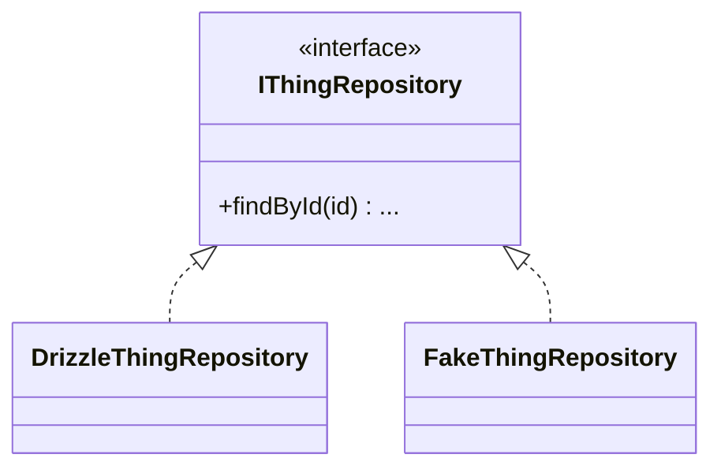
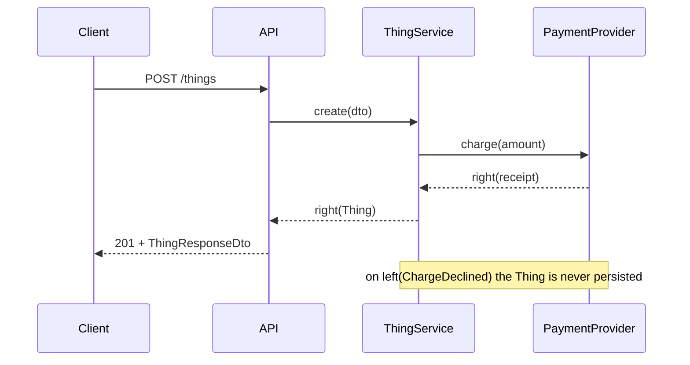
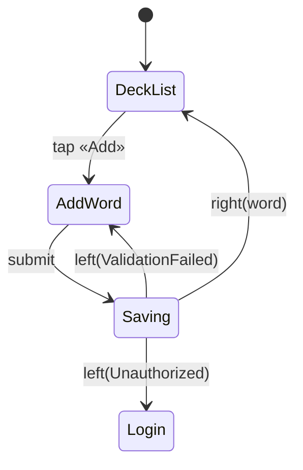

# Phase Design Template

Template for `.planning/phases/XX-name/{phase_num}-DESIGN.md` — fixes structural boundaries before the planner splits work into plans.

**Purpose:** Answer *why the boundary falls here* — which layer owns each piece of new code, which dependencies that placement permits, and what signatures cross between plans. `PATTERNS.md` answers a different question ("what existing file should this one look like"); its role vocabulary is controller/service/model/middleware, which cannot express a layered monorepo where `ports` and `rules` are distinct layers with distinct import rules.

**Not to be confused with** `.planning/codebase/ARCHITECTURE.md` — that is the whole-repository map produced by `map-codebase`, describing what already exists. DESIGN.md is phase-scoped and describes what this phase introduces. Both may exist; DESIGN.md cites ARCHITECTURE.md, never restates it.

**Timing — plan:pre, not plan:post.** A design written after planning documents a decision the planner already made by splitting tasks across files. The split *is* the boundary decision. Written before, DESIGN.md constrains that split; written after, it narrates it.

**Downstream consumers:**
- `gsd-planner` — reads Layer Placement to constrain which NX project each plan may touch; reads `## Contracts` to populate every plan's `<interfaces>` block with one consistent set of signatures
- `gsd-executor` — receives contract signatures via the plan's `<interfaces>`, never reads DESIGN.md directly
- `gsd-verifier` — checks that shipped code matches the placement decisions, and that no Rejected Alternative was silently adopted

---

## Section Contract

| Section | Required | Origin | Reason |
|---------|----------|--------|--------|
| Layer Placement | **yes** | authored | The single decision nothing else in the pipeline records. Without it the planner infers placement from file paths it invented. |
| Allowed Dependencies | conditional | **derived** | Required only when the project has a machine-readable layer graph. Hand-drawn, it is a copy that silently diverges from the linter — worse than absent. |
| Ports & Implementations | conditional | **derived** | Required when the phase introduces or implements a port. Skip for phases with no port boundary. |
| Contracts | **yes, if the phase introduces a signature crossing a plan boundary** | authored | The wave-divergence fix. If nothing crosses plan boundaries, write "no new cross-plan contracts" and skip. |
| Call Sequence | conditional | authored | Required only at **three or more participants**. Below that it restates a signature Contracts already carries. Its value is the failure arrows and the async markers — the two things a diagram records that prose does not. |
| User Route | conditional | authored | Required when the phase touches more than one screen. Nothing else records the path between them — UI-SPEC holds palette and spacing, a user story names an outcome. Skip for backend-only phases and single-screen work. |
| Screen States | conditional | authored | Required alongside User Route. Loading, empty and error are reachable on a feature's first run and get implemented last, from memory. Naming them makes them plan tasks. |
| API Surface | conditional | authored | Required when the phase adds or changes an HTTP route. An endpoint is a contract with a consumer outside the repository, so changing it silently has a different blast radius than an internal signature. |
| Error Contract | conditional | authored | Required when the phase introduces a service that returns `Either`. Skip for phases that only add types or wiring. |
| Rejected Alternatives | **yes** | authored | Cheapest section and the only durable one. A rejected option with no record gets re-proposed every review. |

**Derived means:** produced by running a command against the repository, and reproducible by the reader with that same command. Paste the command next to the output. A derived section that a human edited by hand stops being derived — mark it authored or regenerate it.

---

## File Template

```markdown
---
phase: XX-name
created: {date}
status: draft            # draft | approved | contracts_superseded
contracts_superseded: false
layer_graph_source: {path to the layer config, or "none — project has no layer graph"}
---

# Phase {N} — Design

## Layer Placement

Every artifact this phase introduces, and the boundary that put it there.

| What | Layer | NX project | Why not the neighbour |
|------|-------|-----------|----------------------|
| {ThingName} | {layer} | {@scope/project} | {The specific import that would become illegal, or the specific consumer that would be forced to depend on something it must not know about.} |

The "why not the neighbour" column is the whole section. "Belongs in services" is not a reason — it restates the placement. "`ui/` may not import `services`, and the button needs this predicate, so it goes in `rules`" is a reason: it names the rule and the consumer.

Placement decisions that are forced (only one layer is legal) should say so and take one line. Spend the words on the genuinely contested ones.

## Allowed Dependencies

<!-- DERIVED. Regenerate, do not edit. -->
Command: `{the command that produced this}`

```mermaid
flowchart TD
  {generated edges}
```

If the project has no layer graph, delete this section and say so in `layer_graph_source`. Do not hand-draw it.

## Ports & Implementations

<!-- DERIVED where the port exists; authored for ports this phase introduces. -->



Mark which implementations this phase ships and which are pre-existing. A phase that introduces a port with no implementation and no fake has introduced an untestable seam — say why that is intended.

## Contracts

Signatures this phase INTRODUCES that another plan will call. Signatures only — no bodies, no logic.

Include the full return type. `findById` is not a contract; `findById(id: BookId): Promise<Either<RepositoryError, Book | null>>` is. The abbreviated form is what lets one plan write `EitherAsync` while another calls it as a bare `Promise` — both plans verify green, and the mismatch surfaces at typecheck after both have already been committed.

```typescript
// libs/{scope}/ports/src/lib/thing-repository.port.ts
export interface IThingRepository {
  findById(id: ThingId): Promise<Either<RepositoryError, ThingEntity | null>>;
}
```

Zod schemas this phase introduces — name, module, and the type inferred from it:

| Schema | Module | Inferred type |
|--------|--------|---------------|
| `CreateThingDto` | `@{scope}/dtos` | `CreateThingDto` |

**Lifecycle:** once the phase executes, the code is the contract and this section is a stale copy. Set `contracts_superseded: true` in frontmatter at that point. It stays readable as a record of what was intended; it stops being authoritative. Do not update it to match refactors — that is the code's job.

## Call Sequence

Required only when the phase introduces an interaction spanning **three or more participants** — say
client → API → service → external provider. Omit it entirely below that threshold: a sequence diagram of
two participants restates the signature `## Contracts` already carries, and a section filled to satisfy a
template teaches the reader to skim every section.



**Draw the failure arrows, not only the happy path.** The sequence that gets implemented is the one that
was drawn, and an unreturned error path is what leaves a record half-written when the third participant
refuses. Where a failure obliges an earlier participant to undo something, put it in a `Note` — that
sentence is the compensating action, and it is the part nobody writes down until it is a support ticket.

**Mark what is asynchronous.** `-->>` versus `->>` is not decoration: an await assumed synchronous is a
bug no test inside one plan can catch, because the plan that assumed it and the plan that broke it are
different plans running in different worktrees.

## User Route

Required when the phase touches more than one screen; omit it entirely when it touches one or none.

Nothing else in the pipeline carries this. `UI-SPEC.md` holds palette, spacing and typography — its only
mention of a page is a spacing token. A user story names an outcome ("I want to add a word so I can review
it later"), not a path. So screens get designed one at a time, verified one at a time, and the route
between them is assembled by whoever writes the code last.

First the inventory — every screen the phase touches:

| Screen | Route | Purpose | Entered from |
|--------|-------|---------|--------------|
| {Name} | `/path` | {what the user does here} | {screen + action, or "app launch"} |

Then the route as a `stateDiagram-v2`. The shape is chosen deliberately: it forces a label on every
transition, so an arrow nobody decided cannot be drawn without noticing.



**Then where each FAILURE sends the user, not just each success.** The happy path is always covered —
every screen is reviewed on its own and every one renders. What no artifact records is the branch: the
session expiring on step three, the 403 on submit, the network dropping mid-upload. The user lands on a
dead screen with no way back, and it surfaces in UAT as a major issue needing its own phase.

| From | Trigger | Goes to | User sees | State kept? |
|------|---------|---------|-----------|-------------|
| AddWord | 401 on submit | Login | "Session expired" | draft preserved |

A row saying "state kept? no" is a decision. A missing row is an omission that becomes a bug report.

## Screen States

Required alongside `## User Route`. For each screen the phase introduces, what it renders in every state
it can reach — not only the one where data arrived.

| Screen | Loading | Empty | Error | Success |
|--------|---------|-------|-------|---------|
| {Name} | {skeleton / spinner / nothing} | {copy + the action out} | {copy + retry path} | {the normal case} |

The empty and error columns are the section's whole point. Both are reachable on the first run of a
feature — an account with no data, a request that failed — and both are what gets implemented last, from
memory, at the end of a plan. Naming them here makes them plan tasks instead.

If a screen genuinely cannot reach a state (a route that cannot 404 because the id is validated upstream),
write "n/a — {why}" rather than leaving the cell blank. A blank cell is indistinguishable from an oversight.

## API Surface

Endpoints this phase introduces or changes, and the DTO on each side. Required when the phase adds or
modifies an HTTP route; omit the section entirely when it does not.

| Method | Path | Request DTO | Response DTO | Auth |
|--------|------|-------------|--------------|------|
| `POST` | `/things` | `CreateThingDto` | `ThingResponseDto` | required |

Name the DTO, do not inline its shape — the schema is the source of the type and lives in `## Contracts`
above. Two copies of a field list diverge; a name pointing at one definition cannot.

**Why this is separate from `## Contracts`.** A signature crossing a plan boundary is checked against the
code by the `contract-drift` gate. An endpoint is a contract with a *consumer outside the repository* —
a client, a mobile app, someone's `curl`. Changing it silently is a different failure with a different
blast radius, and the row that records it is what a later phase reads before touching the route.

**Breaking changes get their own line.** If a path, a required field, or a status code changes for an
existing endpoint, say so here explicitly and name what depends on it. "Modified `POST /things`" is not
enough; "`POST /things` now requires `ownerId` — the mobile client sends it since v2.3, the web client
does not" is.

## Error Contract

Error codes this phase introduces, their payload, and the HTTP status each maps to at the controller boundary.

| Code | Payload | HTTP | When |
|------|---------|------|------|
| `ThingNotFound` | `{ id: ThingId }` | 404 | {condition} |

If the phase adds no new error codes, write "no new error codes — {existing union} unchanged" and move on.

## Rejected Alternatives

| Option | Why not | Would revisit if |
|--------|---------|------------------|
| {The alternative, stated as its advocate would state it} | {The specific cost, not "less clean"} | {The condition that would flip this — or "no" if the decision is structural} |

State the alternative strongly enough that its advocate would recognise it. A strawman here is worse than an empty section: it makes the decision look settled when it is not, and the option returns in review with nothing recorded to answer it.

"Would revisit if" is what separates a decision from a prejudice. Most rows should have a real condition.
```

---

## Anti-Patterns

**Restating the layer rules.** DESIGN.md records where *this phase's* code goes and why. The general rule that `ui` may not import `services` belongs in the project's architecture docs and is cited, not copied.

**Hand-drawing the dependency diagram.** A mermaid graph typed by hand is a claim about the linter's configuration that no one will re-check. Either generate it or omit it.

**Contracts as documentation.** The `## Contracts` section exists to make parallel plans agree on a signature before either is written. It is not an API reference and stops being true the moment the code moves. That is why it carries `contracts_superseded`.

**Filling every section.** A phase that adds one utility function to an existing library has one honest row in Layer Placement and nothing else. Sections marked conditional are conditional. A document padded to look complete teaches its readers to skim, and the next reader skims the phase where the boundary genuinely was contested.
